## Задача 1.1

### Запрос
```sql
SELECT f.flight_no,
       a.airport_name,
       f.actual_departure
FROM flights f
JOIN airports a ON a.airport_code = f.departure_airport
WHERE f.status = 'Arrived'
  AND a.city = 'Moscow'
  AND f.actual_departure >= '2017-08-01'
  AND f.actual_departure <  '2017-09-01'
ORDER BY f.actual_departure;
```
### EXPLAIN (ANALYZE, BUFFERS)
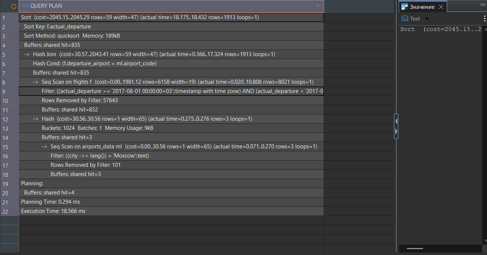

### Результат
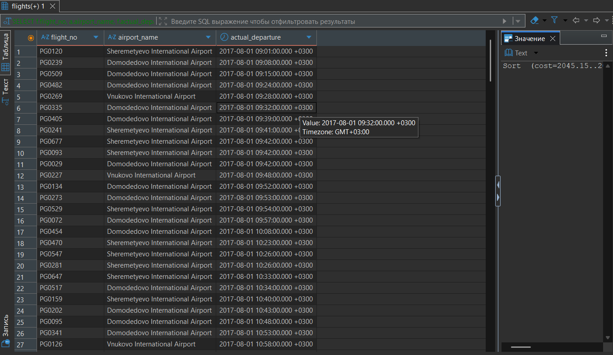

### Резюме
Запрос выполнялся через последовательное сканирование (Seq Scan) таблицы flights, индекс не использовался: фильтр по статусу и датам применялся ко всем строкам, из которых отброшено 57643. С диска ничего не читалось: в Buffers только shared hit=832, то есть все блоки взяты из кеша. Таблица аэропортов тоже читалась через Seq Scan, а затем соединение выполнено через Hash Join. Общее время выполнения 18.6 мс

## Задача 1.2

### Запрос
```sql
SELECT flight_no,
       scheduled_arrival,
       actual_arrival,
       EXTRACT(EPOCH FROM (actual_arrival - scheduled_arrival)) / 60 AS delay_minutes
FROM flights
WHERE actual_arrival - scheduled_arrival > INTERVAL '2 hours'
ORDER BY delay_minutes DESC;
```
### EXPLAIN (ANALYZE, BUFFERS)
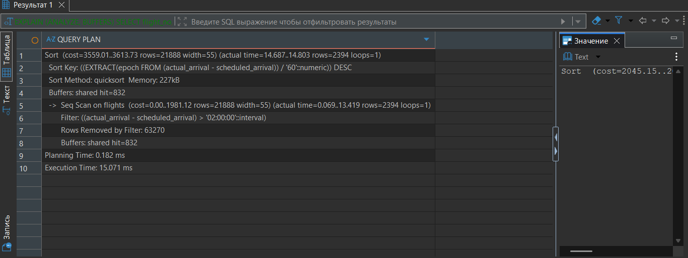

### Результат
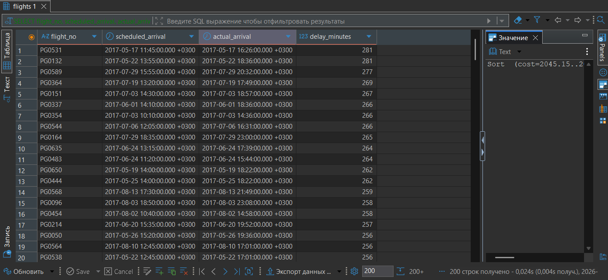

### Резюме
Запрос выполнялся через последовательное сканирование (Seq Scan) таблицы flights, индекс не использовался: условие по разности времён применялось к каждой строке, отброшено 63270, подошло 2394. С диском запрос не работал: в Buffers только shared hit=832, то есть все данные взяты из кеша. Затем найденные строки отсортированы в памяти (quicksort, 227 кБ) по убыванию опоздания. Время выполнения 15.1 мс

## Задача 1.3

### Запрос
```sql
SELECT flight_no,
       COUNT(*) AS flights_count
FROM flights
WHERE flight_no LIKE 'PG04%'
  AND status = 'Arrived'
GROUP BY flight_no
ORDER BY flight_no;
```
### EXPLAIN (ANALYZE, BUFFERS)
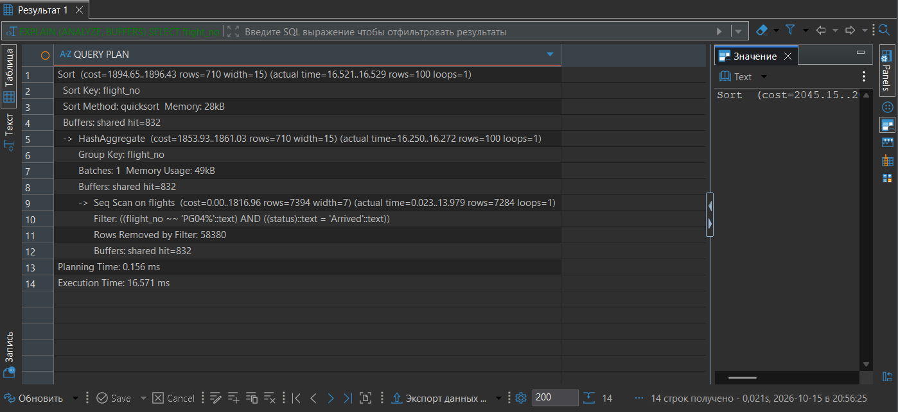

### Результат
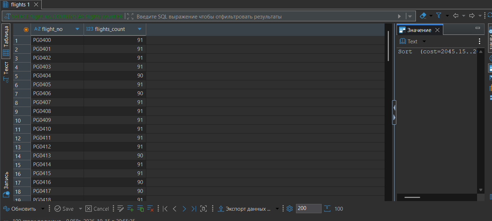

### Резюме
Запрос выполнялся через последовательное сканирование (Seq Scan) таблицы flights, индекс не использовался: фильтр по номеру рейса и статусу применялся ко всем строкам, отброшено 58380, подошло 7284. С диском запрос не работал: в Buffers только shared hit=832, то есть все данные взяты из кеша. Затем строки сгруппированы через HashAggregate (по номеру рейса получилось 100 групп) и отсортированы в памяти (quicksort, 28 кБ). Время выполнения 16.6 мс.

## Задача 2.1

### Запрос
```sql
SELECT a.airport_name,
       COUNT(*) AS flights_count,
       ROUND(AVG(EXTRACT(EPOCH FROM (f.actual_arrival - f.scheduled_arrival)) / 60)::numeric, 1) AS avg_delay_min
FROM flights f
JOIN airports a ON a.airport_code = f.departure_airport
GROUP BY a.airport_code, a.airport_name
HAVING COUNT(*) > 500
ORDER BY avg_delay_min DESC;
```
### EXPLAIN (ANALYZE, BUFFERS)
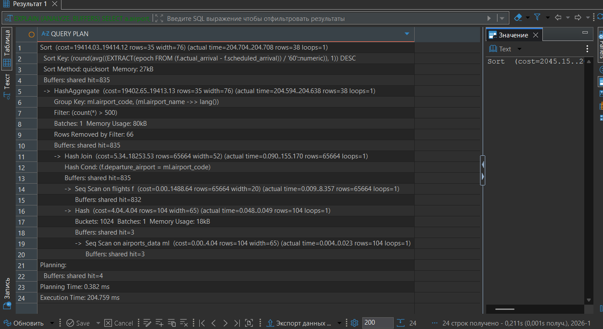

### Результат
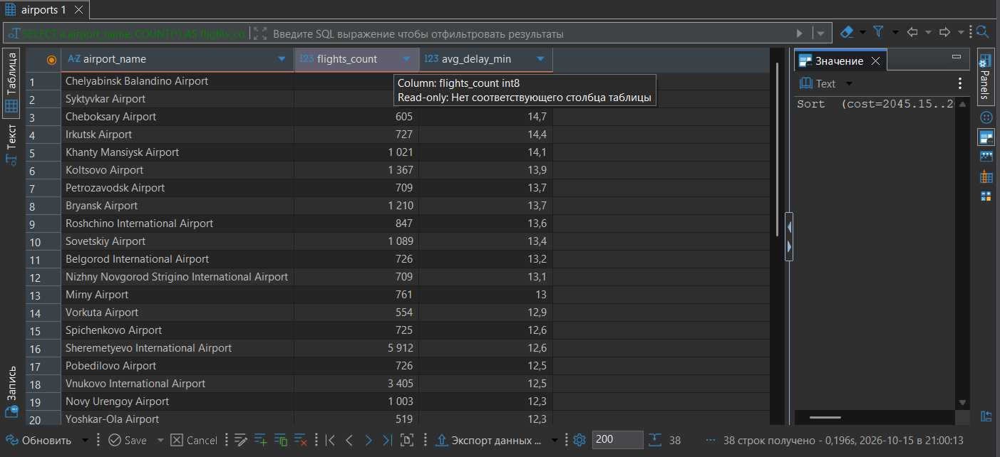

### Резюме
Запрос выполнялся через последовательное сканирование (Seq Scan) таблицы flights: фильтра по строкам нет, поэтому прочитаны все 65664 рейса, индекс не использовался. С диском запрос не работал: в Buffers только shared hit=835, то есть все данные взяты из кеша. Аэропорты загружены в хеш-таблицу (Hash Join), затем HashAggregate собрал рейсы в группы по аэропорту вылета, а условие HAVING отбросило 66 групп из 104, и осталось 38 аэропортов. Время выполнения 204.8 мс, больше, чем в прошлых задачах, потому что запрос обработал всю таблицу и посчитал среднее для каждой строки

## Задача 3.1

### Запрос
```sql
SELECT t.passenger_name,
       tf.amount,
       f.flight_no,
       dep.city AS departure_city,
       arr.city AS arrival_city
FROM ticket_flights tf
JOIN tickets t   ON t.ticket_no = tf.ticket_no
JOIN flights f   ON f.flight_id = tf.flight_id
JOIN airports dep ON dep.airport_code = f.departure_airport
JOIN airports arr ON arr.airport_code = f.arrival_airport
ORDER BY tf.amount DESC
LIMIT 10;
```

### EXPLAIN (ANALYZE, BUFFERS)
.png)
.png)

### Результат
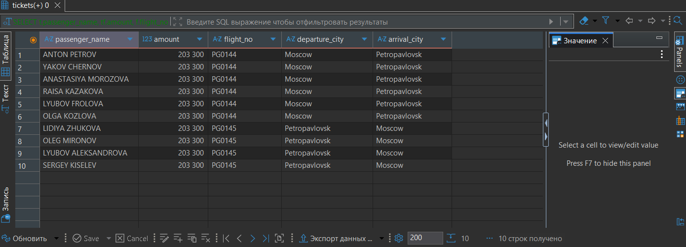

### Резюме
Запрос выполнялся через последовательное сканирование (Seq Scan) всех таблиц: ticket_flights (около 2,36 млн строк), tickets (около 829 тыс.), flights и airports, индексы не использовались. Здесь запрос работал с диском: в Buffers видно read=33639, то есть блоки читались с диска, а не только из кеша (hit=839). Кроме того, хеш-таблица для tickets не поместилась в память и разбилась на 8 пакетов (Batches: 8), поэтому PostgreSQL записывал и читал временные файлы (temp read=16196 written=16196). Итоговая сортировка top-N heapsort заняла всего 29 кБ, потому что нужны только 10 строк. Время выполнения 33.6 с, на порядок больше, чем в прошлых задачах, из-за чтения с диска и соединения миллионов строк

## Задача 3.2

### Запрос
```sql
SELECT a.airport_code,
       a.airport_name,
       COUNT(f.flight_id) AS departures_count
FROM airports a
LEFT JOIN flights f ON f.departure_airport = a.airport_code
GROUP BY a.airport_code, a.airport_name
ORDER BY departures_count DESC;
```

### EXPLAIN (ANALYZE, BUFFERS)
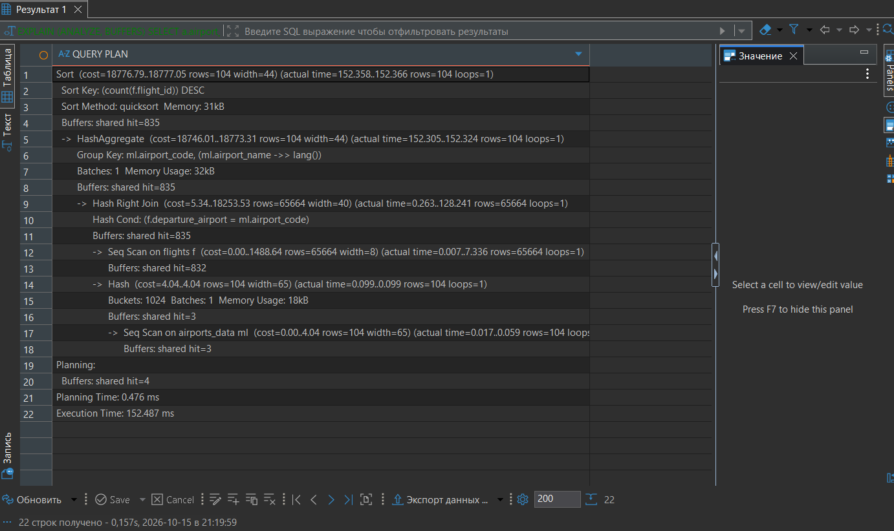


### Результат
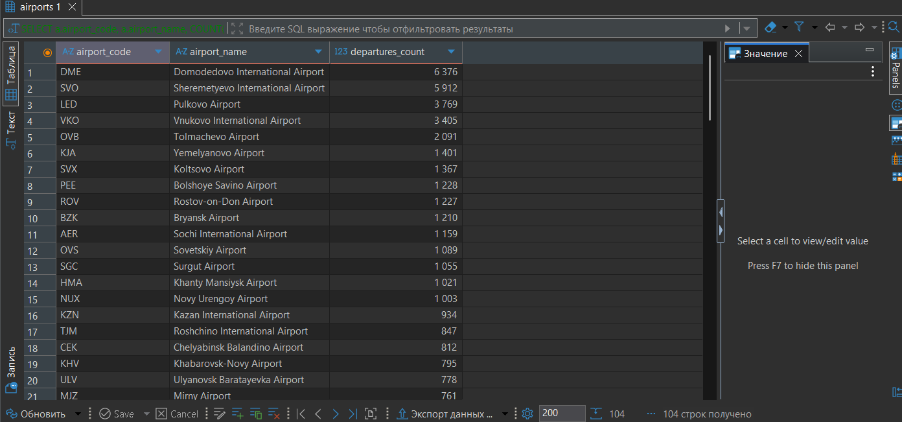

### Резюме
Запрос выполнялся через последовательное сканирование (Seq Scan) таблиц flights и airports, индексы не использовались: условие соединения применялось ко всем 65664 рейсам. С диском запрос не работал: в Buffers только shared hit=835, то есть все данные взяты из кеша. Соединение выполнено через Hash Right Join, затем HashAggregate собрал рейсы по аэропортам (получилось 104 группы, то есть все аэропорты, включая те, из которых ничего не вылетает), и результат отсортирован в памяти (quicksort, 31 кБ). Время выполнения 152.5 мс

## Задача 3.3

### Запрос
```sql
SELECT t.passenger_id,
       t.passenger_name,
       COUNT(*) AS flights_count,
       SUM(tf.amount) AS total_spent
FROM tickets t
JOIN ticket_flights tf ON tf.ticket_no = t.ticket_no
GROUP BY t.passenger_id, t.passenger_name
ORDER BY total_spent DESC
LIMIT 5;
```

### EXPLAIN (ANALYZE, BUFFERS)
.png)
.png)


### Результат
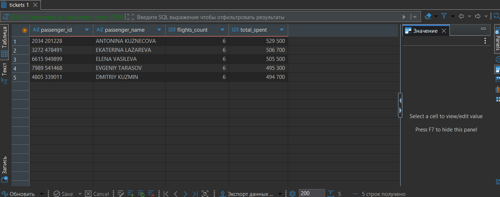

### Резюме
Запрос выполнялся через последовательное сканирование (Seq Scan) таблиц ticket_flights (около 2,36 млн строк) и tickets (около 829 тыс.), индексы не использовались. Запрос активно работал с диском: в Buffers видно read=32934, то есть блоки читались с диска, а кеш дал только hit=706. Кроме того, и хеш-таблица для соединения (Batches: 16), и HashAggregate (Batches: 65, Disk Usage: 126880kB) не поместились в память, поэтому PostgreSQL писал и читал временные файлы (temp read=32216 written=47725). Итоговая сортировка top-N heapsort заняла всего 25 кБ, потому что нужны только 5 строк. Время выполнения 52.1 с

## Пункт 1 помесячная выручка с ROLLUP

### Запрос
```sql
SELECT DATE_TRUNC('month', f.scheduled_departure) AS month,
       SUM(tf.amount) AS revenue
FROM ticket_flights tf
JOIN flights f ON f.flight_id = tf.flight_id
WHERE f.scheduled_departure >= '2017-01-01'
  AND f.scheduled_departure <  '2018-01-01'
GROUP BY ROLLUP (DATE_TRUNC('month', f.scheduled_departure))
HAVING SUM(tf.amount) > 10000000000
ORDER BY month;
```

### EXPLAIN ANALYZE
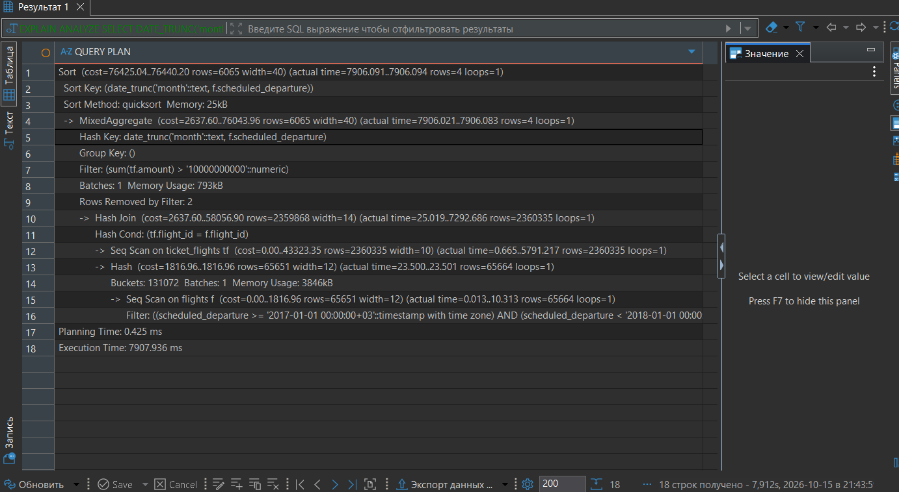


### Результат
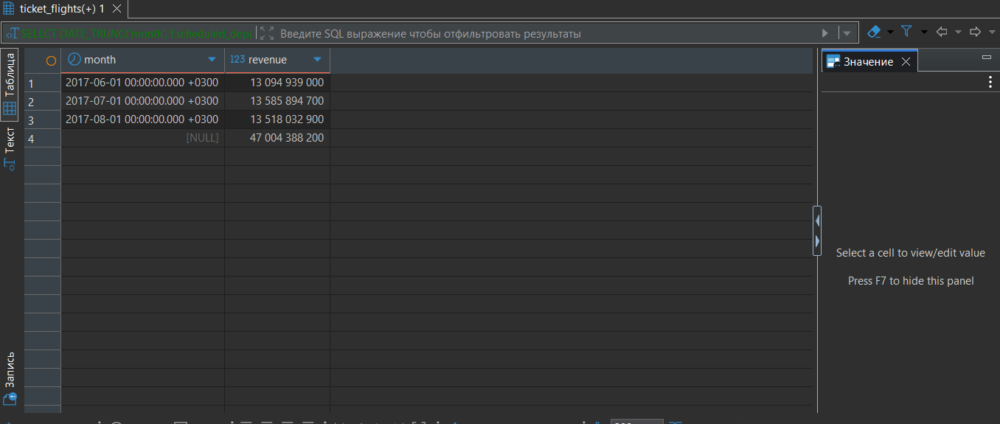

### Резюме
HAVING применяется после группировки, к уже готовым строкам, в том числе к итоговой. В плане фильтр sum(tf.amount) > 10000000000 стоит прямо в узле MixedAggregate, и он отбросил 2 группы (Rows Removed by Filter: 2). Итоговая строка (месяц NULL) это сумма всех месяцев, поэтому она больше любого отдельного месяца и проходит фильтр. NULL в колонке месяца на него не влияет: условие проверяет не месяц, а SUM(amount)

## Пункт 2. LEFT JOIN и условная агрегация

### Запрос (условие в ON)
```sql
SELECT a.airport_code,
       a.airport_name,
       COUNT(f.flight_id) AS arrived_count
FROM airports a
LEFT JOIN flights f
       ON f.arrival_airport = a.airport_code
      AND f.status = 'Arrived'
GROUP BY a.airport_code, a.airport_name
ORDER BY arrived_count DESC;
```

### EXPLAIN ANALYZE
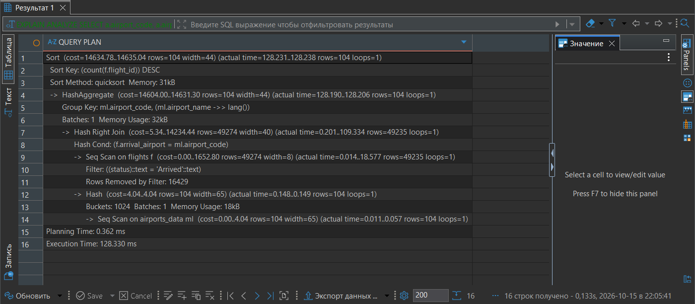

### Результат
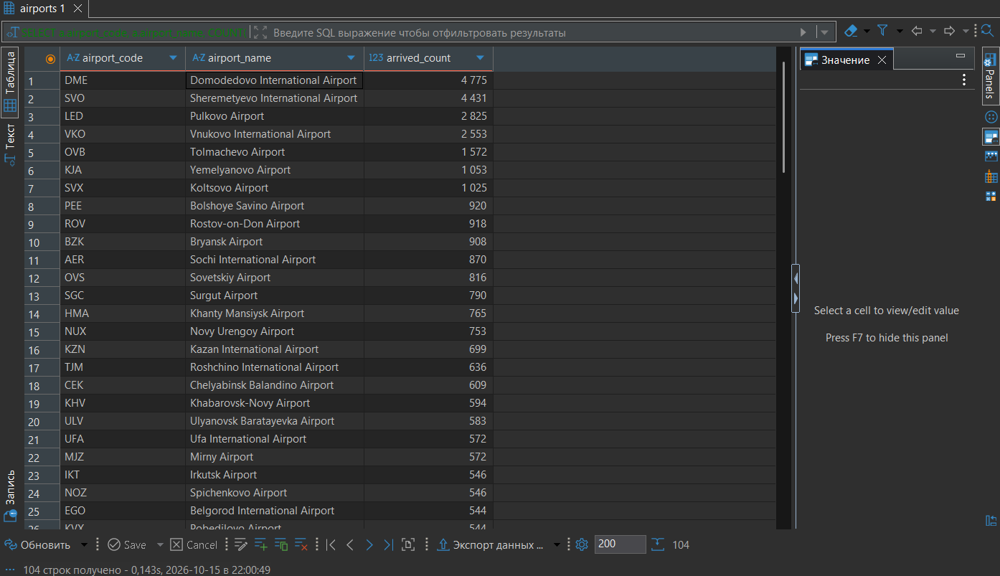

### Контрольный запуск (условие в WHERE)
```sql
SELECT a.airport_code,
       a.airport_name,
       COUNT(f.flight_id) AS arrived_count
FROM airports a
LEFT JOIN flights f
       ON f.arrival_airport = a.airport_code
WHERE f.status = 'Arrived'
GROUP BY a.airport_code, a.airport_name
ORDER BY arrived_count DESC;
```
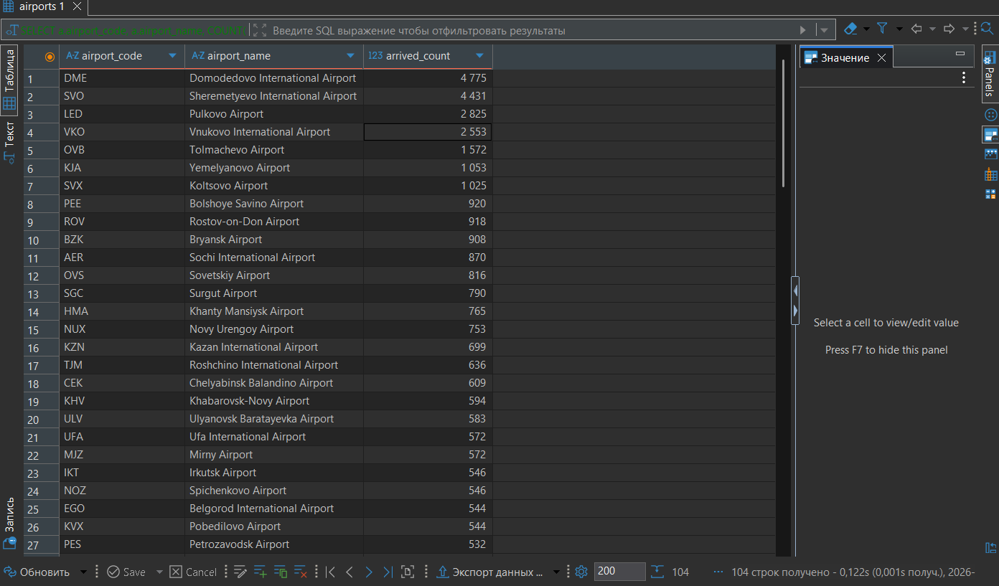

В этом варианте вернулось N строк вместо 104: аэропорты без прибывших рейсов пропали

### Резюме
Запрос выполнялся через последовательное сканирование (Seq Scan) таблиц flights и airports, индексы не использовались. Условие status = 'Arrived' применено прямо при чтении flights: отброшено 16429 рейсов, осталось 49235. Соединение выполнено через Hash Right Join, затем HashAggregate собрал рейсы по аэропортам (104 группы, то есть все аэропорты, включая те, куда ничего не прибыло). Время выполнения 128.3 мс. Про диск и кеш: в плане без BUFFERS этого не видно, а по тому, что таблицы небольшие (в 3.2 они целиком лежали в кеше), данные, скорее всего, брались из кеша

### Объяснения
**Почему условие в WHERE ломает результат.** WHERE выполняется после соединения. У аэропортов без рейсов f.status равен NULL, условие не выполняется, и строка удаляется. LEFT JOIN превращается в обычный JOIN. В ON условие работает во время соединения, и пустые строки сохраняются.

**Почему нельзя COUNT(*).** Он считает строки, а у аэропорта без рейсов строка всё равно есть (с NULL справа), поэтому получится 1 вместо 0. COUNT(f.flight_id) не считает NULL и даёт честный 0.

**Hash Right Join.** Это LEFT JOIN, у которого PostgreSQL поменял таблицы местами: хеш строится по маленькой таблице аэропортов, а рейсы проходят по ней. Все строки аэропортов всё равно сохраняются.

## Пункт 3. Sargability (выходные дни августа 2017)

### Запрос A: неоптимизированный (функции над столбцом)
```sql
SELECT flight_id, flight_no, actual_departure
FROM flights
WHERE status = 'Arrived'
  AND EXTRACT(MONTH FROM actual_departure) = 8
  AND EXTRACT(YEAR FROM actual_departure) = 2017
  AND EXTRACT(DOW FROM actual_departure) IN (0, 6);
```

### EXPLAIN ANALYZE (запрос A)
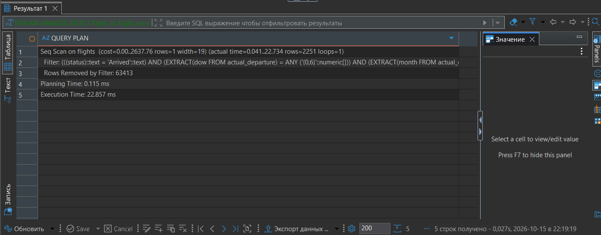

### Результат (запрос A)
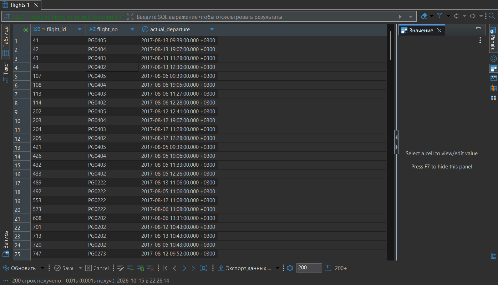

### Запрос B: оптимизированный (диапазон дат)
```sql
SELECT flight_id, flight_no, actual_departure
FROM flights
WHERE status = 'Arrived'
  AND actual_departure >= '2017-08-01'
  AND actual_departure <  '2017-09-01'
  AND EXTRACT(DOW FROM actual_departure) IN (0, 6);
```

### EXPLAIN ANALYZE (запрос B)
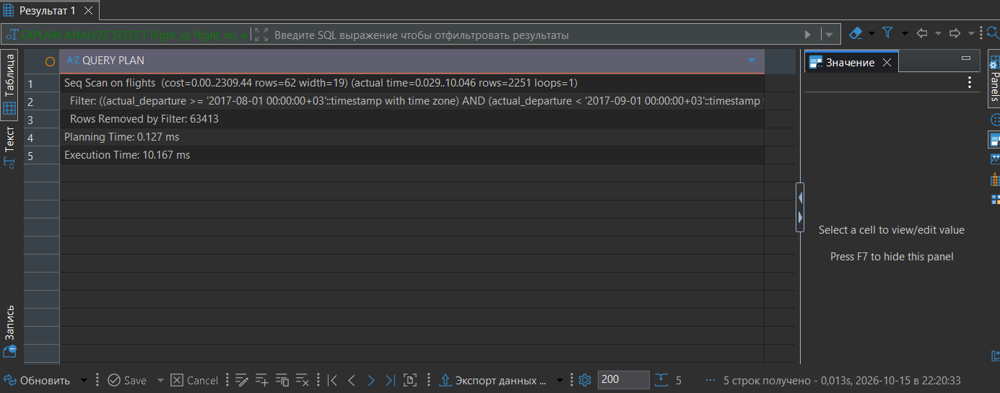

### Результат (запрос B)
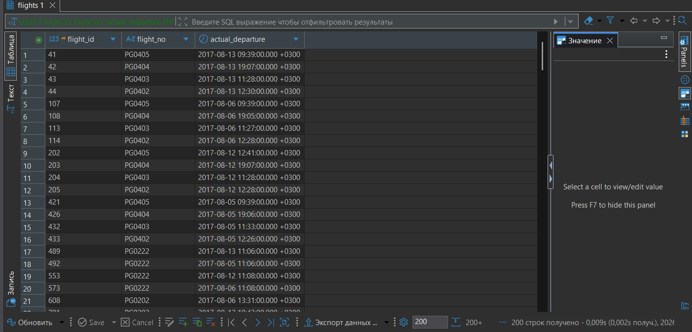

Оба запроса вернули одинаковое число строк: 2251.

### Резюме
Оба запроса выполнялись через последовательное сканирование (Seq Scan) таблицы flights, индекс не использовался: индекса по actual_departure в базе нет. В обоих случаях фильтр применялся ко всем строкам: отброшено 63413, подошло 2251. Запрос A выполнился за 22.9 мс, запрос B за 10.2 мс. Про диск и кеш в этих планах ничего не видно, так как они сняты без BUFFERS.

### Объяснение разницы в планах
В запросе A месяц и год проверяются через `EXTRACT(...)`, то есть функция вызывается над столбцом `actual_departure`. Такое условие не sargable: PostgreSQL не может использовать обычный индекс по этому столбцу, потому что в индексе лежат значения самого столбца, а не результаты функции. Кроме того, планировщик не знает статистику по результату функции, поэтому оценил в плане всего 1 строку (`rows=1`), а на деле их 2251. Стоимость в плане 2637.76.

В запросе B месяц задан диапазоном `>= '2017-08-01' AND < '2017-09-01'`. Это sargable-условие: если бы был индекс по `actual_departure`, PostgreSQL мог бы пойти по нему сразу к нужному диапазону. Статистика по столбцу тоже работает, поэтому оценка точнее (`rows=62`) и стоимость ниже (2309.44). Проверка дня недели (`EXTRACT(DOW ...)`) осталась, потому что выходные одним диапазоном не выразить, но она применяется уже к узкому набору строк.

В нашем плане оба запроса всё равно прочитали всю таблицу, потому что индекса нет. Поэтому разница тут только в оценке и стоимости плана и во времени (10.2 мс против 22.9 мс, на таком небольшом времени часть разницы может быть шумом). Главное преимущество B (использование индекса) проявилось бы при его наличии.

## Пункт 4. ANTI-JOIN: рейсы без билетов бизнес-класса

### Запрос A: NOT IN
```sql
SELECT f.flight_id, f.flight_no
FROM flights f
WHERE f.flight_id NOT IN (
    SELECT tf.flight_id
    FROM ticket_flights tf
    WHERE tf.fare_conditions = 'Business'
);
```

### EXPLAIN ANALYZE (запрос A)
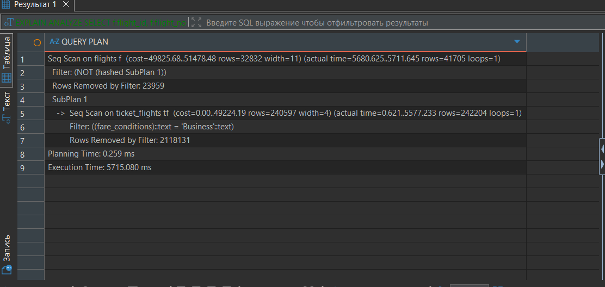

### Результат (запрос A)
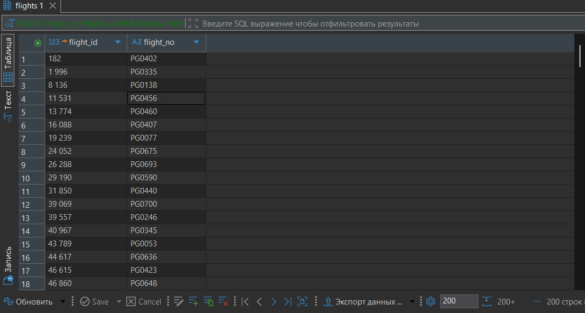

### Запрос B: NOT EXISTS
```sql
SELECT f.flight_id, f.flight_no
FROM flights f
WHERE NOT EXISTS (
    SELECT 1
    FROM ticket_flights tf
    WHERE tf.flight_id = f.flight_id
      AND tf.fare_conditions = 'Business'
);
```

### EXPLAIN ANALYZE (запрос B)
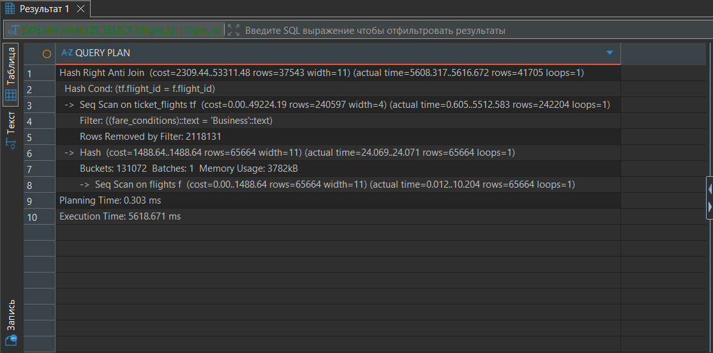

### Результат (запрос B)
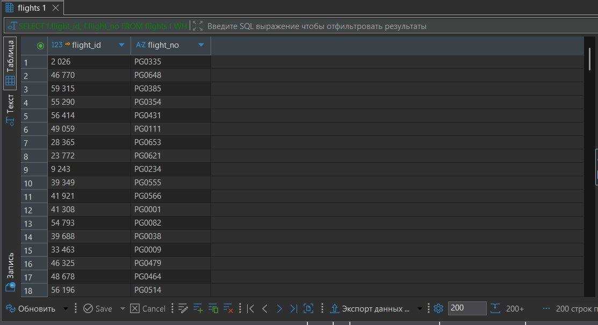

Оба запроса вернули одинаковое число строк: 41705.

### Резюме
Оба запроса выполнялись через последовательное сканирование (Seq Scan) таблиц ticket_flights и flights, индексы не использовались. В ticket_flights условие `fare_conditions = 'Business'` применялось ко всем строкам: отброшено 2118131, осталось 242204. Запрос A выполнился за 5715 мс, запрос B за 5619 мс. Про диск и кеш в этих планах ничего не видно, так как они сняты без BUFFERS.

### Объяснение разницы в планах
В запросе A (NOT IN) PostgreSQL выполнил подзапрос как `hashed SubPlan`: один раз прочитал ticket_flights, собрал все flight_id бизнес-класса в хеш-таблицу, а затем при сканировании flights для каждого рейса проверяет фильтром `NOT (hashed SubPlan 1)`, что его там нет. Превратить NOT IN в Anti Join планировщик не может, потому что NOT IN по-особому работает с NULL.

В запросе B (NOT EXISTS) планировщик использовал `Hash Right Anti Join`: это настоящий Anti Join, то есть соединение, которое оставляет только те рейсы, для которых в ticket_flights не нашлось пары. Он построен как обычное соединение по `tf.flight_id = f.flight_id`, поэтому планировщик может выбрать порядок таблиц и способ соединения (Hash, Merge, Nested Loop), а у NOT IN такой свободы нет.

В нашей базе время почти одинаковое (5.7 с и 5.6 с): обе таблицы небольшие для хеша и в обоих случаях главная работа это полное чтение ticket_flights. Поэтому честно: заметного выигрыша NOT EXISTS здесь нет, его преимущество в гибкости плана и безопасности. На больших данных или когда подзапрос не помещается в память, NOT IN в виде hashed SubPlan может сильно замедляться (при нехватке памяти он превращается в медленный повторный перебор подзапроса), а Anti Join остаётся эффективным.

### Почему NOT IN опасен при NULL
Если в подзапросе встретится хотя бы один NULL, то условие `x NOT IN (..., NULL)` никогда не будет истинным: сравнение даёт «неизвестно», и запрос вернёт ноль строк, хотя логически строки должны подойти. NOT EXISTS этой проблемы не имеет. В нашей базе `flight_id` в ticket_flights не бывает NULL, поэтому на результат это не повлияло, но в общем случае это ловушка.

## Пункт 5. Index Only Scan

### Запрос
```sql
SELECT status, COUNT(*) FROM flights GROUP BY status;
```

### EXPLAIN (ANALYZE, BUFFERS) до создания индекса
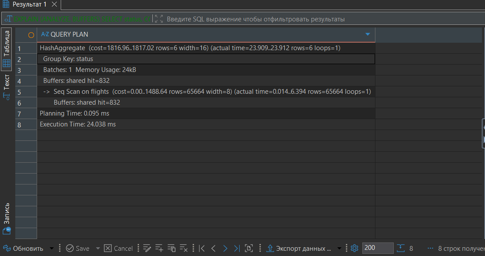

### Создание индекса
```sql
CREATE INDEX idx_flights_status ON flights(status);
VACUUM flights;
```

### EXPLAIN (ANALYZE, BUFFERS) после создания индекса
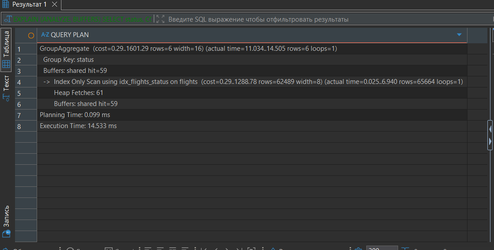

### Результат
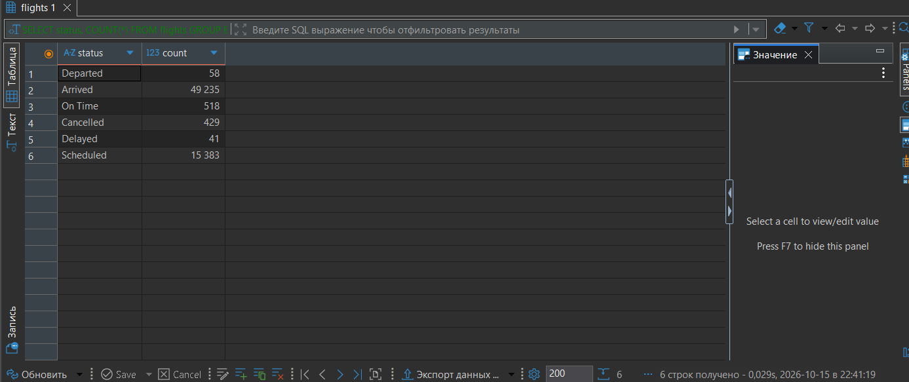

### Резюме
До индекса запрос выполнялся через последовательное сканирование (Seq Scan) всей таблицы flights (65664 строки), затем HashAggregate сгруппировал строки по статусу. С диском запрос не работал: в Buffers только `shared hit=832`, то есть все данные взяты из кеша. Время выполнения 24.0 мс.

После создания индекса и VACUUM планировщик выбрал `Index Only Scan using idx_flights_status`, а группировка выполнена через GroupAggregate. Запрос тоже не обращался к диску: `shared hit=59`, то есть прочитано 59 блоков из кеша вместо 832. Время выполнения сократилось до 14.5 мс.

### Что означает Index Only Scan и при чём тут Visibility Map
Index Only Scan означает, что PostgreSQL отвечает на запрос, читая только индекс, и почти не обращается к самой таблице (heap). Это возможно, потому что все нужные запросу данные (столбец status) лежат в индексе. Индекс намного меньше таблицы, поэтому и читать нужно меньше блоков: 59 вместо 832.

Но в индексе нет информации о том, видна ли строка текущей транзакции (из-за MVCC). Чтобы не ходить в таблицу за проверкой каждой строки, PostgreSQL использует Visibility Map: это карта, которая помечает страницы таблицы, где все строки точно видимы всем транзакциям. Для таких страниц обращение к таблице не нужно. Именно поэтому перед запросом нужен `VACUUM`: он обновляет Visibility Map. В плане это видно по строке `Heap Fetches: 61`: к таблице пришлось обратиться всего 61 раз на 65664 строки, то есть почти все страницы были помечены как «всё видимо».

### Примечание
Первый запуск запроса с индексом был медленнее (42.6 мс), потому что индекс только что создали и часть его блоков читалась с диска (`read=57`). Во втором запуске индекс уже лежал в кеше, и время составило 14.5 мс. Выигрыш на таблице в 65 тысяч строк небольшой, на больших таблицах он был бы заметнее.