# Домашнее задание: PostgreSQL, планы выполнения запросов

**БД:** `demo-medium-en-20170815.sql` (демо-база авиаперелётов)

# Часть 1. Недоделанные запросы с семинара

## Задача 1.1. Выполненные рейсы из московских аэропортов за август 2017

```sql
SELECT f.flight_no, f.departure_airport, f.actual_departure
FROM flights f
JOIN airports a ON a.airport_code = f.departure_airport
WHERE f.status = 'Arrived'
  AND a.city = 'Moscow'
  AND f.actual_departure >= '2017-08-01' AND f.actual_departure < '2017-09-01'
ORDER BY f.actual_departure;
```

Московские аэропорты: SVO, DME, VKO.

📸 **Скриншот A (вывод данных):**
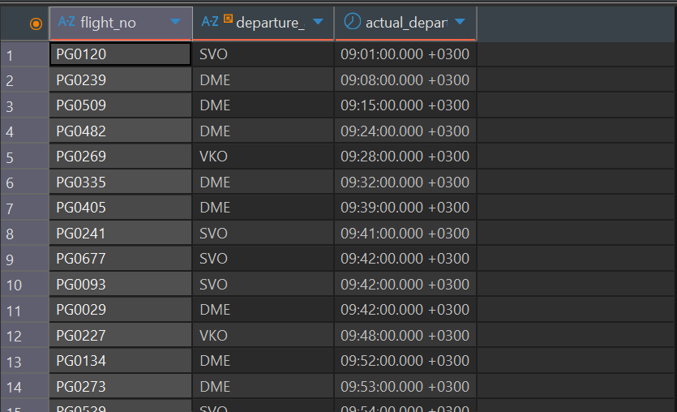

📸 **Скриншот B (`EXPLAIN (ANALYZE, BUFFERS)`):**
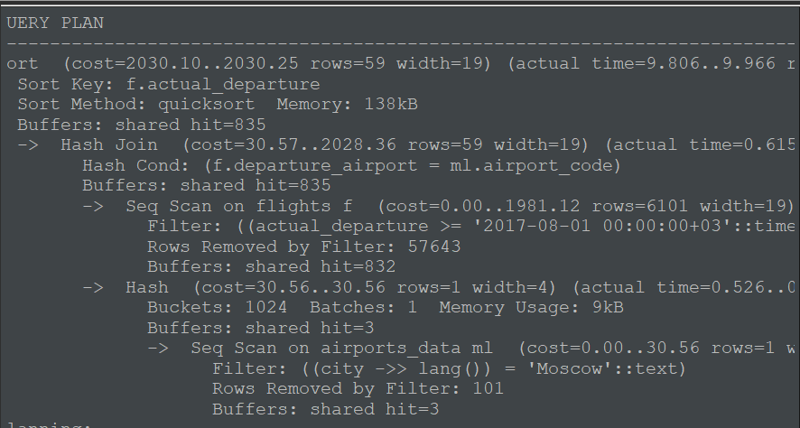

 **Резюме:** Запрос выполнился примерно за 9,97 мс. Использован Seq Scan по таблице flights и airports_data, индексы для сканирования не использовались. В плане shared hit=835, данные были получены из кеша PostgreSQL; shared read не указан. Использован Hash Join для соединения таблиц по условию f.departure_airport = ml.airport_code, а затем Sort по f.actual_departure. При фильтрации таблицы flights исключено 57 643 строки, а таблицы airports_data — 101 строка.

---

## Задача 1.2. Рейсы с опозданием прибытия более 2 часов

```sql
SELECT flight_no, scheduled_arrival, actual_arrival,
       ROUND(EXTRACT(EPOCH FROM (actual_arrival - scheduled_arrival)) / 60) AS delay_min
FROM flights
WHERE status = 'Arrived'
  AND actual_arrival > scheduled_arrival + interval '2 hours'
ORDER BY delay_min DESC;
```

📸 **Скриншот A (вывод данных):**
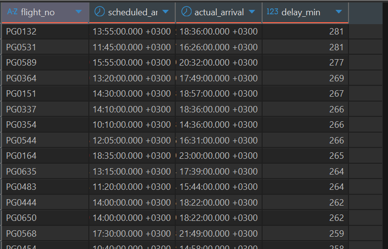

📸 **Скриншот B (`EXPLAIN (ANALYZE, BUFFERS)`):**
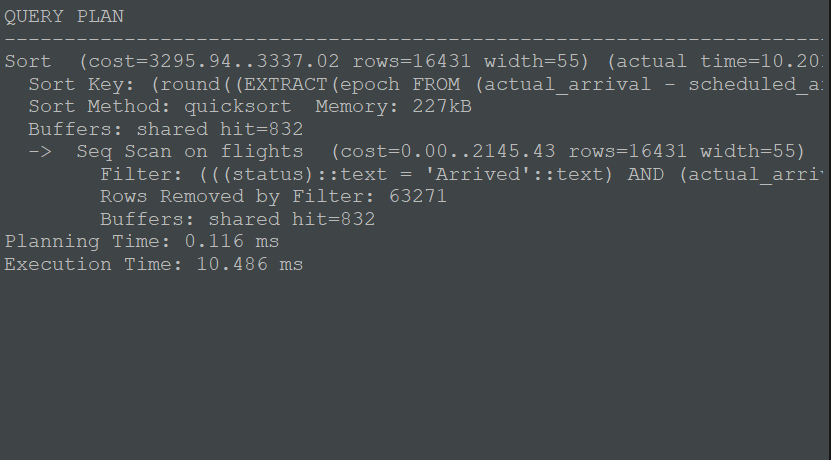

 **Резюме:** Запрос выполнился за 10,486 мс. Использован Seq Scan по таблице flights, индекс не использовался. В плане shared hit=832, то есть данные были получены из кеша PostgreSQL; чтение с диска (shared read) не зафиксировано. При фильтрации исключено 63 271 строка, осталось 16 431 строка. Затем выполнена сортировка методом quicksort по вычисляемому выражению на основе actual_arrival и scheduled_arrival. Сортировка выполнялась в оперативной памяти и заняла 227 КБ.

---

## Задача 1.3. Выполненные рейсы с номерами PG04xx

```sql
SELECT flight_no, COUNT(*) AS arrived_cnt
FROM flights
WHERE status = 'Arrived' AND flight_no LIKE 'PG04%'
GROUP BY flight_no
ORDER BY flight_no;
```

📸 **Скриншот A (вывод данных):**
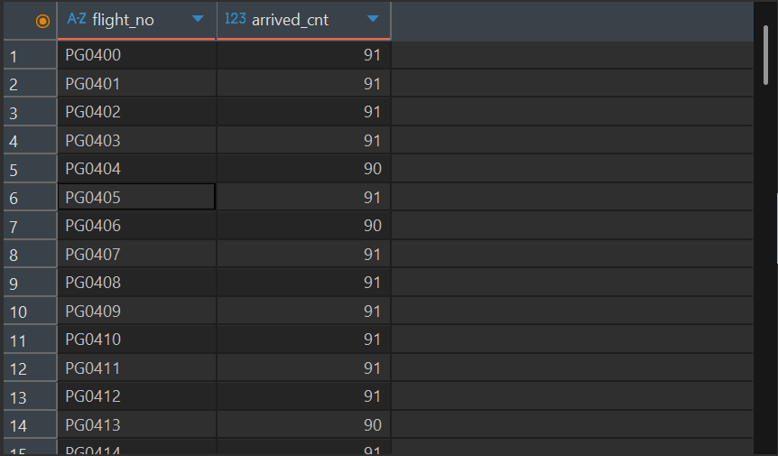

📸 **Скриншот B (`EXPLAIN (ANALYZE, BUFFERS)`):**
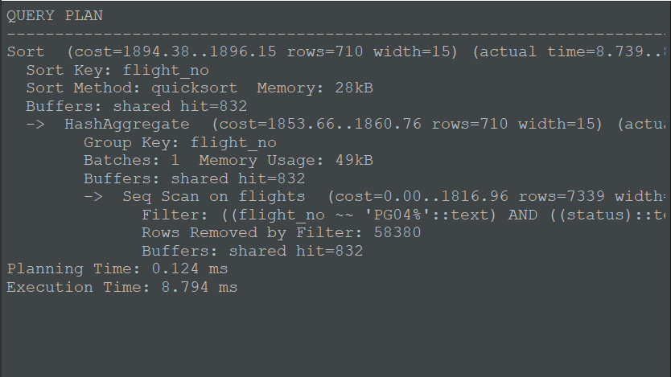

 **Резюме:** Запрос выполнился за 8,794 мс. Использован Seq Scan по таблице flights, индекс не использовался. В плане shared hit=832, то есть данные были получены из кеша PostgreSQL; чтение с диска (shared read) не зафиксировано. При фильтрации исключено 58 380 строк, осталось 7 339 строк. Затем выполнена агрегация HashAggregate по flight_no, в результате которой получено 710 групп. После этого данные отсортированы методом quicksort по flight_no, сортировка заняла 28 КБ оперативной памяти.

---

## Задача 2.1. Число рейсов и среднее опоздание по аэропортам вылета

`AVG` сам игнорирует NULL (у несостоявшихся рейсов нет `actual_arrival`).

```sql
SELECT departure_airport,
       COUNT(*) AS flights_cnt,
       ROUND(AVG(EXTRACT(EPOCH FROM (actual_arrival - scheduled_arrival)) / 60)::numeric, 1) AS avg_delay_min
FROM flights
GROUP BY departure_airport
HAVING COUNT(*) > 500
ORDER BY avg_delay_min DESC;
```

📸 **Скриншот A (вывод данных):**
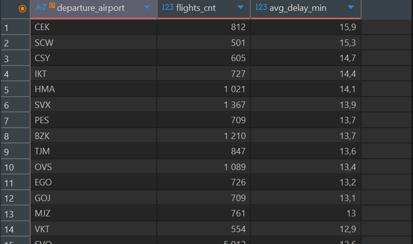

📸 **Скриншот B (`EXPLAIN (ANALYZE, BUFFERS)`):**
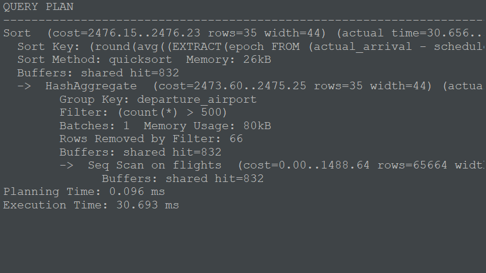

 **Резюме:** Запрос выполнился за 30.693 мс. Использован Seq Scan по таблице flights, индекс не использовался. В плане shared hit=832, read=0, то есть данные читались в основном из кеша (точнее, полностью из кеша). Главная особенность плана: использована агрегация HashAggregate с фильтрацией по количеству рейсов (count(*) > 500) и последующая сортировка результатов (quicksort) по вычисляемому среднему значению задержки.

---

## Задача 3.1. Топ-10 самых дорогих проданных билетов

```sql
SELECT t.passenger_name, tf.amount, f.flight_no,
       dep.city AS dep_city, arr.city AS arr_city
FROM ticket_flights tf
JOIN tickets  t   ON t.ticket_no = tf.ticket_no
JOIN flights  f   ON f.flight_id = tf.flight_id
JOIN airports dep ON dep.airport_code = f.departure_airport
JOIN airports arr ON arr.airport_code = f.arrival_airport
ORDER BY tf.amount DESC, t.passenger_name
LIMIT 10;
```

📸 **Скриншот A (вывод данных):**
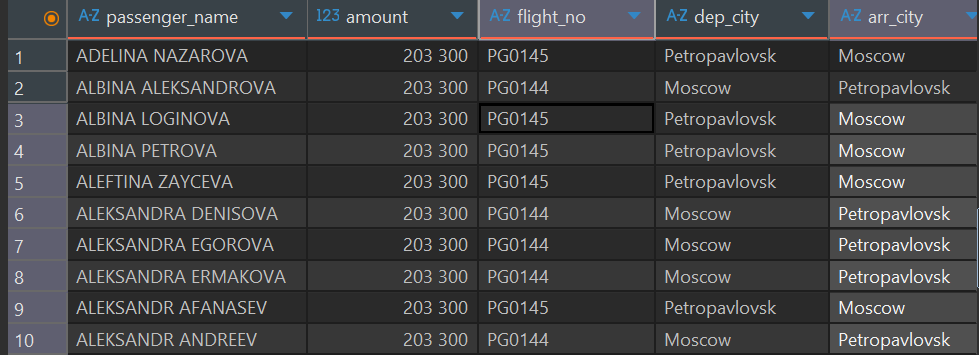

📸 **Скриншот B (`EXPLAIN (ANALYZE, BUFFERS)`):**
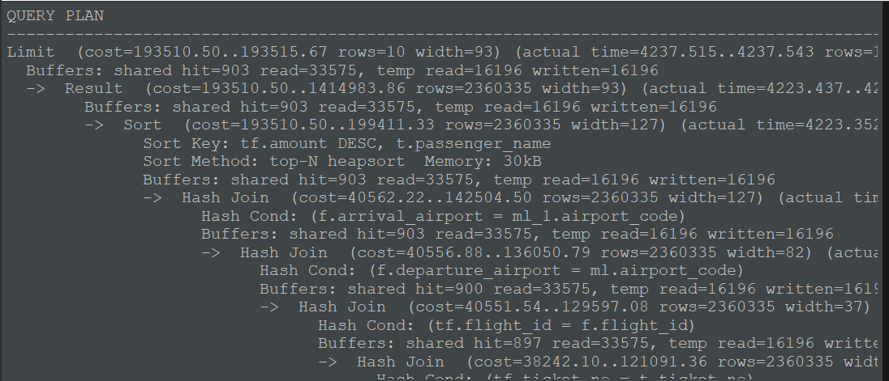

 **Резюме:** Запрос выполнился за 4239.950 мс. Использован Seq Scan по таблицам flights и airports_data, индекс не использовался. В плане shared hit=903, read=33575, temp read=16196 written=16196, то есть данные читались в основном с диска, а также активно сбрасывались во временные файлы на диск. Главная особенность плана: использована множественная Hash Join для соединения четырех таблиц, затем top-N heapsort для сортировки и Limit для вывода только 10 строк.

---

## Задача 3.2. Все аэропорты с числом вылетающих рейсов (включая пустые)

```sql
SELECT a.airport_code, a.airport_name, COUNT(f.flight_id) AS departures
FROM airports a
LEFT JOIN flights f ON f.departure_airport = a.airport_code
GROUP BY a.airport_code, a.airport_name
ORDER BY departures DESC;
```


📸 **Скриншот A (вывод данных):**
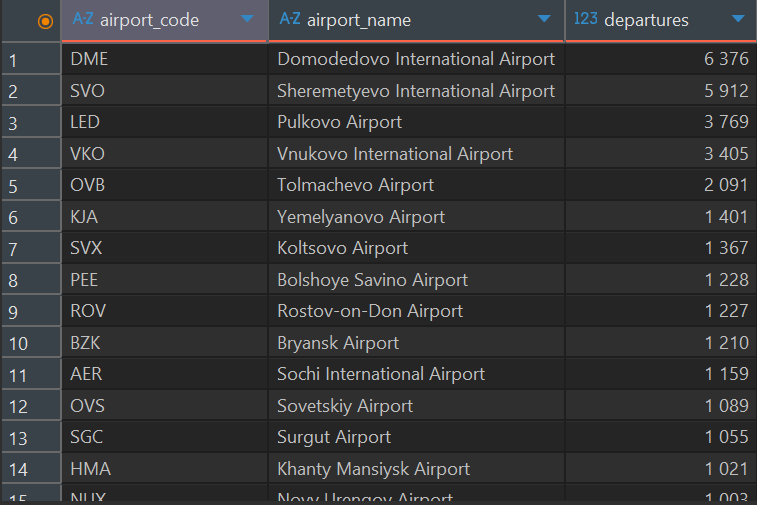

📸 **Скриншот B (`EXPLAIN (ANALYZE, BUFFERS)`):**
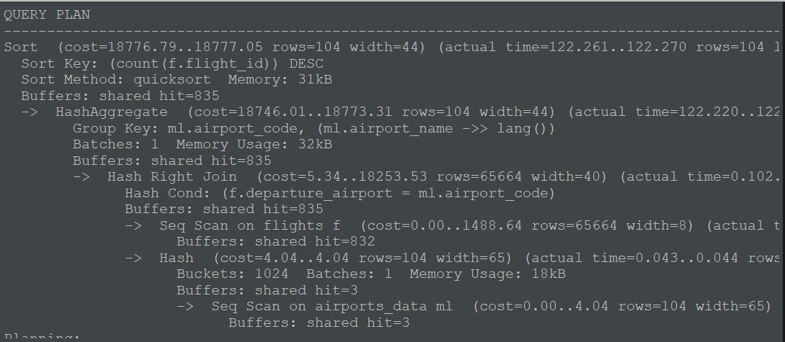

 **Резюме:** Запрос выполнился за 122.270 мс. Использован Seq Scan по таблицам flights и airports_data, индекс не использовался. В плане shared hit=835, read=0, то есть данные читались в основном из кеша (полностью из кеша). Главная особенность плана: выполнено Hash Right Join для соединения таблиц, затем агрегация HashAggregate с группировкой по коду и названию аэропорта, и финальная сортировка (quicksort) по убыванию количества рейсов.

---

## Задача 3.3. Топ-5 пассажиров по суммарным тратам

```sql
SELECT t.passenger_id, MIN(t.passenger_name) AS passenger_name,
       COUNT(*) AS flights_cnt, SUM(tf.amount) AS total_spent
FROM tickets t
JOIN ticket_flights tf ON tf.ticket_no = t.ticket_no
GROUP BY t.passenger_id
ORDER BY total_spent DESC
LIMIT 5;
```

📸 **Скриншот A (вывод данных):**
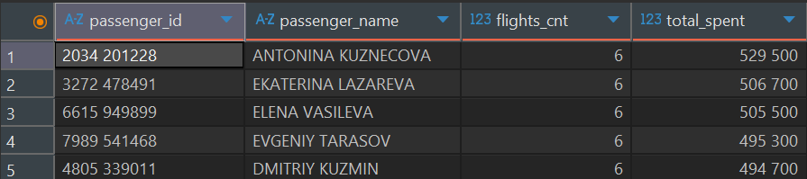

📸 **Скриншот B (`EXPLAIN (ANALYZE, BUFFERS)`):**
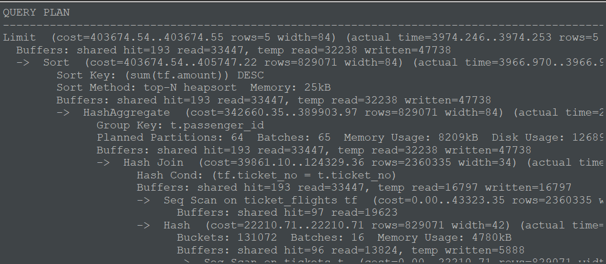

 **Резюме:** Запрос выполнился за 4002.670 мс. Использован Seq Scan по таблицам ticket_flights и tickets, индекс не использовался. В плане shared hit=193, read=33447, temp read=32238 written=47738, то есть данные читались в основном с диска, и наблюдался активный сброс во временные файлы. Главная особенность плана: выполнено Hash Join для соединения таблиц, затем HashAggregate с разбиением на 64 партиции (из-за нехватки памяти), и финальная сортировка (top-N heapsort) с ограничением Limit.

---

# Часть 2. Курс SQL на Stepik

📸 **Скриншот сертификата:**


Степик всё ещё не работает (╥_╥)

---

# Часть 3. Дополнительные задания

## 4. Группировки и многоуровневые итоги (ROLLUP)

**Задание:** помесячная выручка от продажи билетов за 2017 год с общим итогом, одним запросом, через `ROLLUP`. Оставить месяцы с выручкой > 10 млрд руб. (`HAVING`), итоговая строка не должна потеряться.

```sql
SELECT date_trunc('month', book_date)::date AS month,
       SUM(total_amount) AS revenue
FROM bookings
WHERE book_date >= '2017-01-01' AND book_date < '2018-01-01'
GROUP BY ROLLUP (date_trunc('month', book_date)::date)
HAVING SUM(total_amount) > 10000000000
ORDER BY month NULLS LAST;
```

📸 **Скриншот A (результат с `HAVING`):**
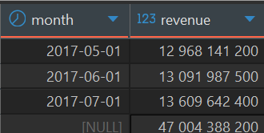

📸 **Скриншот A2 (контрольный: тот же запрос без `HAVING`, чтобы видны были все месяцы):**
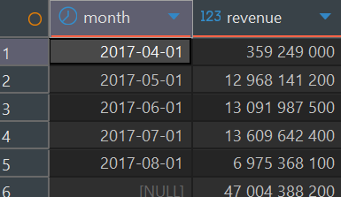

📸 **Скриншот B (`EXPLAIN ANALYZE`):**
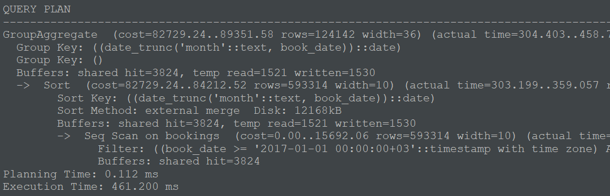

**Объяснение: как `HAVING` работает с `ROLLUP`.**
`HAVING` применяется **после** агрегации и фильтрует каждую готовую строку результата, включая строки итогов `ROLLUP`. У итоговой строки в колонке месяца стоит `NULL`, а `SUM(total_amount)` в ней считается по всем месяцам сразу, поэтому она заведомо больше любого месячного значения и проходит порог. Условие по месяцу (например, `month IS NOT NULL`) писать не нужно: итоговая строка отфильтруется. `NULL` в колонке месяца не мешает фильтру, потому что `HAVING` проверяет не месяц, а значение агрегата. В плане `HAVING` виден как `Filter: (sum(total_amount) > ...)` над узлом агрегации (`MixedAggregate` или `GroupAggregate`). В отличие от `WHERE`, он не уменьшает объём читаемых данных из таблицы.

 **Резюме по плану:** Запрос выполнился за 461.200 мс. Использован Seq Scan по таблице bookings, индекс не использовался. В плане shared hit=3824, read=0, temp read=1521 written=1530, то есть основные данные читались из кеша, но при сортировке наблюдался сброс во временные файлы. Главная особенность плана: выполнена сортировка (external merge) с использованием диска из-за нехватки памяти, и финальная агрегация GroupAggregate для группировки по месяцам.

---

## 5. LEFT JOIN и условная агрегация

**Задание:** для каждого аэропорта прибытия число прибывших рейсов (`status = 'Arrived'`), включая аэропорты без рейсов. Условие по статусу в `ON`.

### 5.1. Правильный запрос (условие в `ON`)

```sql
SELECT a.airport_code, a.airport_name, COUNT(f.flight_id) AS arrived_cnt
FROM airports a
LEFT JOIN flights f
       ON f.arrival_airport = a.airport_code AND f.status = 'Arrived'
GROUP BY a.airport_code, a.airport_name
ORDER BY arrived_cnt DESC;
```

📸 **Скриншот A (вывод данных):**
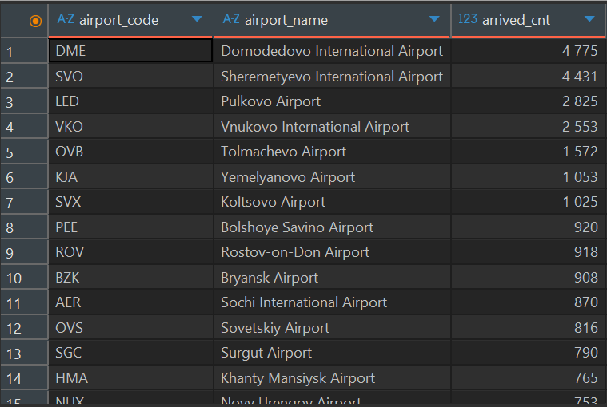

📸 **Скриншот B (`EXPLAIN ANALYZE`):**
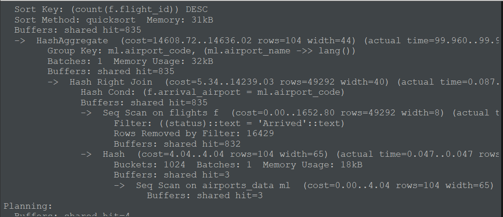

### 5.2. Контрольный запуск: условие в `WHERE` (чтобы показать проблему)

```sql
SELECT a.airport_code, a.airport_name, COUNT(f.flight_id) AS arrived_cnt
FROM airports a
LEFT JOIN flights f ON f.arrival_airport = a.airport_code
WHERE f.status = 'Arrived'
GROUP BY a.airport_code, a.airport_name
ORDER BY arrived_cnt DESC;
```

> Аэропорты без подходящих рейсов пропадут из результата. Если в вашей базе у всех аэропортов есть прибывшие рейсы, разницы не будет. Тогда для наглядной демонстрации замените `'Arrived'` на `'Departed'` (в обоих вариантах запроса, 5.1 и 5.2). Рейсов «в воздухе» на 15.08.2017 мало, и аэропорты без них точно найдутся. Сравните число строк (`(N rows)`) в двух результатах.

📸 **Скриншот C (вывод данных с условием в `WHERE`, видно, что строк стало меньше):**
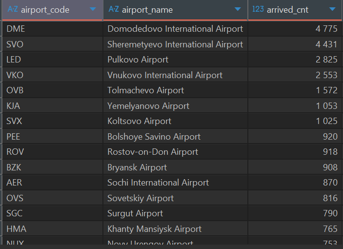

**Объяснение.**

- **Почему условие в `WHERE` ломает результат:** `LEFT JOIN` для аэропорта без совпадений добавляет строку, где все колонки `flights` равны `NULL`. Условие `WHERE f.status = 'Arrived'` для такой строки даёт `UNKNOWN` и строка отбрасывается. `LEFT JOIN` фактически превращается в `INNER JOIN`. Условие в `ON` фильтрует только присоединяемые строки `flights` и не удаляет аэропорты из левой таблицы.
- **Почему нельзя `COUNT(*)`:** для аэропорта без совпадений `LEFT JOIN` всё равно возвращает одну строку (с `NULL` справа). `COUNT(*)` считает строки, поэтому вернёт 1 вместо 0. `COUNT(f.flight_id)` пропускает `NULL` и даёт корректный 0.
- **Что означает `Hash Right Join` в плане:** это тот же `LEFT JOIN` логически, но планировщик поменял стороны местами. Хеш-таблица строится по меньшей таблице (`airports`), которая является сохраняемой стороной, а большая (`flights`) проходит через неё построчно. В конце в результат добавляются строки хеш-таблицы, для которых не нашлось совпадений, с `NULL` справа.

 **Резюме по плану:** Запрос выполнился за 97.507 мс (время верхнего узла). Использован Seq Scan по таблицам flights и airports_data, индекс не использовался. В плане shared hit=835, read=0, то есть данные читались полностью из кеша. Главная особенность плана: выполнено Hash Join для соединения таблиц, затем агрегация HashAggregate с группировкой по аэропорту, и финальная сортировка (quicksort) по убыванию количества рейсов.

---

## 6. Sargability (оптимизация предикатов)

**Задание:** рейсы со статусом `Arrived`, выполненные в выходные (сб и вс) в августе 2017.

### 6.1. Неоптимизированный запрос (функция от колонки)

```sql
SELECT flight_id, flight_no, actual_departure
FROM flights
WHERE status = 'Arrived'
  AND EXTRACT(YEAR  FROM actual_departure) = 2017
  AND EXTRACT(MONTH FROM actual_departure) = 8
  AND EXTRACT(DOW   FROM actual_departure) IN (0, 6);
```

📸 **Скриншот A (вывод данных):**
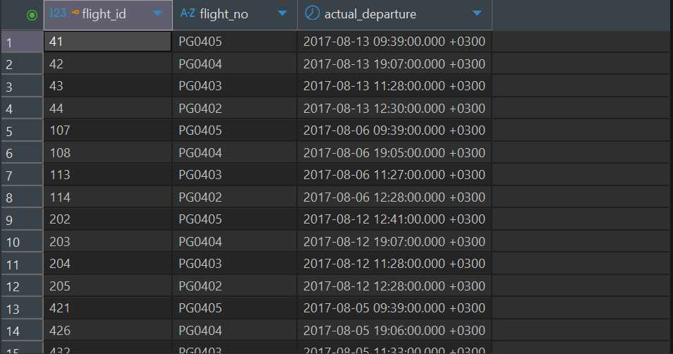

📸 **Скриншот B (`EXPLAIN (ANALYZE, BUFFERS)`):**
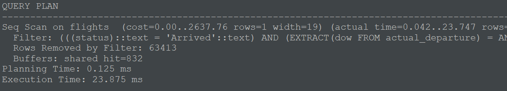

### 6.2. Оптимизированный запрос (диапазоны дат)

1 августа 2017 был вторник, поэтому выходные: сб 5, 12, 19, 26 и вс 6, 13, 20, 27.

```sql
SELECT flight_id, flight_no, actual_departure
FROM flights
WHERE status = 'Arrived'
  AND ( (actual_departure >= '2017-08-05' AND actual_departure < '2017-08-07')
     OR (actual_departure >= '2017-08-12' AND actual_departure < '2017-08-14')
     OR (actual_departure >= '2017-08-19' AND actual_departure < '2017-08-21')
     OR (actual_departure >= '2017-08-26' AND actual_departure < '2017-08-28') );
```

📸 **Скриншот A (вывод данных, число строк должно совпасть с 6.1):**
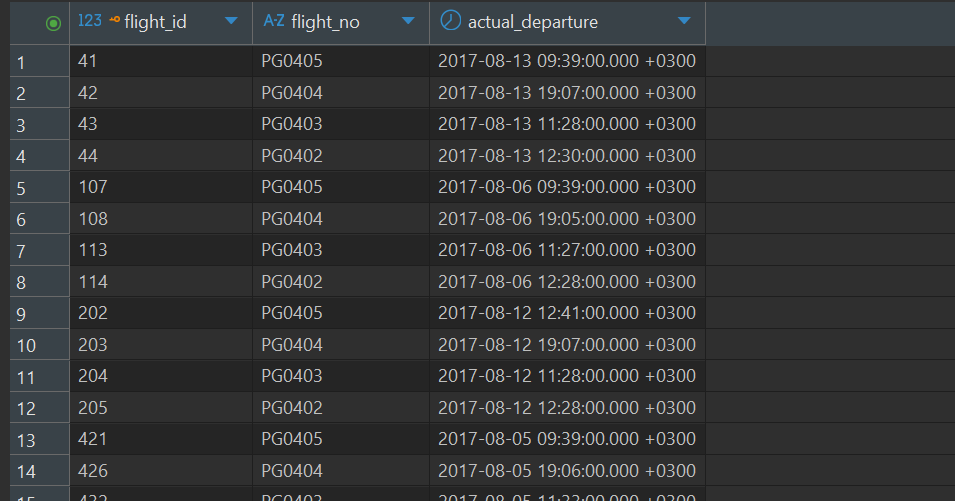

📸 **Скриншот B (`EXPLAIN (ANALYZE, BUFFERS)`):**
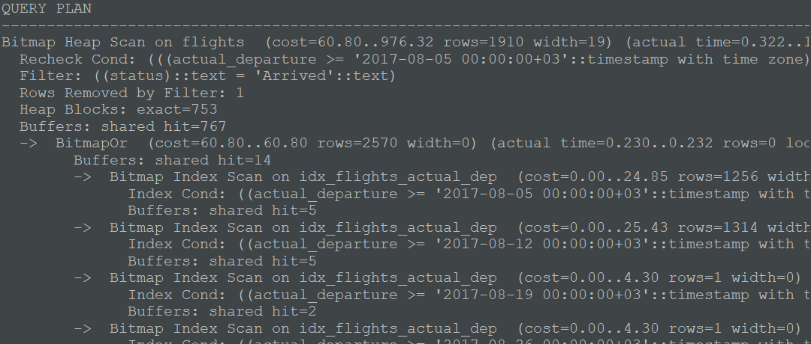

**Объяснение разницы в планах.**
Предикат `EXTRACT(...) = ...` применяет функцию к колонке, поэтому он **не sargable**: планировщик не может сравнить значения в индексе с константой, использовать индекс нельзя, и каждая строка проверяется в `Filter` (при этом в плане видно много `Rows Removed by Filter`). В оптимизированном варианте колонка сравнивается с константами напрямую, поэтому возможен `Bitmap Index Scan` с `BitmapOr` (по одному диапазону на выходные), читается заметно меньше буферов и страниц таблицы. Результат запросов должен совпадать (проверьте число строк). Если планировщик всё равно выбрал `Seq Scan` (например, потому что выходные составляют большую долю таблицы), так и напишите в резюме и объясните это селективностью.

 **Резюме по плану 6.1:** Запрос выполнился за 23.875 мс. Использован Seq Scan по таблице flights, индекс не использовался. В плане shared hit=832, read=0, то есть данные читались полностью из кеша. Главная особенность плана: фильтр EXTRACT(dow FROM actual_departure) не позволяет использовать индекс, поэтому база перебирает все строки, отсеивая 63 413 записей.
 **Резюме по плану 6.2:** Запрос выполнился за 1.780 мс. Использован Bitmap Index Scan по индексу idx_flights_actual_dep с последующим Bitmap Heap Scan по таблице flights, индекс использовался. В плане shared hit=767, read=0, то есть данные читались полностью из кеша. Главная особенность плана: использован BitmapOr для объединения нескольких сканирований индекса по диапазонам дат (выходные дни), что позволило сократить количество отфильтрованных строк до 1.

---

## 7. ANTI-JOIN (оптимизация отрицания)

**Задание:** рейсы, на которые не продано ни одного билета бизнес-класса.

### 7.1. `NOT IN`

```sql
SELECT f.flight_id, f.flight_no
FROM flights f
WHERE f.flight_id NOT IN (
    SELECT flight_id FROM ticket_flights WHERE fare_conditions = 'Business');
```

📸 **Скриншот A (вывод данных):**
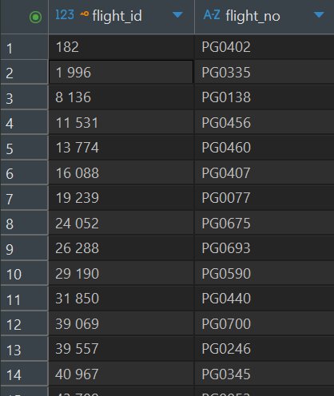

📸 **Скриншот B (`EXPLAIN (ANALYZE, BUFFERS)`):**
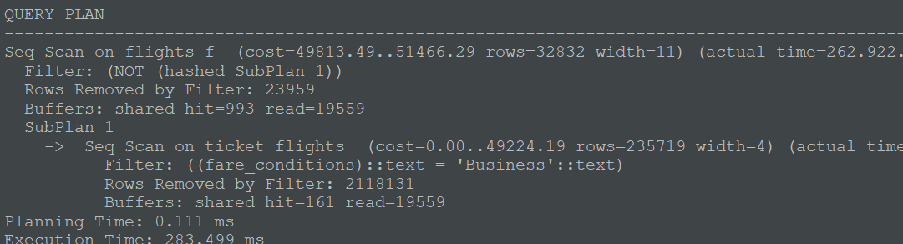

### 7.2. `NOT EXISTS`

```sql
SELECT f.flight_id, f.flight_no
FROM flights f
WHERE NOT EXISTS (
    SELECT 1 FROM ticket_flights tf
    WHERE tf.flight_id = f.flight_id AND tf.fare_conditions = 'Business');
```

📸 **Скриншот A (вывод данных, число строк должно совпасть с 7.1):**
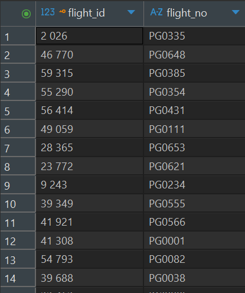

📸 **Скриншот B (`EXPLAIN (ANALYZE, BUFFERS)`):**
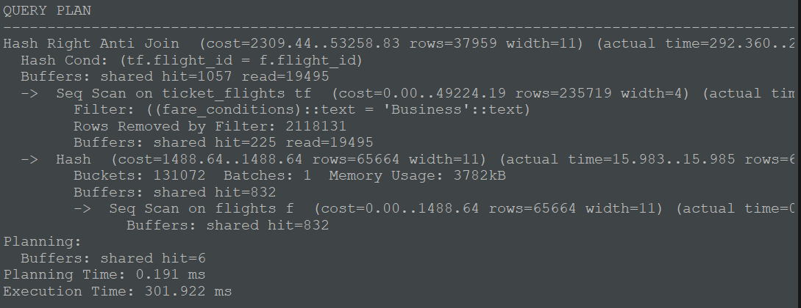

**Объяснение.**

- **Почему `NOT EXISTS` эффективнее:** планировщик превращает его в `Hash Anti Join` (или `Merge/Nested Loop Anti Join`): один проход по таблицам, в результат попадают строки левой стороны, для которых не нашлось пары. Он может выбирать разные стратегии соединения.
- **Что происходит с `NOT IN`:** обычно в плане `Filter: NOT (hashed SubPlan 1)`. Если подзапрос не помещается в `work_mem`, остаётся обычный `SubPlan`, который перебирается заново для каждой строки (квадратичная сложность). В anti join PostgreSQL `NOT IN` не превращает из-за семантики `NULL`.
- **Опасность `NULL`:** если подзапрос вернёт хотя бы одно `NULL`, то `x NOT IN (..., NULL)` для всех несовпавших значений даёт `UNKNOWN`, и запрос вернёт **0 строк**. В этой схеме `ticket_flights.flight_id` входит в первичный ключ и `NULL` быть не может, поэтому на этих данных результат корректен, но в общем случае это источник тихих багов.

 **Резюме по плану 7.1:** Запрос выполнился за 283.499 мс. Использован Seq Scan по таблицам flights и ticket_flights, индекс не использовался. В плане shared hit=993, read=19559, то есть данные читались в основном с диска. Главная особенность плана: использован SubPlan (NOT hashed) с анти-соединением через NOT IN, при этом подзапрос выполняется отдельно и отсеивает огромное количество строк (2 118 131).
 **Резюме по плану 7.2:** Запрос выполнился за 301.922 мс. Использован Seq Scan по таблицам ticket_flights и flights, индекс не использовался. В плане shared hit=1057, read=19495, то есть данные читались в основном с диска. Главная особенность плана: вместо медленного NOT IN (SubPlan) использовано Hash Right Anti Join для анти-соединения таблиц, однако внутренний подзапрос по-прежнему отсеивает огромное количество строк (2 118 131).

---

## 8. Index Only Scan

**Задание:** `SELECT status, COUNT(*) FROM flights GROUP BY status;` до и после создания индекса.

### 8.1. До создания индекса

```sql
EXPLAIN (ANALYZE, BUFFERS)
SELECT status, COUNT(*) FROM flights GROUP BY status;
```

📸 **Скриншот A (вывод данных обычного запроса без `EXPLAIN`):**
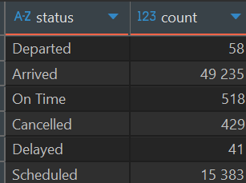

📸 **Скриншот B (план до индекса, ожидается `Seq Scan on flights`):**


### 8.2. После создания индекса

```sql
CREATE INDEX idx_flights_status ON flights(status);
VACUUM flights;   
EXPLAIN (ANALYZE, BUFFERS)
SELECT status, COUNT(*) FROM flights GROUP BY status;
```

📸 **Скриншот B (план после индекса, ожидается `Index Only Scan using idx_flights_status`, `Heap Fetches: 0`):**
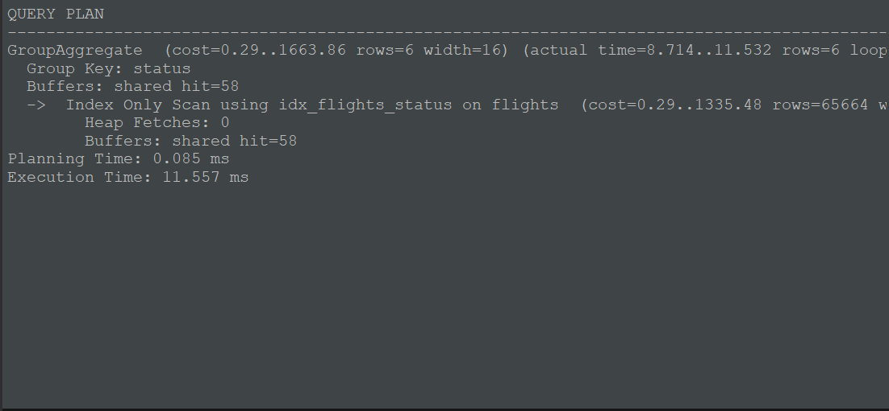

**Объяснение.**
`Index Only Scan` отвечает на запрос данными прямо из индекса, не обращаясь к таблице (heap): запросу нужна только колонка `status`, а она есть в индексе. Но в PostgreSQL версия строки может быть невидима для текущей транзакции, и обычно за этим пришлось бы заходить в heap. Здесь помогает **Visibility Map**: она отмечает страницы, где все строки видны всем транзакциям. Для таких страниц проверка видимости в heap не нужна, поэтому в плане `Heap Fetches` равен 0 или близок к нему. `VACUUM` как раз обновляет Visibility Map. Индекс по одной колонке компактнее таблицы, поэтому читается меньше буферов (сравните `Buffers:` до и после) и запрос выполняется быстрее.

 **Резюме по планам до и после:** До создания индекса. Запрос выполнился за 18,7 мс. Индекса по status не было, поэтому PostgreSQL прочитал всю таблицу flights последовательным сканированием (Seq Scan, 65 664 строки) и сгруппировал строки через HashAggregate. Диск не использовался: в плане только shared hit=832 и нет read, то есть все 832 страницы таблицы уже были в кеше PostgreSQL.
После создания индекса и VACUUM. Планировщик выбрал Index Only Scan using idx_flights_status, и время выполнения сократилось до 11,6 мс. Значение Heap Fetches: 0 показывает, что в таблицу (heap) заходить не пришлось: колонка status берётся прямо из индекса. Visibility Map, обновлённая командой VACUUM, отмечает страницы, где все строки видны всем транзакциям, поэтому проверять видимость строк в heap не нужно. Число прочитанных буферов упало с 832 до 58 (все hit, чтения с диска нет), потому что индекс по одной короткой колонке намного компактнее таблицы. Агрегация сменилась с HashAggregate на GroupAggregate: индекс отдаёт значения уже отсортированными по status, и хеш-таблица не нужна.


