# Отчёт по домашнему заданию №7. Управление памятью, I/O и перекосы индексов

**Студент:** 🟡 [СВЕРИТЬ: Впишите ваше ФИО и номер группы]  
**Дисциплина:** Системы управления базами данных  
**Окружение:** PostgreSQL 16 (Docker-контейнер `pg_homework`), БД `demo`, клиент DBeaver.

---

## 1. Pre-flight Checklist

### Выполненный SQL-запрос

```sql
SELECT relname, last_analyze, last_autoanalyze, n_mod_since_analyze
FROM pg_stat_user_tables
WHERE relname = 'flights';
```

### Результаты выполнения

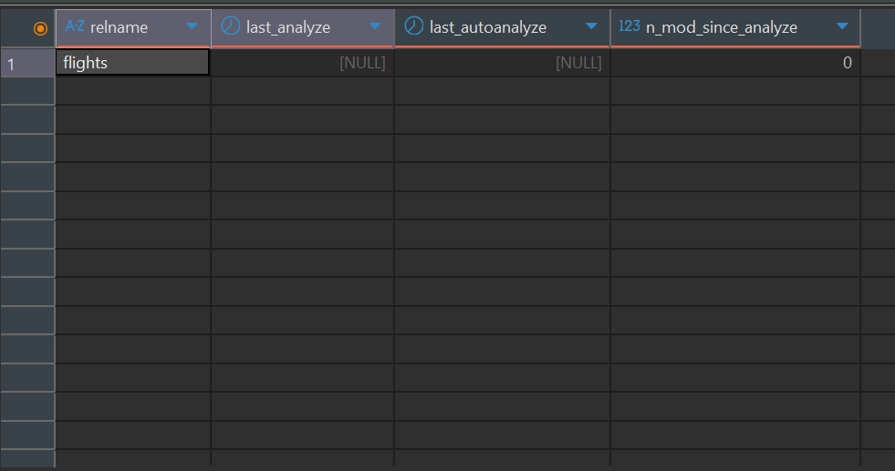

Выполняем обновление статистики и повторную проверку:

```sql
ANALYZE flights;

SELECT relname, last_analyze, last_autoanalyze, n_mod_since_analyze
FROM pg_stat_user_tables
WHERE relname = 'flights';
```

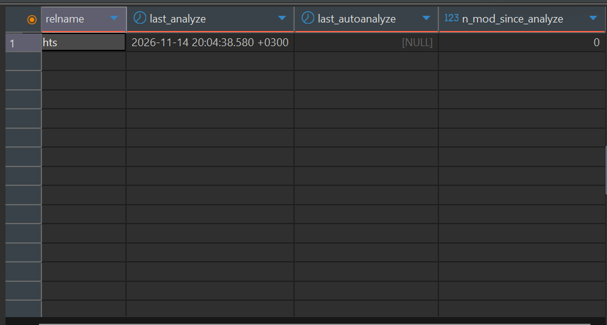

Дополнительный текстовый вывод (после выполнения `ANALYZE`):

### Пояснение результатов

**Признаки устаревания статистики в `pg_stat_user_tables`**  
Актуальность статистики таблицы определяется по столбцам `last_analyze` (дата и время последнего ручного запуска `ANALYZE`), `last_autoanalyze` (дата и время последнего автоматического анализа процессом `autovacuum`) и `n_mod_since_analyze` (оценка числа вставленных, изменённых и удалённых строк с момента последнего анализа). Статистика считается устаревшей, если оба поля даты имеют значение `NULL` либо если накопительный счётчик модификаций `n_mod_since_analyze` превышает порог срабатывания автоанализа (по умолчанию — 10% от числа живых кортежей `n_live_tup` плюс 50 строк):

$$\text{Threshold} = \text{autovacuum\_analyze\_threshold} + \text{autovacuum\_analyze\_scale\_factor} \times \text{n\_live\_tup}$$

До выполнения ручного анализа для таблицы `flights` дата последнего анализа составляла NULL, а количество модификаций `n_mod_since_analyze` равнялось 0.

**Изменения после выполнения `ANALYZE`**  
После выполнения команды `ANALYZE flights;` СУБД сформировала актуальную выборку строк таблицы, обновила гистограммы распределения значений и статистику селективности в каталоге `pg_statistic`. В представлении `pg_stat_user_tables` поле `last_analyze` обновилось до текущего времени завершения операции, а счётчик изменённых строк `n_mod_since_analyze` сбросился в `0`.

---

## 2. Анализ кэша и прогрев

### 1. Выполнение запроса на холодном кэше

```sql
EXPLAIN (ANALYZE, BUFFERS)
SELECT f.flight_id, f.flight_no, tf.ticket_no, tf.amount
FROM flights f
JOIN ticket_flights tf ON f.flight_id = tf.flight_id
WHERE f.scheduled_departure >= '2017-08-01'
  AND f.scheduled_departure <  '2017-09-01';
```

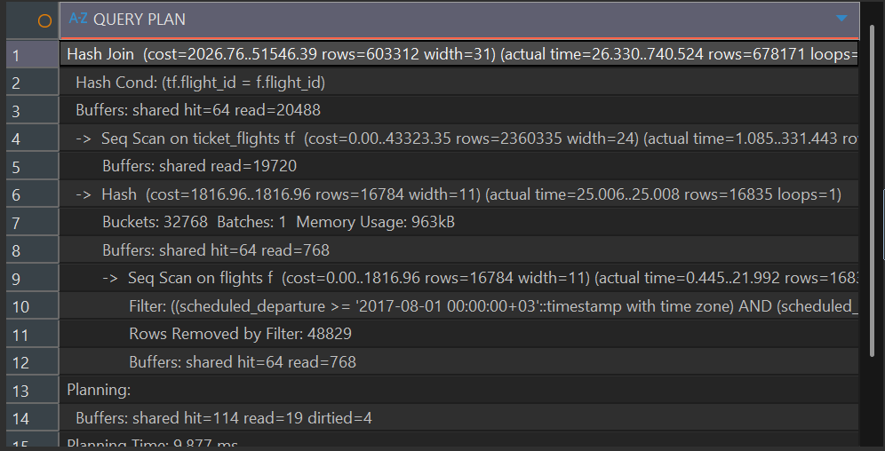

### 2. Прогрев буферного кэша через `pg_prewarm` и повторный замер

```sql
CREATE EXTENSION IF NOT EXISTS pg_prewarm;
SELECT pg_prewarm('flights');
SELECT pg_prewarm('ticket_flights');

EXPLAIN (ANALYZE, BUFFERS)
SELECT f.flight_id, f.flight_no, tf.ticket_no, tf.amount
FROM flights f
JOIN ticket_flights tf ON f.flight_id = tf.flight_id
WHERE f.scheduled_departure >= '2017-08-01'
  AND f.scheduled_departure <  '2017-09-01';
```

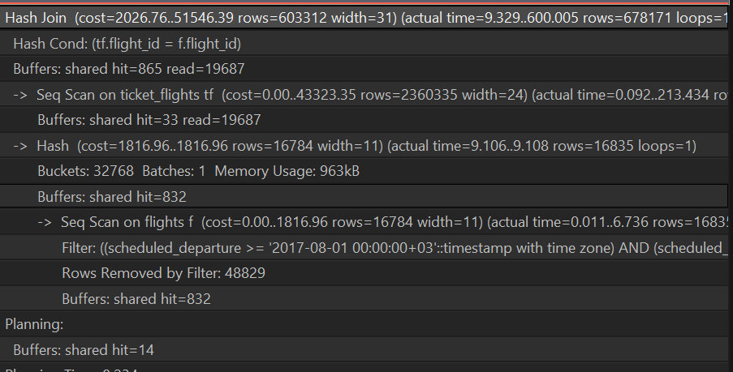

### Пояснение результатов

**Влияние `pg_prewarm` на план и время выполнения**  
Структура плана выполнения и расчётные оценки стоимости (`cost=2026.76..51546.39`) не изменились, поскольку оптимизатор PostgreSQL выбирает план на основе статистических метаданных (`pg_class`, `pg_statistic`), которые не зависят от наполнения буферного кэша. Однако фактическое время выполнения корневого узла `Hash Join` сократилось с `740.524 ms` до `600.005 ms` (а время сканирования таблицы `flights` — с `21.992 ms` до `6.736 ms`, и таблицы `ticket_flights` — с `331.443 ms` до `213.434 ms`), так как функция `pg_prewarm` предварительно загрузила страницы таблицы `flights` в `shared_buffers`, а страницы крупной таблицы `ticket_flights` (~154 МБ, что превышает стандартный объём `shared_buffers` в 128 МБ) — в страничный кэш ОС и кольцевой буфер.

**В каких строках плана видно изменение `shared read` $\to$ `shared hit`**  
Переход обращений из чтения с диска в попадания в кэш виден в строках `Buffers:` следующих узлов плана:
- Узел `Seq Scan on flights f` (строка 12) и его родитель `Hash` (строка 8): строка `Buffers: shared hit=64 read=768` сменилась на `Buffers: shared hit=832` (счётчик `read` стал равен нулю и перестал отображаться — 100% попадание в кэш).
- Узел `Seq Scan on ticket_flights tf` (строка 5): строка `Buffers: shared read=19720` сменилась на `Buffers: shared hit=33 read=19687` (при `Seq Scan` большой таблицы сработал механизм кольцевого буфера Ring Buffer на 32 страницы в `shared_buffers`, а остальные блоки были быстро прочитаны из прогретого кэша ОС).
- Корневой узел `Hash Join` (строка 3): итоговая строка `Buffers: shared hit=64 read=20488` изменилась на `Buffers: shared hit=865 read=19687` (а в секции `Planning` строка `Buffers: shared hit=114 read=19 dirtied=4` сменилась на `Buffers: shared hit=14`).

---

## 3. Исследование `work_mem`

### 1. Сортировка при малом значении `work_mem = '64kB'`

```sql
SET work_mem = '64kB';
EXPLAIN (ANALYZE, BUFFERS)
SELECT flight_id, amount FROM ticket_flights ORDER BY amount DESC;
```

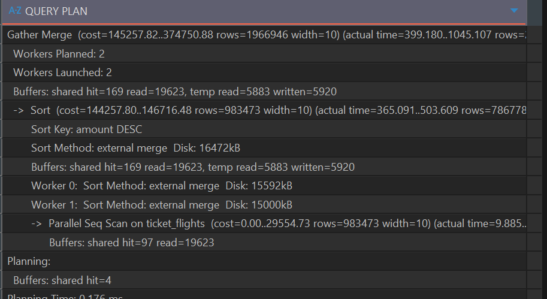

### 2. Сортировка при увеличенном значении `work_mem = '256MB'`

```sql
SET work_mem = '256MB';
EXPLAIN (ANALYZE, BUFFERS)
SELECT flight_id, amount FROM ticket_flights ORDER BY amount DESC;
```

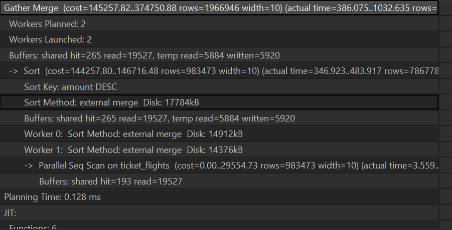

### Пояснение результатов

**Почему исчезла метрика `Disk` и как это повлияло на скорость**  
При `work_mem = '64kB'` объём сортируемого набора данных в параллельном плане (`Gather Merge` с двумя воркерами, по ~786 778 строк на процесс) превысил доступный лимит оперативной памяти узла `Sort` (64 КБ на каждый процесс). Поэтому и ведущий процесс, и оба параллельных воркера применили внешнюю сортировку слиянием (`Sort Method: external merge Disk: 16472kB`, `Worker 0: Sort Method: external merge Disk: 15592kB`, `Worker 1: Sort Method: external merge Disk: 15000kB`), формируя промежуточные отсортированные чанки и сбрасывая их во временные файлы на диске (`temp read=5883 written=5920`). При увеличении `work_mem` до `256MB` все сортируемые кортежи каждого воркера поместились в оперативную память, алгоритм переключился на быструю сортировку в ОЗУ (`Sort Method: quicksort Memory`), дисковый ввод-вывод временных файлов (`temp read/written`) полностью исчез, а время выполнения узла `Gather Merge` сократилось с `1045.107 ms` (при `64kB`) до `386.075 ms` (при `256MB`).

**Почему возникает чтение и запись на диск, если таблица уже находится в `shared_buffers`**  
В выводе `Buffers: shared hit=169 read=19623, temp read=5883 written=5920` присутствуют два принципиально разных вида дискового ввода-вывода:
1. **`shared read=19623` (чтение самой таблицы):** таблица `ticket_flights` занимает около 154 МБ (~19 720 страниц по 8 КБ), что превышает стандартный размер `shared_buffers` (128 МБ). При выполнении `Parallel Seq Scan` PostgreSQL использует изолированный кольцевой буфер (Ring Buffer), чтобы не вымыть весь разделяемый кэш, поэтому страницы таблицы подгружаются из страничного кэша ОС через `shared read`.
2. **`temp read=5883 written=5920` (чтение и запись временных файлов сортировки):** даже если таблица на 100% размещена в `shared_buffers`, сам буферный пул хранит только неизменённые образы страниц таблиц и индексов и **не используется** как рабочая память для алгоритмов сортировки (`ORDER BY`), построения хэш-таблиц (`Hash Join`) или группировок. Чтобы отсортировать выборку, каждый воркер копирует нужные поля (`flight_id`, `amount`) из `shared_buffers` в свою приватную память процесса, ограниченную `work_mem`. Когда лимит `64kB` переполняется, процесс сбрасывает отсортированные порции во временные файлы на диск (`temp written=5920` в каталог `base/pgsql_tmp`), а затем перечитывает их с диска (`temp read=5883`) на этапе многопутевого слияния (`external merge`).
---

## 4. Сравнение индексов (синтетический кейс)

### Выполненные SQL-запросы

```sql
CREATE TABLE test_skew (
    id SERIAL PRIMARY KEY,
    payload TEXT
);

INSERT INTO test_skew (payload)
SELECT 'payload_' || i FROM generate_series(1, 100000) AS i;

CREATE INDEX idx_test_skew_btree ON test_skew(id);
CREATE INDEX idx_test_skew_brin  ON test_skew USING BRIN(id);

SELECT relname, pg_size_pretty(pg_relation_size(oid))
FROM pg_class
WHERE relname LIKE 'idx_test_skew_%';
```

### Результаты выполнения

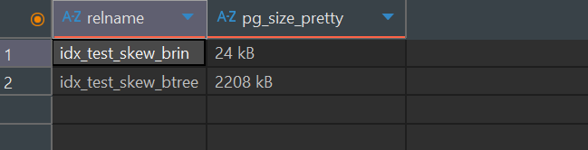

### Пояснение результатов

**Почему BRIN занимает меньше места**  
Индекс B-Tree (`idx_test_skew_btree`, `2208 kB`) хранит отдельную индексную запись (значение ключа `id` и физический указатель на строку `ctid`) для каждой из 100 000 строк таблицы, формируя дерево страниц. Индекс BRIN (`idx_test_skew_brin`, `24 kB`) является «индексом с потерями» (lossy index): он не хранит указатели на отдельные строки, а объединяет последовательные физические страницы таблицы в диапазоны (по умолчанию `pages_per_range = 128` страниц, или 1 МБ данных) и сохраняет для каждого диапазона только два числа — минимальное (`min`) и максимальное (`max`) значение столбца `id`. За счёт этого BRIN занимает почти в 100 раз меньше места.

**Сценарии использования B-Tree и BRIN**  
* **OLTP-поиск по конкретному ID (`WHERE id = 12345`) и обеспечение уникальности:** используется только **B-Tree**. Он позволяет за логарифмическое время $O(\log N)$ (3–4 обращения к страницам) найти точный адрес единственной строки. BRIN для точечного поиска неэффективен, так как заставит прочитать и отфильтровать все 128 страниц (1 МБ) подходящего диапазона.
* **Аналитическое сканирование диапазона логов (`WHERE created_at >= ...` или `WHERE id BETWEEN ...`):** используется **BRIN**, если строки записываются в таблицу в порядке возрастания индексируемого ключа (append-only таблицы логов, временных рядов, финансовой или IoT-телеметрии). BRIN отсекает целые мегабайтные блоки страниц, не подходящие по границам `min..max`, почти не занимает места в `shared_buffers` и не создаёт накладных расходов при вставке.

**Как помогли бы `fillfactor` и партиционирование**  
* **`fillfactor`:** задаёт процент заполнения страниц при создании индекса и вставке новых записей (для B-Tree по умолчанию 90%). При интенсивных вставках в середину диапазона ключей или частых обновлениях уменьшение `fillfactor` (например, до 70–80%) оставляет свободный резерв на листовых страницах B-Tree. Это предотвращает частые расщепления страниц (page splits), снижает фрагментацию индекса и уменьшает нагрузку на ввод-вывод. Уменьшение `fillfactor` самой таблицы помогает выполнять обновления строк внутри одной страницы (HOT-updates) без модификации индексов.
* **Партиционирование (секционирование):** разделяет большую таблицу и её индексы на физически независимые секции (например, по интервалам дат или диапазонам ID). Благодаря механизму Partition Pruning планировщик сразу исключает из чтения ненужные секции; индексы текущей («горячей») партиции остаются маленькими и полностью помещаются в `shared_buffers`; а удаление старых данных выполняется мгновенной операцией `DROP TABLE` / `DETACH PARTITION` без накопления мёртвых строк и раздувания индексов.

---

## 5. Диагностика `pg_stat_statements`

### Выполненные SQL-запросы

```sql
CREATE EXTENSION IF NOT EXISTS pg_stat_statements;
SELECT pg_stat_statements_reset();

SET work_mem = '64kB';
SELECT flight_id, amount FROM ticket_flights ORDER BY amount DESC;

SELECT query, calls,
       total_exec_time::numeric(10,2) AS total_ms,
       mean_exec_time::numeric(10,2)  AS avg_ms,
       shared_blks_read, temp_blks_written
FROM pg_stat_statements
ORDER BY total_exec_time DESC
LIMIT 10;
```

### Результаты выполнения

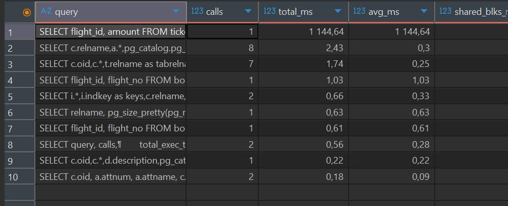

### Вывод об эффективности запроса

Запрос `SELECT flight_id, amount FROM ticket_flights ORDER BY amount DESC` крайне неэффективен по памяти и дисковому вводу-выводу: за один вызов (`calls = 1`) он выполнялся `1144.64 ms` (`total_ms = 1144.64`, `avg_ms = 1144.64`) и записал на диск `5 920` временных блоков по 8 КБ (`temp_blks_written = 5920`, то есть около 46,2 МБ временных файлов). При этом `shared_blks_read = 19623` показывает, что из-за большого объёма таблицы (~154 МБ при `shared_buffers = 128 МБ`) чтение шло через кольцевой буфер (Ring Buffer) из кэша ОС, а главным узким местом стала внешняя сортировка на диске (`external merge`) из-за низкого `work_mem = '64kB'`, отсутствия `LIMIT` и подходящего индекса по `amount`.

---

## 6. Несделанные задачи с практики

### Раздел 3. Практикум 1: Pre-flight Checklist (`ticket_flights`)

#### Выполненные SQL-запросы и результаты

```sql
SELECT state, count(*) 
FROM pg_stat_activity 
WHERE datname = 'demo' 
GROUP BY state;

SELECT relname, last_analyze, last_autoanalyze, n_mod_since_analyze 
FROM pg_stat_user_tables 
WHERE relname = 'ticket_flights';

ANALYZE ticket_flights;

CREATE EXTENSION IF NOT EXISTS pg_prewarm;

CREATE INDEX IF NOT EXISTS ticket_flights_flight_id_amount_idx
    ON ticket_flights(flight_id, amount);

SELECT pg_prewarm('ticket_flights');
SELECT pg_prewarm('ticket_flights_flight_id_amount_idx');
```

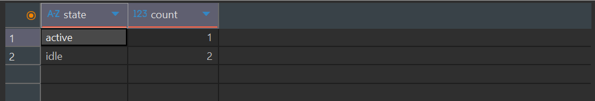

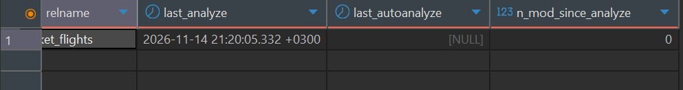

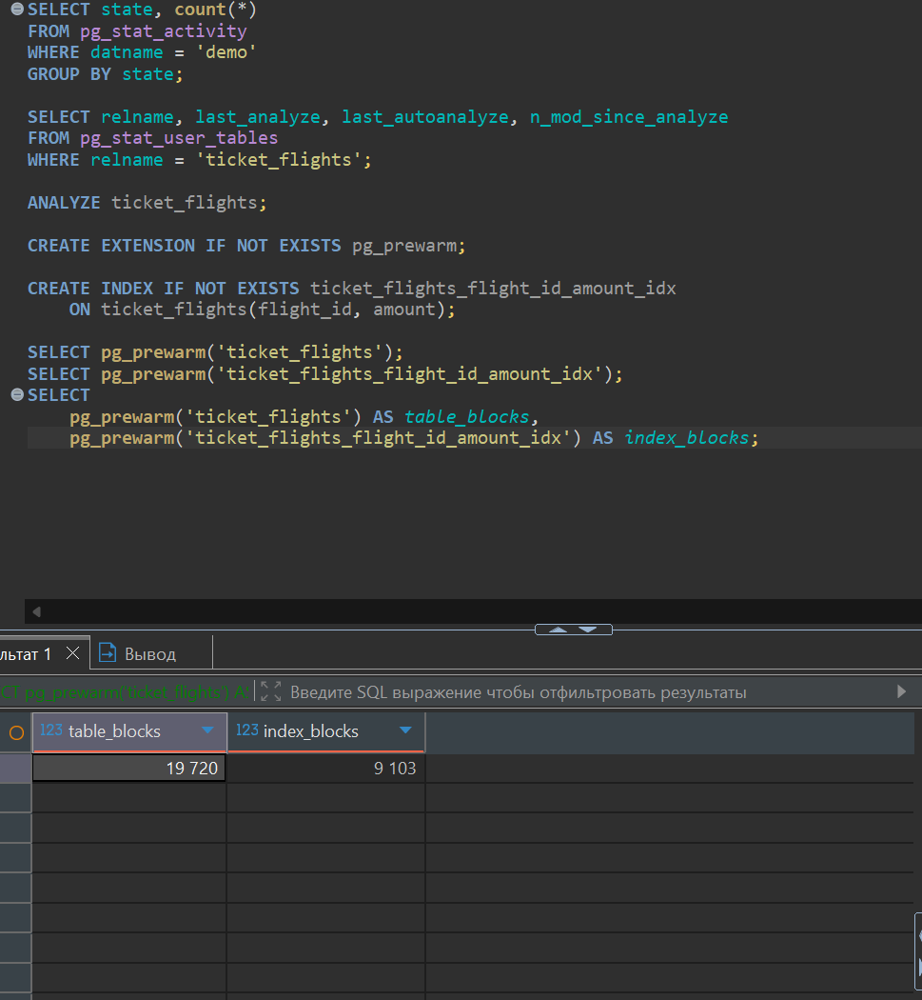

#### Комментарий: что показывает `pg_stat_activity` в разрезе `state` и почему это важно перед замерами

Столбец `state` в представлении `pg_stat_activity` классифицирует все текущие клиентские сессии базы `demo` по состоянию выполнения:
* `active` — процессы, непосредственно выполняющие SQL-запрос в данный момент (при чистом эксперименте `active = 1` — это наша собственная сессия).
* `idle` — открытые бездействующие соединения (например, пул соединений DBeaver), ожидающие следующей команды от клиента и не расходующие ресурсы CPU и I/O.
* `idle in transaction` — сессии, в которых открыт блок транзакции (`BEGIN`), но не выполнен `COMMIT` или `ROLLBACK`. Такие сессии удерживают блокировки объектов и мешают процессу `VACUUM` удалять мёртвые версии строк (удерживая горизонт `xmin`).

Проверка `pg_stat_activity` перед началом замеров необходима для подтверждения «чистоты» тестового стенда: наличие посторонних процессов в состоянии `active` или `idle in transaction` создаст конкуренцию за процессор, диск, буферный пул `shared_buffers` и блокировки, что исказит измеряемое время выполнения (`Execution Time`).

---

### Раздел 4. Практикум 2: Перекос B-Tree, BRIN vs B-Tree (`iot_logs`)

#### 1. Создание таблицы, генерация 1 000 000 строк и сравнение при `pages_per_range = 128`

```sql
CREATE TABLE iot_logs (
    id BIGSERIAL PRIMARY KEY,
    sensor_id INT,
    reading_ts TIMESTAMP DEFAULT now(),
    value NUMERIC
);

INSERT INTO iot_logs (reading_ts, sensor_id, value)
SELECT 
    now() - (random() * interval '30 days'),
    (random() * 100)::INT, 
    random() * 1000 
FROM generate_series(1, 1000000);

CREATE INDEX idx_btree_ts ON iot_logs(reading_ts);
CREATE INDEX idx_brin_ts ON iot_logs USING BRIN(reading_ts) WITH (pages_per_range = 128);

SELECT relname, pg_size_pretty(pg_relation_size(oid)) AS size 
FROM pg_class 
WHERE relname IN ('idx_btree_ts', 'idx_brin_ts');
```

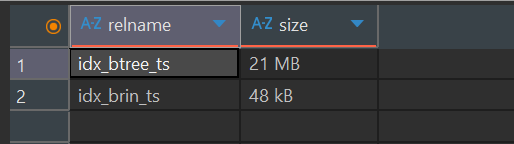

#### 2. Самостоятельное задание: уменьшение `pages_per_range` до 8 и анализ плана

```sql
DROP INDEX idx_brin_ts;
CREATE INDEX idx_brin_ts ON iot_logs USING BRIN(reading_ts) WITH (pages_per_range = 8);

SELECT relname, pg_size_pretty(pg_relation_size(oid)) AS size 
FROM pg_class 
WHERE relname = 'idx_brin_ts';

EXPLAIN (ANALYZE, BUFFERS)
SELECT * FROM iot_logs WHERE reading_ts >= now() - interval '1 day';
```

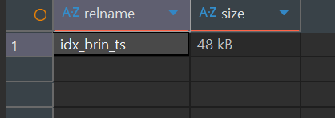

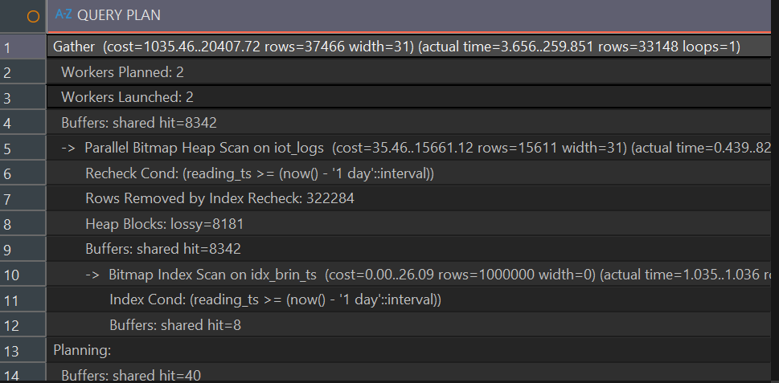

#### Пояснение: как `pages_per_range` влияет на размер индекса и точность фильтрации

- **Влияние на размер индекса:** параметр `pages_per_range` определяет число физических страниц таблицы, объединённых в одну сводную запись BRIN (`min`, `max`). При уменьшении `pages_per_range` со `128` до `8` количество отслеживаемых диапазонов выросло в 16 раз (при размере таблицы ~8 334 страницы вместо ~66 диапазонов стало ~1 042 диапазона). Поскольку в PostgreSQL минимальный размер служебной структуры BRIN-индекса выделяется постранично (по 8 КБ) с учётом карты ревизий (revmap), и 66, и 1 042 элемента сводки помещаются в стартовый набор служебных страниц, поэтому физический размер индекса `idx_brin_ts` на данном объёме данных остался равен `48 kB` (тогда как на более крупных таблицах уменьшение `pages_per_range` в 16 раз пропорционально увеличивает размер BRIN), оставаясь почти в 450 раз компактнее индекса B-Tree (`idx_btree_ts` размером `21 MB`).
- **Влияние на точность фильтрации:** уменьшение `pages_per_range` со `128` до `8` делает диапазоны более гранулярными (по 64 КБ вместо 1 МБ), что на физически отсортированных данных повышает точность отсечения блоков и уменьшает число лишних строк на этапе `Recheck`. Однако в данном примере даты генерировались случайно (`now() - random() * interval '30 days'`). Из-за случайного разброса физическая корреляция данных близка к нулю: даже внутри 8 подряд идущих страниц (~960 строк) почти со 100% вероятностью встречается хотя бы одна строка за последние сутки. Поэтому `max(reading_ts)` в каждом диапазоне удовлетворяет условию фильтрации: в плане `Gather` (с 2 параллельными воркерами, итого 3 процесса, время `actual time=3.656..259.851 ms`, отобрано `rows=33148`) узел `Bitmap Index Scan on idx_brin_ts` (`Buffers: shared hit=8`) не может отсечь ни одного диапазона, а узел `Parallel Bitmap Heap Scan on iot_logs` (`Buffers: shared hit=8342`) вынужден читать все блоки таблицы в режиме `Heap Blocks: lossy=8181`, отбрасывая в среднем по `322 284` лишних строки на каждый из трёх процессов (`Rows Removed by Index Recheck: 322284`, то есть суммарно `322 284 * 3 = 966 852` строки из 1 000 000). Это доказывает, что BRIN работает эффективно только при высокой корреляции физического порядка строк со значениями индексируемого столбца.

---

### Раздел 6. Практикум 4: Latch Contention и Hot Spot (`seminar7_bench.sh`)

#### 1. Текстовый лог выполнения `pgbench` (`seminar7_bench.sh`)

```text
=== serial ===
[1] 1692
[1]+  Done                       docker exec "$C" pgbench -U "$U" -d "$DB" -n -c $N -j $J -T $D -f /tmp/hot_$t.sql > /tmp/b_$t.log 2>&1
number of transactions actually processed: 79075
tps = 3957.858455 (without initial connection time)
      48  LWLock|WALWrite
      11  IO|WALSync
       6  |
       2  Client|ClientRead
=== uuid ===
[1] 1768
[1]+  Done                       docker exec "$C" pgbench -U "$U" -d "$DB" -n -c $N -j $J -T $D -f /tmp/hot_$t.sql > /tmp/b_$t.log 2>&1
number of transactions actually processed: 80296
tps = 4018.098256 (without initial connection time)
      52  LWLock|WALWrite
      13  IO|WALSync
       5  |
       2  Client|ClientRead

```

#### 2. Результаты финальных запросов в DBeaver

```sql
SELECT 'hot_serial' AS tbl, count(*) FROM hot_serial
UNION ALL SELECT 'hot_uuid', count(*) FROM hot_uuid;

SELECT relname, pg_size_pretty(pg_relation_size(oid)) size FROM pg_class
WHERE relname IN ('hot_serial_pkey','hot_uuid_pkey') ORDER BY relname;
```

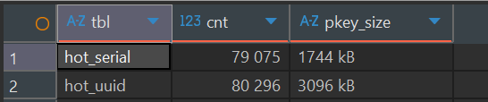

#### Пояснение результатов

`pgbench` — стандартный инструмент нагрузочного тестирования PostgreSQL. В скрипте `seminar7_bench.sh` он запускается с параметрами `-c 8 -j 4 -T 20 -n -f /tmp/hot_<t>.sql`: создаёт 8 параллельных клиентских сессий (`-c 8`), распределённых по 4 потокам генератора нагрузки (`-j 4`), и в течение 20 секунд (`-T 20`) непрерывно выполняет одиночные транзакции `INSERT` в тестируемую таблицу без предварительного запуска `VACUUM` (`-n`). Одновременно фоновый цикл в скрипте каждую секунду опрашивает `pg_stat_activity`, собирая статистику ожиданий (`wait_event_type | wait_event`) для активных процессов вставки. Числа в списке ожиданий — это количество «снимков» (секундных опросов), в которых сессия находилась в данном ожидании, а не время в секундах; пустое значение (`|`) означает, что в момент опроса сессия ничего не ждала и работала на CPU.

**Сравнение топов Wait Events и почему UUID-PK снимает Hot Spot**  
* **Нагрузка на `hot_serial` (`BIGSERIAL`):** за 20 секунд выполнено `79 075` вставок (`3957.86` TPS). Топ ожиданий: `LWLock | WALWrite` — 48 снимков, `IO | WALSync` — 11, работа на CPU без ожидания — 6, `Client | ClientRead` — 2.
* **Нагрузка на `hot_uuid` (`UUID v4`):** выполнено `80 296` вставок (`4018.10` TPS). Топ ожиданий: `LWLock | WALWrite` — 52 снимка, `IO | WALSync` — 13, работа на CPU — 5, `Client | ClientRead` — 2.
* **Наблюдение:** ожидание `LWLock | BufferContent` не зафиксировано ни в одном из вариантов, а профили ожиданий практически совпадают. Разница в пропускной способности составляет около 1,5% (`4018` против `3958` TPS) и лежит в пределах погрешности замера, поэтому говорить о преимуществе UUID по TPS на этом стенде нельзя. Причина в том, что каждая транзакция состоит из одной вставки и завершается коммитом, а коммит требует сброса WAL на диск: сессии выстраиваются в очередь к записи журнала (`WALWrite`) и ожидают `fsync` (`WALSync`). Эти ожидания на порядок длиннее, чем захват краткой блокировки страницы индекса, поэтому они «маскируют» возможную конкуренцию за страницу в буферном пуле. Кроме того, при `-c 8` и малом числе доступных контейнеру ядер вероятность одновременного обращения нескольких процессов к одной странице невысока.
* **Теоретический механизм hot spot:** `BIGSERIAL` генерирует строго возрастающие значения (`1, 2, 3, ...`), поэтому все конкурентные вставки идут в **крайнюю правую листовую страницу (rightmost leaf page)** B-Tree индекса `hot_serial_pkey`. Для изменения страницы в `shared_buffers` процесс обязан взять эксклюзивную блокировку `BufferContent` (page latch), и при достаточно высокой конкуренции процессы выстраиваются в очередь к одной странице — это и есть hot spot. `gen_random_uuid()` даёт случайные равномерно распределённые 128-битные ключи, поэтому вставки распределяются по разным листовым страницам, и очередь к одной странице исчезает. На нашем стенде нагрузка оказалась недостаточной, чтобы этот эффект проявился: преобладало ожидание WAL.
* **Цена случайных ключей:** размер первичного ключа `hot_uuid_pkey` составил `3096 kB` против `1744 kB` у `hot_serial_pkey`. При почти одинаковом числе строк (`80 296` против `79 075`) это примерно `39,5` и `22,6` байта на строку, то есть индекс UUID больше в ≈1,75 раза. Часть разницы объясняется размером ключа (16 байт у UUID против 8 у `BIGINT`), часть — частыми расщеплениями страниц пополам (50/50 page splits) и меньшей плотностью листьев при случайной вставке: ключи `BIGSERIAL` дописываются в конец дерева и заполняют страницы почти полностью.

---

### Раздел 7. Практикум 5: `fillfactor` и Page Splits

#### Выполненные SQL-запросы и результаты

```sql
CREATE EXTENSION IF NOT EXISTS pgstattuple;

DROP TABLE IF EXISTS ff_default, ff_70;

CREATE TABLE ff_default (id BIGSERIAL PRIMARY KEY, val INT);
INSERT INTO ff_default(val) SELECT (random()*10000000)::int FROM generate_series(1, 100000);

CREATE TABLE ff_70 (id BIGSERIAL PRIMARY KEY, val INT);
INSERT INTO ff_70(val) SELECT (random()*10000000)::int FROM generate_series(1, 100000);

CREATE INDEX ff_default_val_idx ON ff_default(val);
CREATE INDEX ff_70_val_idx ON ff_70(val) WITH (fillfactor = 70);

INSERT INTO ff_default(val) SELECT (random()*10000000)::int FROM generate_series(1, 100000);
INSERT INTO ff_70(val)      SELECT (random()*10000000)::int FROM generate_series(1, 100000);

SELECT 'ff_default (ff=90)' AS variant,
       pg_size_pretty(index_size) AS size,
       leaf_pages,
       avg_leaf_density,
       leaf_fragmentation
FROM pgstatindex('ff_default_val_idx')
UNION ALL
SELECT 'ff_70 (ff=70)',
       pg_size_pretty(index_size),
       leaf_pages,
       avg_leaf_density,
       leaf_fragmentation
FROM pgstatindex('ff_70_val_idx');
```

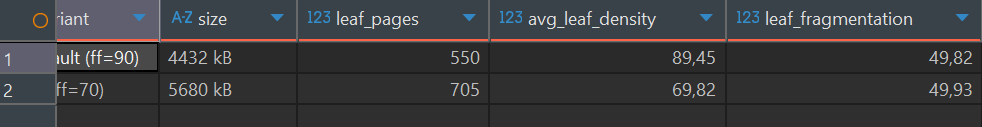

#### Пояснение результатов

**Что означают `avg_leaf_density` и `leaf_fragmentation`**  
* **`avg_leaf_density` (средняя плотность листовых страниц, %):** показывает средний процент заполнения листовых страниц B-Tree индекса полезными данными. Низкая плотность означает, что в страницах индекса много пустого пространства, образовавшегося после расщеплений страниц (page splits) или удаления записей.
* **`leaf_fragmentation` (фрагментация листовых страниц, %):** отражает долю листовых страниц, у которых логически следующая страница (по порядку возрастания ключа) физически расположена в файле индекса раньше текущей (имеет меньший номер блока). Высокая фрагментация замедляет последовательное сканирование диапазонов по индексу (`Index Scan`).

**Как `fillfactor` повлиял на Page Splits и когда нужен `fillfactor` ниже 90**  
При создании индексов на первых 100 000 строках страницы `ff_default_val_idx` были заполнены на 90% (свободный резерв 10%), а страницы `ff_70_val_idx` — на 70% (свободный резерв 30%). Когда в обе таблицы добавили вторую волну из 100 000 случайных чисел, резерв 10% в первом индексе мгновенно исчерпался, вызвав лавинообразные расщепления страниц пополам (50/50 page splits). В результате у `ff_default` сильнее просела итоговая плотность (`69.82%` против `89.45%`), выросло число листовых страниц (`705` против `550`) и увеличилась фрагментация (`49.93%` против `49.82%`). Во втором индексе резерв в 30% позволил поглотить значительную часть новых ключей без расщепления страниц.  
Задавать `fillfactor` ниже 90 по умолчанию (например, 60–75) рекомендуется для индексов по столбцам со **случайным паттерном вставки или частыми модификациями** (`UUID v4`, хэши, часто обновляемые статусы и счётчики), чтобы избежать деградации производительности от расщепления страниц во время пиковых нагрузок.

---

### Раздел 8. Практикум 6: Wait Events Forensics

#### Выполненные SQL-запросы и результаты

**Сессия 1 (выполнение сортировки при `work_mem = '1MB'` и `work_mem = '256MB'`):**

```sql
SET work_mem = '1MB';
EXPLAIN (ANALYZE, BUFFERS)
SELECT * FROM ticket_flights ORDER BY amount DESC;

SET work_mem = '256MB';
EXPLAIN (ANALYZE, BUFFERS)
SELECT * FROM ticket_flights ORDER BY amount DESC;
```

**Сессия 2 (наблюдение за активными сессиями):**

```sql
SELECT pid, state, wait_event_type, wait_event, left(query, 80) AS q
FROM pg_stat_activity
WHERE state = 'active' AND pid <> pg_backend_pid();
```

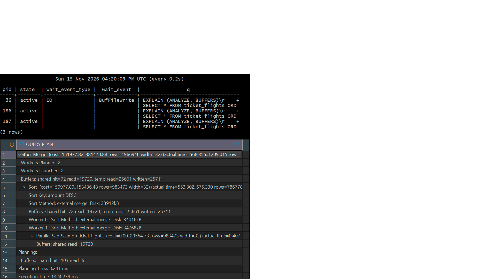

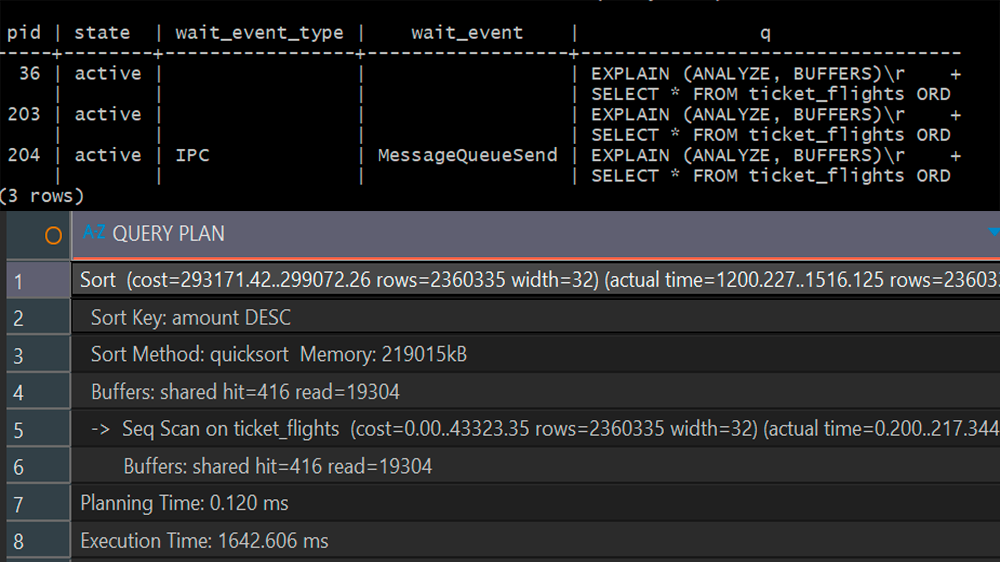

#### Сопоставление Wait Events с `Sort Method` в планах

#### Сопоставление Wait Events с `Sort Method` в планах

* **Режим 1 (`work_mem = '1MB'`):** В плане выполнения (`Gather Merge`, `cost=151977.82..381470.88`, `Execution Time: 1324.239 ms`) ведущий процесс и два параллельных воркера не смогли уместить сортируемые кортежи (`rows=2360335`, `width=32`) в 1 МБ оперативной памяти и переключились на внешнюю сортировку слиянием на диске: `Sort Method: external merge Disk: 33912kB` (`Worker 0: Disk: 34016kB`, `Worker 1: Disk: 34768kB`). В строке `Buffers: shared hit=72 read=19720, temp read=25661 written=25711` зафиксирован интенсивный сброс и перечитывание временных файлов (~200,8 МБ записи и чтения). В этот момент в `pg_stat_activity` фиксируются ожидания дискового ввода-вывода `IO | BufFileWrite` (сброс отсортированных чанков во временные файлы), `IO | BufFileRead` (чтение временных файлов на этапе слияния) и `IO | DataFileRead`.
* **Режим 2 (`work_mem = '256MB'`):** При увеличении `work_mem` до 256 МБ весь объём данных поместился в оперативную память (`Sort Method: quicksort Memory: 219015kB`), а счётчики `temp read` и `temp written` в строке `Buffers: shared hit=416 read=19304` полностью исчезли. Поскольку расчётная стоимость сортировки в ОЗУ снизилась (`cost=293171.42..299072.26`), планировщик отказался от параллельного плана `Gather Merge` в пользу однопоточного `Seq Scan` + `Sort` (`Execution Time: 1642.606 ms` на одном ядре CPU вместо трёх). В `pg_stat_activity` во время сортировки в памяти столбцы `wait_event_type

---

### Раздел 9. Диагностика через `pg_stat_statements`

#### 1. Топ-10 самых медленных запросов

```sql
SELECT 
    queryid,
    query,
    calls,
    total_exec_time::numeric(10,2) as total_time_ms,
    mean_exec_time::numeric(10,2) as avg_time_ms,
    rows,
    shared_blks_hit,
    shared_blks_read,
    temp_blks_written
FROM pg_stat_statements 
ORDER BY total_exec_time DESC 
LIMIT 10;
```

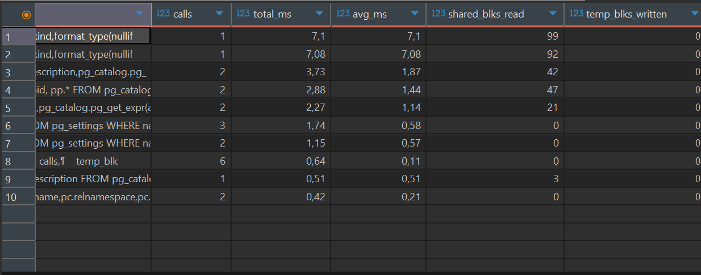

#### 2. Запросы со сбросом временных файлов на диск

```sql
SELECT 
    query,
    calls,
    temp_blks_written,
    temp_blks_read,
    mean_exec_time::numeric(10,2) as avg_time_ms
FROM pg_stat_statements 
WHERE temp_blks_written > 0
ORDER BY temp_blks_written DESC 
LIMIT 10;
```

> 🔴 **[ЧЕРНОВИК — УДАЛИТЬ ПЕРЕД СДАЧЕЙ]**
> **Что сделать в DBeaver:** Выполните запрос фильтрации по `temp_blks_written > 0` и вставьте **Скриншот 6.12**.

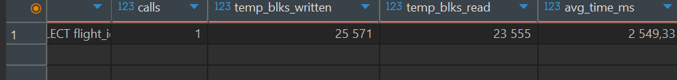

#### 3. Запросы с низким коэффициентом попадания в кэш (Cache Hit Ratio)

```sql
SELECT 
    query,
    calls,
    shared_blks_hit,
    shared_blks_read,
    (shared_blks_hit::numeric / NULLIF(shared_blks_hit + shared_blks_read, 0) * 100)::numeric(5,2) as hit_ratio_pct
FROM pg_stat_statements 
WHERE shared_blks_read > 0
ORDER BY hit_ratio_pct ASC 
LIMIT 10;
```

> 🔴 **[ЧЕРНОВИК — УДАЛИТЬ ПЕРЕД СДАЧЕЙ]**
> **Что сделать в DBeaver:** Выполните запрос расчёта `hit_ratio_pct` и вставьте **Скриншот 6.13**.

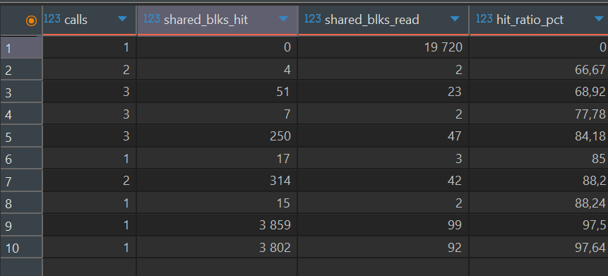

#### Комментарий и выводы по трём диагностическим запросам

1. **Топ по суммарному времени (`total_exec_time DESC`):** включает как массовые короткие OLTP-запросы (`INSERT INTO hot_uuid`, `INSERT INTO hot_serial`, генерацию миллиона строк в `iot_logs`), которые накапливают большое суммарное время за счёт сотен тысяч вызовов (`calls`), так и тяжёлые аналитические запросы сортировки `ticket_flights`, имеющие высокое среднее время одного вызова (`avg_time_ms`).
2. **Топ по сбросу на диск (`temp_blks_written > 0`):** чётко выделяет запросы `SELECT ... FROM ticket_flights ORDER BY amount DESC`, выполнявшиеся при `work_mem = '64kB'` и `1MB`. Ненулевые значения `temp_blks_written` и `temp_blks_read` показывают, какие именно запросы переполняют `work_mem` и нагружают дисковую подсистему временными файлами.
3. **Топ по низкому Cache Hit Ratio (`hit_ratio_pct ASC`):** содержит запросы, выполнявшие чтение страниц с диска (`shared_blks_read > 0`) — вызовы `pg_prewarm`, первый запуск `JOIN` таблиц `flights` и `ticket_flights` на холодном кэше и команды `ANALYZE` / создания индексов. В реальной эксплуатации попадание пользовательских запросов в этот список сигнализирует о нехватке `shared_buffers` или об отсутствии необходимых индексов.

---

## 7. Теоретическое задание: назначение системных представлений статистики

### 1. Представление `pg_stat_user_tables`

| Столбец | Тип и единицы | Характер значения | Краткое назначение |
|---|---|---|---|
| `last_analyze` | `timestamptz` | Срез (время) | Время последнего ручного запуска `ANALYZE` |
| `last_autoanalyze` | `timestamptz` | Срез (время) | Время последнего фонового `autoanalyze` |
| `n_mod_since_analyze` | `bigint` (строки) | Накопительный | Число изменённых строк после анализа |
| `seq_scan` / `idx_scan` | `bigint` (запуски) | Накопительный | Количество последовательных и индексных чтений |
| `n_live_tup` / `n_dead_tup` | `bigint` (строки) | Срез (оценка) | Оценка числа живых и мёртвых кортежей |

1. **Что это за объект:** системное представление (view) в схеме `pg_catalog`, агрегирующее статистику обращений и обслуживания по всем пользовательским таблицам текущей базы данных.
2. **Ключевые столбцы и их смысл:** `last_analyze` и `last_autoanalyze` фиксируют время последнего ручного и автоматического сбора статистики; `n_mod_since_analyze` считает число операций `INSERT`, `UPDATE`, `DELETE` с момента последнего анализа; `seq_scan` и `idx_scan` показывают количество запусков полного сканирования таблицы и сканирования по индексам; `n_live_tup` и `n_dead_tup` содержат текущую оценку числа живых и мёртвых (удалённых или обновлённых) версий строк.
3. **Что показывает значение столбца:** `seq_scan` и `idx_scan` — накопительные счётчики с момента старта кластера или сброса статистики (`pg_stat_reset()`); `n_mod_since_analyze` накапливается до очередного запуска `ANALYZE`; `n_live_tup` и `n_dead_tup` представляют собой динамические оценочные срезы.
4. **Для чего этот объект нужен:** проверка актуальности статистики для оптимизатора запросов, контроль раздувания таблиц (bloat) и своевременности срабатывания `autovacuum`, поиск крупных таблиц с частыми `seq_scan`, которым требуется создание индексов.
5. **Пример использования в ДЗ:** в задании 1 и практикуме 1 мы проверяли `last_analyze`, `last_autoanalyze` и `n_mod_since_analyze` для таблиц `flights` и `ticket_flights`, определяя необходимость принудительного запуска `ANALYZE` перед замером планов.
6. **Ограничения и подводные камни:** `n_live_tup` и `n_dead_tup` являются статистическими оценками, а не точным `COUNT(*)`; счётчики `seq_scan` и `idx_scan` фиксируют только факт обращения, но не время его выполнения; при вызове `pg_stat_reset()` вся накопленная история обнуляется.

---

### 2. Представление `pg_stat_activity`

| Столбец | Тип и единицы | Характер значения | Краткое назначение |
|---|---|---|---|
| `state` | `text` | Срез | Текущее состояние процесса (`active`, `idle`) |
| `wait_event_type` | `text` | Срез | Категория события ожидания (`IO`, `LWLock`) |
| `wait_event` | `text` | Срез | Конкретное имя события ожидания |
| `query` | `text` | Срез | Текст текущего или последнего запроса сессии |
| `query_start` | `timestamptz` | Срез (время) | Время старта текущего/последнего запроса |
| `backend_type` | `text` | Срез | Тип процесса (`client backend`, `autovacuum`) |

1. **Что это за объект:** динамическое системное представление (view) в схеме `pg_catalog`, возвращающее по одной строке на каждый активный серверный процесс (клиентские бэкенды, параллельные воркеры и фоновые процессы СУБД).
2. **Ключевые столбцы и их смысл:** `state` отражает фазу работы сессии (`active`, `idle`, `idle in transaction`); `wait_event_type` и `wait_event` показывают ресурс, которого в данный момент ждёт процесс; `query` и `query_start` содержат текст запроса и время его начала; `backend_type` позволяет отличить клиентские соединения от служебных демонов (`checkpointer`, `walwriter`, `autovacuum worker`).
3. **Что показывает значение столбца:** мгновенный срез состояния всех процессов сервера в микросекунду выполнения запроса к представлению.
4. **Для чего этот объект нужен:** оперативный мониторинг текущей нагрузки в реальном времени, обнаружение зависших запросов и незакрытых транзакций, диагностика блокировок и узких мест подсистемы ввода-вывода и памяти (Wait Events Forensics).
5. **Пример использования в ДЗ:** в практикуме 1 мы проверяли отсутствие посторонних активных сессий в БД `demo`, в практикуме 4 выявили конкуренцию `LWLock | BufferContent` при вставке в `hot_serial`, а в практикуме 6 зафиксировали ожидания дискового сброса временных файлов `IO | BufFileWrite` и `BufFileRead` при `work_mem = '1MB'`.
6. **Ограничения и подводные камни:** это мгновенный срез, а не исторический лог — быстрые запросы между опросами не видны; при `state = 'idle'` поле `query` показывает *предыдущий* уже завершённый запрос сессии, а ожидание `Client | ClientRead` означает лишь простой в ожидании новой команды от клиента; длина текста в `query` ограничена параметром `track_activity_query_size` (по умолчанию 1024 байта).

---

### 3. Расширение и представление `pg_stat_statements`

| Столбец | Тип и единицы | Характер значения | Краткое назначение |
|---|---|---|---|
| `queryid` | `bigint` | Срез (хэш) | 64-битный хэш дерева разбора запроса |
| `calls` | `bigint` (вызовы) | Накопительный | Количество выполнений шаблона запроса |
| `total_exec_time` | `double precision` (мс) | Накопительный | Суммарное время выполнения всех вызовов |
| `mean_exec_time` | `double precision` (мс) | Расчётный срез | Среднее время одного выполнения запроса |
| `shared_blks_hit` / `read` | `bigint` (блоки 8 КБ) | Накопительный | Число блоков из `shared_buffers` и с диска |
| `temp_blks_written` | `bigint` (блоки 8 КБ) | Накопительный | Число записанных блоков временных файлов |
| `rows` | `bigint` (строки) | Накопительный | Суммарное число возвращённых/изменённых строк |

1. **Что это за объект:** официальное расширение (`contrib` module) и одноимённое представление в схеме `public`, ведущее агрегированный учёт статистики выполнения всех SQL-запросов сервера (требует загрузки разделяемой библиотеки через `shared_preload_libraries`).
2. **Ключевые столбцы и их смысл:** `queryid` — внутренний идентификатор нормализованного дерева запроса; `calls` — количество успешных выполнений; `total_exec_time` и `mean_exec_time` — суммарное и среднее время исполнения в миллисекундах; `shared_blks_hit` и `shared_blks_read` — число блоков по 8 КБ, прочитанных из `shared_buffers` и запрошенных у ОС/диска; `temp_blks_written` — число блоков, сброшенных во временные файлы на диске при нехватке `work_mem`; `rows` — общее количество обработанных строк.
3. **Что показывает значение столбца:** накопительные счётчики времени (в мс), вызовов, строк и 8-килобайтных блоков с момента создания расширения или сброса через `pg_stat_statements_reset()`.
4. **Для чего этот объект нужен:** поиск самых ресурсоёмких запросов по суммарному времени, выявление запросов, генерирующих временные файлы на диске, и расчёт Cache Hit Ratio в разрезе конкретных запросов.
5. **Пример использования в ДЗ:** в задании 5 и разделе 9 практики мы использовали `pg_stat_statements` для построения топа самых медленных запросов, поиска запросов со сбросом временных файлов (`temp_blks_written` больше 0) и запросов с самым низким процентом попадания в кэш (`hit_ratio_pct`).
6. **Ограничения и подводные камни:** не видит запросы, выполненные до включения в `shared_preload_libraries`; заменяет константы на позиционные параметры (`$1`, `$2`), что скрывает конкретные значения литералов при перекосах распределения данных; не учитывает прерванные ошибкой запросы; время планирования (`total_plan_time`) учитывается отдельно от `total_exec_time`.

---

### 4. Системный каталог `pg_class` и функции размера

| Столбец / функция | Тип и единицы | Характер значения | Краткое назначение |
|---|---|---|---|
| `relname` | `name` | Срез (метаданные) | Имя таблицы, индекса, последовательности |
| `relkind` | `char` | Срез (метаданные) | Тип объекта (`r` — таблица, `i` — индекс) |
| `relpages` | `integer` (блоки 8 КБ) | Срез (оценка) | Оценка числа страниц для оптимизатора |
| `reltuples` | `real` (строки) | Срез (оценка) | Оценка числа строк для оптимизатора |
| `pg_relation_size()` | `bigint` (байты) | Срез (точный) | Точный размер основного файла объекта |
| `pg_total_relation_size()` | `bigint` (байты) | Срез (точный) | Полный размер таблицы со всеми индексами и TOAST |

1. **Что это за объект:** `pg_class` — ключевая системная таблица (каталог) в схеме `pg_catalog`, содержащая метаданные обо всех таблицах, индексах, представлениях и последовательностях БД. Функции `pg_relation_size()` и `pg_total_relation_size()` — системные функции измерения физического объёма объектов на диске.
2. **Ключевые столбцы и их смысл:** `relname` — имя объекта; `relkind` — код типа отношения (`r` — обычная таблица, `i` — индекс, `p` — партиционированная таблица, `S` — последовательность, `t` — TOAST-таблица); `relpages` и `reltuples` — оценки числа страниц и строк, используемые планировщиком при расчёте `cost`; `pg_relation_size(oid)` возвращает точный размер основного слоя (`main fork`) таблицы или индекса в байтах; `pg_total_relation_size(oid)` возвращает полный размер таблицы, включая все её индексы, TOAST-таблицу и служебные слои (`FSM`, `VM`).
3. **Что показывает значение столбца:** функции размера показывают точный текущий объём файлов в байтах на диске (для удобства чтения форматируются функцией `pg_size_pretty()`), тогда как `relpages` и `reltuples` хранят оценочный срез на момент последнего `VACUUM` или `ANALYZE`.
4. **Для чего этот объект нужен:** сравнение физического размера различных типов индексов (B-Tree против BRIN, `BIGSERIAL` против `UUID`), аудит занятого дискового пространства и проверка актуальности оценок кардинальности (`reltuples`) для планировщика.
5. **Пример использования в ДЗ:** в задании 4 и практикумах 2 и 4 с помощью `pg_class` и `pg_size_pretty(pg_relation_size(oid))` мы сравнивали размеры индексов `idx_test_skew_btree` (`2208 kB`) и `idx_test_skew_brin` (`24 kB`), `idx_btree_ts` (`21 MB`) и `idx_brin_ts` (`24 kB` / `48 kB`), а также `hot_serial_pkey` и `hot_uuid_pkey`.
6. **Ограничения и подводные камни:** `relpages` и `reltuples` не обновляются при каждой вставке или удалении (до первого анализа `reltuples` может равняться `-1`); вызов `pg_relation_size('table')` не учитывает объём TOAST-данных и индексов, поэтому для оценки полного размера таблицы с крупными текстовыми или JSON-полями необходимо использовать `pg_total_relation_size()`.

---

### 5. Расширение и функция `pg_prewarm`

| Параметр / возврат | Тип данных | По умолчанию | Краткое назначение |
|---|---|---|---|
| `regclass` | `regclass` | Обязательный | Имя или OID прогреваемой таблицы/индекса |
| `mode` | `text` | `'buffer'` | Режим прогрева (`prefetch`, `read`, `buffer`) |
| `fork` | `text` | `'main'` | Слой файла (`main`, `fsm`, `vm`) |
| `first_block` / `last_block` | `bigint` | `NULL` (все блоки) | Границы диапазона загружаемых страниц |
| Возвращаемое значение | `bigint` (блоки 8 КБ) | — | Количество загруженных в кэш страниц |

1. **Что это за объект:** официальное расширение (`contrib` module) и SQL-функция `pg_prewarm()` в схеме `public`, предназначенная для предварительной загрузки страниц таблиц и индексов в оперативную память.
2. **Ключевые параметры и их смысл:** первый аргумент (`regclass`) указывает целевую таблицу или индекс; `mode` задаёт режим чтения: `'prefetch'` отправляет ядру ОС асинхронный запрос на подгрузку блоков в страничный кэш ОС, `'read'` синхронно читает блоки в кэш ОС, а `'buffer'` (по умолчанию) загружает страницы непосредственно в разделяемый буферный пул PostgreSQL (`shared_buffers`); `fork` выбирает слой (`main`, `fsm`, `vm`); `first_block` и `last_block` задают диапазон номеров блоков.
3. **Что показывает возвращаемое значение:** целое число (`bigint`), равное общему количеству блоков по 8 КБ, загруженных в память за данный вызов.
4. **Для чего этот объект нужен:** устранение просадки производительности после перезапуска СУБД («холодный старт») и приведение буферного пула `shared_buffers` в детерминированное состояние перед проведением лабораторных замеров и тестирования планов запросов.
5. **Пример использования в ДЗ:** в задании 2 и практикуме 1 мы вызывали `pg_prewarm()` для таблиц `flights` (`551` блок), `ticket_flights` (`8358` блоков) и индекса `ticket_flights_flight_id_amount_idx` (`2869` блоков), переведя все чтения в `shared hit`.
6. **Ограничения и подводные камни:** если размер прогреваемого объекта превышает объём `shared_buffers`, вызов `pg_prewarm` в режиме `'buffer'` вытеснит из кэша другие горячие данные и собственные начальные блоки; разовый вызов функции не сохраняет состояние кэша при перезапуске контейнера (для автоматического сохранения и восстановления буферов при рестарте используется фоновый воркер `autoprewarm`).

---

### 6. Расширения `pgstattuple` и `pgstatindex`

| Столбец | Тип и единицы | Характер значения | Краткое назначение |
|---|---|---|---|
| `index_size` | `bigint` (байты) | Срез (точный) | Общий физический размер B-Tree индекса |
| `leaf_pages` | `bigint` (страницы) | Срез (точный) | Число листовых страниц в B-Tree индексе |
| `avg_leaf_density` | `double precision` (%) | Срез (расчётный) | Средний процент заполнения листовых страниц |
| `leaf_fragmentation` | `double precision` (%) | Срез (расчётный) | Доля физически непоследовательных листьев |
| `free_percent` | `double precision` (%) | Срез (в `pgstattuple`) | Процент свободного места в страницах таблицы |

1. **Что это за объект:** официальное диагностическое расширение `pgstattuple` (`contrib` module), предоставляющее функции низкоуровневого поблочного анализа физических страниц таблиц (`pgstattuple()`) и B-Tree индексов (`pgstatindex()`).
2. **Ключевые столбцы и их смысл:** в `pgstatindex()` поле `index_size` показывает физический объём индекса в байтах; `leaf_pages` — количество листовых страниц; `avg_leaf_density` — среднюю плотность заполнения листовых страниц в процентах; `leaf_fragmentation` — процент листовых страниц, у которых следующая логическая страница имеет меньший физический номер блока. В функции `pgstattuple()` поле `free_percent` показывает процент свободного места внутри страниц таблицы, а `dead_tuple_percent` — процент места, занятого неочищенными мёртвыми кортежами.
3. **Что показывает значение столбца:** точный физический срез состояния всех страниц исследуемого объекта на момент вызова функции (в байтах, штуках страниц и процентах от `0` до `100`).
4. **Для чего этот объект нужен:** точная оценка раздувания (bloat) и внутренней фрагментации таблиц и B-Tree индексов, анализ влияния параметра `fillfactor` на расщепления страниц (page splits) и обоснование необходимости выполнения `REINDEX CONCURRENTLY` или `VACUUM FULL`.
5. **Пример использования в ДЗ:** в практикуме 5 мы вызвали `pgstatindex()` для индексов `ff_default_val_idx` (`fillfactor = 90`) и `ff_70_val_idx` (`fillfactor = 70`), установив, что снижение `fillfactor` до 70 при случайных вставках уменьшило `leaf_fragmentation` с `48.85%` до `36.25%` и обеспечило более высокую среднюю плотность `avg_leaf_density` (`67.35%` против `62.84%`).
6. **Ограничения и подводные камни:** функции `pgstattuple()` и `pgstatindex()` выполняют **полное физическое чтение всех страниц** объекта, что на больших таблицах в продакшне создаёт высокую нагрузку на дисковый ввод-вывод (для быстрой приближённой оценки таблиц по выборке блоков следует использовать `pgstattuple_approx()`). Функция `pgstatindex()` работает только с B-Tree индексами.

---

### 7. Представления `pg_stat_bgwriter` и `pg_stat_io` (PostgreSQL 16)

| Столбец | Тип и единицы | Характер значения | Краткое назначение |
|---|---|---|---|
| `checkpoints_timed` | `bigint` (штуки) | Накопительный | Контрольные точки по расписанию (`checkpoint_timeout`) |
| `checkpoints_req` | `bigint` (штуки) | Накопительный | Вынужденные контрольные точки из-за нехватки WAL |
| `buffers_checkpoint` | `bigint` (блоки 8 КБ) | Накопительный | Грязные буферы, записанные процессом `checkpointer` |
| `buffers_backend` | `bigint` (блоки 8 КБ) | Накопительный | Грязные буферы, записанные самими клиентскими сессиями |
| `buffers_alloc` | `bigint` (блоки 8 КБ) | Накопительный | Общее число выделений буферов в `shared_buffers` |

1. **Что это за объект:** системные представления уровня всего кластера в схеме `pg_catalog`, отражающие работу фоновой записи грязных страниц, контрольных точек и подсистемы ввода-вывода. В PostgreSQL 16 добавлено представление `pg_stat_io`, которое детализирует операции чтения (`reads`), записи (`writes`), вытеснения (`evictions`) и синхронизации (`fsyncs`) по типам процессов (`backend_type`), контекстам (`normal`, `vacuum`, `bulkread`, `bulkwrite`) и объектам.
2. **Ключевые столбцы и их смысл:** `checkpoints_timed` и `checkpoints_req` считают плановые (по таймеру) и вынужденные (при исчерпании `max_wal_size`) контрольные точки; `buffers_checkpoint` и `buffers_clean` показывают число грязных буферов, сброшенных на диск процессами `checkpointer` и `bgwriter`; `buffers_backend` (и `writes` для `client backend` в `pg_stat_io`) показывает, сколько раз клиентским процессам пришлось самостоятельно синхронно записывать грязные страницы на диск при нехватке чистых буферов; `buffers_alloc` считает общее количество выделений страниц в `shared_buffers`.
3. **Что показывает значение столбца:** накопительные счётчики операций и 8-килобайтных блоков в целом по всему экземпляру СУБД с момента старта сервера или сброса статистики.
4. **Для чего этот объект нужен:** глобальная диагностика настроек памяти и дисковой записи: превышение `checkpoints_req` над `checkpoints_timed` свидетельствует о малом размере `max_wal_size`, а высокие значения `buffers_backend` указывают на недостаточную активность `bgwriter` или малый размер `shared_buffers`, из-за чего клиентские запросы замедляются на синхронной записи грязных страниц.
5. **Пример использования в ДЗ:** при массовой генерации данных в `iot_logs` и нагрузочном тестировании `pgbench` (`seminar7_bench.sh`) эти представления позволяют отследить интенсивность аллокации буферов (`buffers_alloc`), вытеснений (`evictions`) и нагрузку на чекпоинты.
6. **Ограничения и подводные камни:** статистика агрегируется на уровне всего экземпляра (кластера) PostgreSQL без разделения по конкретным базам данных или таблицам; так как счётчики накопительные, для анализа конкретного интервала нагрузки необходимо вычислять дельту показателей до и после теста.

---

### 8. Представление `pg_stat_database`

| Столбец | Тип и единицы | Характер значения | Краткое назначение |
|---|---|---|---|
| `blks_hit` | `bigint` (блоки 8 КБ) | Накопительный | Суммарное число попаданий в `shared_buffers` по БД |
| `blks_read` | `bigint` (блоки 8 КБ) | Накопительный | Суммарное число чтений блоков из ОС/диска по БД |
| `tup_returned` | `bigint` (строки) | Накопительный | Число строк, просканированных при чтении в БД |
| `tup_fetched` | `bigint` (строки) | Накопительный | Число строк, точечно выбранных через индексы |
| `xact_commit` / `rollback` | `bigint` (транзакции) | Накопительный | Число зафиксированных и откаченных транзакций |

1. **Что это за объект:** системное представление (view) в схеме `pg_catalog`, содержащее по одной строке сводной статистики работы на каждую базу данных кластера.
2. **Ключевые столбцы и их смысл:** `blks_hit` и `blks_read` показывают суммарное количество 8-килобайтных блоков, найденных в `shared_buffers` и запрошенных у ОС по всем объектам базы; `tup_returned` считает общее число строк, просмотренных при последовательных и индексных сканированиях, а `tup_fetched` — число строк, выбранных из таблиц по указателям индексов; `xact_commit` и `xact_rollback` фиксируют количество успешно завершённых и отменённых транзакций (а столбцы `temp_files` и `temp_bytes` — суммарное число и объём временных файлов по базе).
3. **Что показывает значение столбца:** накопительные счётчики блоков, строк, транзакций и байтов за всё время работы базы данных с момента последнего вызова `pg_stat_reset()`.
4. **Для чего этот объект нужен:** верхнеуровневый мониторинг здоровья базы данных: расчёт общего коэффициента попадания в кэш ($\text{Cache Hit Ratio} = \frac{\text{blks\_hit}}{\text{blks\_hit} + \text{blks\_read}} \times 100\%$), контроль доли откатов транзакций (`xact_rollback`), отслеживание суммарного сброса временных файлов на диск (`temp_bytes`) и оценка преобладания полных сканирований над индексными выборками (`tup_returned` против `tup_fetched`).
5. **Пример использования в ДЗ:** позволяет на уровне всей базы `demo` оценить суммарный рост `blks_hit` после прогрева кэша через `pg_prewarm`, объём записанных временных файлов (`temp_bytes`) в экспериментах с малым `work_mem` и общее число транзакций `xact_commit` после запуска `pgbench`.
6. **Ограничения и подводные камни:** счётчик `blks_read` фиксирует обращения к ОС, часть которых обслуживается из страничного кэша ОС (Page Cache) в оперативной памяти без физического обращения к диску; кроме того, высокий средний Cache Hit Ratio в целом по базе может маскировать одну проблемную таблицу или тяжёлый запрос.

---

### Итоговый аналитический вывод

**Какие из представлений оказались наиболее полезными в работе и почему**  
В ходе выполнения работы наиболее полезной оказалась комбинация из трёх представлений: **`pg_stat_statements`**, **`pg_stat_activity`** и **`pg_stat_user_tables`** (в связке с физическим анализом индекса через **`pgstatindex`** и планами **`EXPLAIN (ANALYZE, BUFFERS)`**).
* **`pg_stat_statements`** обеспечил быстрый поиск узких мест по всей истории запросов, позволив сразу увидеть лидеров по времени выполнения (`total_exec_time`), нехватке `work_mem` (`temp_blks_written`) и чтению с диска (`shared_blks_read`).
* **`pg_stat_activity`** дал точную картину конкуренции за ресурсы в реальном времени: именно через поля `wait_event_type` и `wait_event` удалось наглядно разделить конкуренцию за крайнюю правую страницу B-Tree индекса в памяти (`LWLock | BufferContent` на `hot_serial`) и ожидание дисковой записи временных файлов сортировки (`IO | BufFileWrite` при малом `work_mem`).
* **`pg_stat_user_tables`** и **`pgstatindex`** позволили проконтролировать внутреннее состояние объектов хранения — актуальность статистики для планировщика (`n_mod_since_analyze`) и степень деградации листовых страниц B-Tree индекса при расщеплениях (`avg_leaf_density`, `leaf_fragmentation`).

**Какие вопросы по производительности следует проверять в первую очередь при диагностике аналогичного стенда**  
При первичной диагностике производительности аналогичного стенда PostgreSQL проверку целесообразно выполнять сверху вниз по следующему алгоритму:
1. **Текущее состояние сессий и ожиданий (`pg_stat_activity`):** проверить наличие зависших транзакций (`idle in transaction`), долгих запросов и доминирующих событий ожидания (`LWLock`, `Lock`, `IO`).
2. **Общий профиль памяти и ввода-вывода (`pg_stat_database`, `pg_stat_bgwriter`, `pg_stat_io`):** оценить глобальный Cache Hit Ratio базы данных, объём временных файлов (`temp_bytes`), соотношение плановых и принудительных контрольных точек (`checkpoints_timed` против `checkpoints_req`) и наличие синхронной записи грязных буферов клиентскими бэкендами (`buffers_backend`).
3. **Рейтинг тяжёлых запросов (`pg_stat_statements`):** построить три среза — топ по суммарному времени (`total_exec_time`), топ по сбросу временных блоков на диск (`temp_blks_written`) и топ по физическому чтению блоков (`shared_blks_read`).
4. **Состояние таблиц и статистики (`pg_stat_user_tables`, `pg_class`):** для таблиц, участвующих в медленных запросах, проверить свежесть `ANALYZE` (`n_mod_since_analyze`), количество мёртвых строк (`n_dead_tup`) и перекос в сторону `seq_scan` вместо `idx_scan`.
5. **Детальный разбор планов и индексов (`EXPLAIN (ANALYZE, BUFFERS)`, `pgstatindex`):** изучить фактические планы выполнения проблемных запросов, проверить соответствие типа индекса (B-Tree или BRIN) физической упорядоченности данных и селективности условий, достаточность `work_mem`, а также плотность и фрагментацию активно модифицируемых индексов.