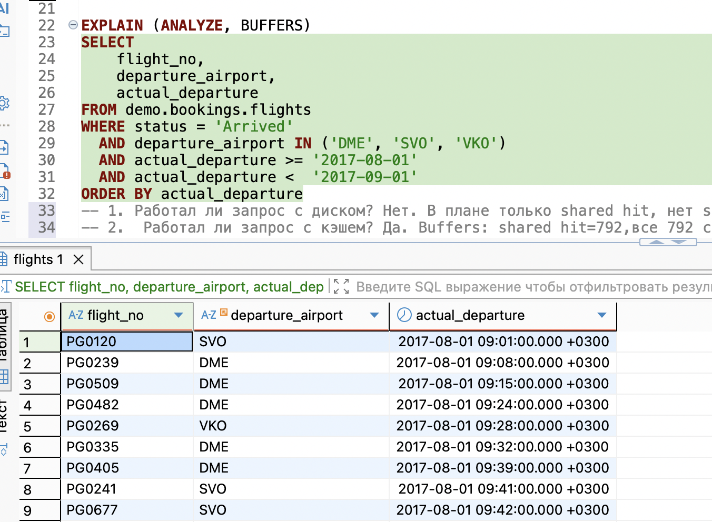

# Домашнее задание №4

**Студент:** Сальков Ефим Павлович
**Группа:** Дэ 16-25

### Скриншоты все находятся в папке "screenshots"
##### Пример скриншота:

---

``` sql
-- В классе

select airport_code 
from demo.bookings.airports
where city = 'Moscow'

-- Задача 1.1 в классе

SELECT *
FROM demo.bookings.flights 
WHERE departure_airport IN ('DME','SVO','VKO') AND status = 'Arrived' AND actual_arrival < '2017-09-01' AND actual_arrival > '2017-07-01'

/*
Задача 1.1
Выбрать все выполненные рейсы (status = 'Arrived') из московских аэропортов 
за август 2017 года: номер рейса, аэропорт вылета, фактическое время вылета. 
Отсортировать по возрастанию времени вылета.
*/


EXPLAIN (ANALYZE, BUFFERS)
SELECT 
    flight_no,
    departure_airport,
    actual_departure
FROM demo.bookings.flights
WHERE status = 'Arrived'
  AND departure_airport IN ('DME', 'SVO', 'VKO')
  AND actual_departure >= '2017-08-01'
  AND actual_departure <  '2017-09-01'
ORDER BY actual_departure
-- 1. Работал ли запрос с диском? Нет. В плане только shared hit, нет shared read. Все страцниы читались из кэша
-- 2.  Работал ли запрос с кэшем? Да. Buffers: shared hit=792,все 792 страницы взяты из кэша. Данные полностью в памяти
-- 3. Использовал ли индекс? Нет. В плане Seq Scan — полное сканирование таблицы. 
-- Общее время Execution Time: 16.922 ms
-- Всего строк -> Rows Removed by Filter: 63 751 + actual rows: 1 913 = 65 664

SELECT 
    flight_no,
    departure_airport,
    actual_departure
FROM demo.bookings.flights
WHERE status = 'Arrived'
  AND departure_airport IN (
      SELECT airport_code 
      FROM bookings.airports 
      WHERE city = 'Moscow'
  )
  AND actual_departure >= '2017-08-01'
  AND actual_departure <  '2017-09-01'
ORDER BY actual_departure
``` 

``` sql
/* 
Задача 1.2. Найти рейсы, прибывшие с опозданием более чем на 2 часа: 
номер рейса, плановое и фактическое время прибытия, опоздание в минутах. 
Самые большие опоздания — сверху.
 */

EXPLAIN (ANALYZE, BUFFERS)
SELECT flight_no, scheduled_arrival, actual_arrival,
	(EXTRACT(EPOCH FROM(actual_arrival - scheduled_arrival)) / 60) AS delay_min
FROM demo.bookings.flights
WHERE actual_arrival > scheduled_arrival + INTERVAL '2 hours'
ORDER BY delay_min DESC
-- shared hit=792 - все страницы читались из кэша
-- Seq Scan - работала без индкесов. Таблица читалась целиком. Индексов не блыо
-- Не прошло фильтор Rows Removed by Filter: 63270
-- Sort Method: quicksort Memory: 227kB - сортировка в памяти, не в диске
-- Обзщее время Execution Time: 16.957 ms
-- Оценка оптимизатора в промох - rows=20836, actual rows=2394
``` 

``` sql
/*
 Задача 1.3.
 Рейсы с номерами, начинающимися на PG04 (номера диапазона PG0400–PG0499):
 сколько выполнено рейсов каждым номером.
 */

EXPLAIN (ANALYZE, BUFFERS)
SELECT flight_no, COUNT(*) AS flights_cnt
FROM flights  
WHERE flight_no LIKE 'PG04%'
	AND status = 'Arrived'
GROUP BY flight_no
ORDER BY flights_cnt
-- Группировка выполнена через HashAggregate
-- Работал ли с диском? Нет (read=0)
-- Работал ли с кэшем? Да (shared hit=792)
-- Использовал ли индекс? Нет (Seq Scan)
``` 

``` sql
/*
Задача 2.1. Для каждого аэропорта вылета: число рейсов и
среднее опоздание прибытия в минутах. Оставить только аэропорты с
более чем 500 рейсами, отсортировать по убыванию среднего опоздания.
*/

-- черновик
SELECT flight_no, COUNT(*) AS flights_cnt, 
	ROUND(AVG(EXTRACT(EPOCH FROM(actual_arrival - scheduled_arrival))), 2)
FROM flights
GROUP BY flight_no

SELECT departure_airport, COUNT(actual_arrival) AS flights_cnt,
		ROUND(AVG(EXTRACT(EPOCH FROM(actual_arrival - scheduled_arrival)) / 60), 1) AS avg_del
FROM flights
GROUP BY departure_airport
HAVING COUNT(actual_arrival) > 500
ORDER BY avg_del DESC

EXPLAIN (ANALYZE, BUFFERS)
SELECT 
    departure_airport,
    COUNT(*) AS flights_cnt,
    ROUND(AVG(EXTRACT(EPOCH FROM (actual_arrival - scheduled_arrival)) / 60), 1) AS avg_delay_min
FROM demo.bookings.flights
WHERE actual_arrival IS NOT NULL
GROUP BY departure_airport
HAVING COUNT(*) > 500
ORDER BY avg_delay_min DESC
-- Seq Scan (65 664 строк), прошло 49 258, отсеяно 16 406. Индекс не использовался. 
-- Кэш — да (hit=792, read=0). Диск — нет. 
-- HashAggregate HAVING осталось 28 групп. Сортировка в памяти. Время 36.6 мс.
```

``` sql
/*
 * Задача 3.1.
 * Топ-10 самых дорогих проданных билетов: 
 * имя пассажира, сумма, номер рейса, город вылета и город прилёта.
*/

EXPLAIN (ANALYZE, BUFFERS)
SELECT 
    t.passenger_name,
    tf.amount,
    f.flight_no,
    dep.city AS departure_city,
    arr.city AS arrival_city
FROM demo.bookings.tickets t
JOIN demo.bookings.ticket_flights tf ON tf.ticket_no = t.ticket_no
JOIN demo.bookings.flights f ON f.flight_id = tf.flight_id
JOIN demo.bookings.airports dep ON dep.airport_code = f.departure_airport
JOIN demo.bookings.airports arr ON arr.airport_code = f.arrival_airport
ORDER BY tf.amount DESC
LIMIT 10
-- Работл с диском и кешом - shared hit=2157(кеш) read=32296(диск), temp read=16196(диск) / плохое отношение - 
-- сортировка не посместилась в память, поэтому произошла выгрузка на диск
-- Запрос выполнен - 4 Hash Join + 5 Seq Scan
-- Индексы не испльзовались, Seq Scan
``` 

``` sql
/*
 * Задача 3.2. Вывести все аэропорты с количеством вылетающих из
 * них рейсов — включая аэропорты, из которых вообще ничего не летает.
 */

EXPLAIN (ANALYZE, BUFFERS)
SELECT 
    a.airport_code,
    a.airport_name,
    COUNT(f.flight_id) AS flights_cnt
FROM airports a
LEFT JOIN flights f ON f.departure_airport = a.airport_code
GROUP BY a.airport_code, a.airport_name
ORDER BY flights_cnt
-- Один Hash Right Join, два Seq Scan; Shared hit = 795 все страницы читались из кеша. Диска не было
-- Группировка через HashAggregate
-- Execution Time: 113.235 ms
``` 

``` sql
/*
 * Задача 3.3.
 * Топ-5 пассажиров по суммарным тратам на билеты:
 * id пассажира, имя, число перелётов, суммарная стоимость.
 */ 

-- моя
EXPLAIN (ANALYZE, BUFFERS)
SELECT t.passenger_id, t.passenger_name, COUNT(f.flight_id), SUM(tf.amount)
FROM tickets t
JOIN ticket_flights tf ON t.ticket_no = tf.ticket_no
JOIN flights f ON tf.flight_id = f.flight_id
GROUP BY passenger_id, passenger_name
ORDER BY SUM(tf.amount) DESC
LIMIT 5
-- Работал МНОГО с диском (read=32167 + temp 35464/58995)
-- Частично работал с кешом, но мало по сравнению с диском (hit=2265)
-- Индексов нет, только Seq Scan

-- другое
SELECT 
    t.passenger_id, 
    t.passenger_name, 
    COUNT(*) AS flights_cnt, 
    SUM(tf.amount) AS total_spent
FROM tickets t
JOIN ticket_flights tf ON t.ticket_no = tf.ticket_no
GROUP BY t.passenger_id, t.passenger_name
ORDER BY total_spent DESC
LIMIT 5
``` 

``` sql
/*
 * 1. Группировки и многоуровневые итоги (ROLLUP): 
 * Посчитайте помесячную выручку от продажи билетов за 2017 
 * год вместе с общим итогом — одним запросом, через ROLLUP.
 * a) Оставьте только месяцы с выручкой более 10 млрд рублей (HAVING), 
 * следя за тем, чтобы итоговая строка при этом не потерялась.
 * - Приложите EXPLAIN ANALYZE. Объясните, как HAVING работает вместе 
 * б) ROLLUP и почему итоговая строка (со значением NULL в колонке месяца) проходит фильтр.
 */

-- a/б)
EXPLAIN (ANALYZE, BUFFERS)
SELECT 
    date_trunc('month', f.scheduled_departure)::date AS month,
    SUM(tf.amount) AS revenue
FROM demo.bookings.flights f
JOIN demo.bookings.ticket_flights tf ON tf.flight_id = f.flight_id
WHERE f.scheduled_departure >= '2017-01-01'
  AND f.scheduled_departure <  '2018-01-01'
GROUP BY ROLLUP (month)
HAVING SUM(tf.amount) > 10000000000 
    OR GROUPING(date_trunc('month', f.scheduled_departure)::date) = 1 -- гарантирует итог
ORDER BY month
-- Работает с диском read=18693
-- с кешем частично (hit=1822)
-- Индексов нет
-- 1 - Hash Join, 2 - Seq Scan, MixedAggregate - Rollup

-- б) HAVING - фильтр групп после агрегации,  фильтрует группы после. "GROUP BY ROLLUP(month)" - можно сказать 
-- обчаная двойная гурппировка, работает как обычно. NULL будет гарнитровать итог
-- по  GROUPING() = 1
``` 

``` sql
/*
 * 2. LEFT JOIN и условная агрегация: 
 * Для каждого аэропорта прибытия посчитайте число прибывших рейсов (status = 'Arrived'), 
 * включая аэропорты, куда не прибыл ни один рейс: код аэропорта, название, число рейсов.
 * a) Важно: условие по статусу перенесите в ON соединения, а не в WHERE. 
 * Продемонстрируйте контрольным запуском, что произойдёт с результатом, 
 * если оставить условие в WHERE.
 * б) Приложите EXPLAIN ANALYZE. Объясните, 
 * почему здесь недопустим COUNT(*), и что означает 
 * узел Hash Right Join в плане.
 */

-- а)
-- WHERE фильтрация - что оставить после соединения. Можно сказать LEFT JOIN превращается 
-- в INNER JOIN, благодаря условию ON
-- 
SELECT a.airport_code, a.airport_name, 
	COUNT(f.flight_id) AS arrived --FILTER (WHERE status = 'Arrived') AS arrived
FROM airports a
LEFT JOIN flights f ON f.arrival_airport = a.airport_code
WHERE f.status = 'Arrived'
GROUP BY a.airport_code, a.airport_name
ORDER BY arrived DESC

-- ON фильтрация - что присоединять. 
EXPLAIN (ANALYZE, BUFFERS)
SELECT a.airport_code, a.airport_name, 
	COUNT(f.flight_id) AS arrived_cnt
FROM airports a
LEFT JOIN flights f 
	ON f.arrival_airport = a.airport_code
	AND f.status = 'Arrived'
GROUP BY a.airport_code, a.airport_name
ORDER BY arrived_cnt DESC
-- Hash Right Join + 2 Seq Scan
-- кэш есть (hit=795), диска нет
-- HashAggregate - группировка

-- б) 
-- Потому что LEFT JOIN создаёт для аэропорта без рейсов 1 строку с NULL в flights. 
-- COUNT(*) посчитает её как 1, хотя рейсов 0.
-- СOUNT(f.flight_id) игнорирует NULL и будет просто 0.
-- Hash Right Join — это LEFT JOIN, только сделанный наоборот оптимизатором.
``` 

``` sql
/*
 * 3. Sargability (Оптимизация предикатов): 
 * Найдите все рейсы, выполненные (status = 'Arrived') 
 * в выходные дни (суббота и воскресенье) в августе 2017 года.
 * а) Напишите неоптимизированный запрос с EXTRACT(DOW FROM ...) или TO_CHAR(...).
 * б) Напишите оптимизированный запрос с использованием диапазонов дат.
 * в) Приложите EXPLAIN ANALYZE к обоим. Объясните разницу в планах выполнения.
 */

-- а)
EXPLAIN (ANALYZE, BUFFERS)
SELECT flight_no, scheduled_departure
FROM flights
WHERE status = 'Arrived'
  AND EXTRACT(DOW FROM scheduled_departure) IN (0, 6)
  AND EXTRACT(YEAR FROM scheduled_departure) = 2017
  AND EXTRACT(MONTH FROM scheduled_departure) = 
-- Seq Scan
-- Кеш (hit=792), диска нет
-- Время 35.6 мс

-- б)
EXPLAIN ANALYZE
SELECT flight_no, scheduled_departure
FROM flights
WHERE status = 'Arrived'
	AND (
		scheduled_departure >= '2017-08-05' AND scheduled_departure < '2017-08-07'
		OR scheduled_departure >= '2017-08-12' AND scheduled_departure < '2017-08-14'
		OR scheduled_departure >= '2017-08-19' AND scheduled_departure < '2017-08-21'
		OR scheduled_departure >= '2017-08-26' AND scheduled_departure < '2017-08-28'
)
-- Seq Scan
-- Кеш (hit=792), диска нет
-- Время 15.0 мс

-- Слияние двух способов
EXPLAIN ANALYZE
SELECT flight_no, scheduled_departure
FROM flights
WHERE status = 'Arrived'
	AND scheduled_departure >= '2017-08-01'
	AND scheduled_departure < '2017-09-01'
	AND EXTRACT(DOW FROM scheduled_departure) IN (0, 6)

-- в) Execution Time(общее время выполнения запросов), у способа 
-- с прямым сравнением в два раза быстрее, чем EXTRACT
-- Оба запроса(a, б) дают Seq Scan, но если бы у (б) были бы 
-- индексы, то у (б) было бы Index Scan
```

``` sql
/*
 * 4. ANTI-JOIN (Оптимизация отрицания): 
 * Найдите все рейсы, на которые не был продан ни один 
 * билет бизнес-класса (fare_conditions = 'Business').
 * a) Напишите запрос с использованием NOT IN.
 * б) Напишите запрос с использованием NOT EXISTS.
 * в) Приложите EXPLAIN ANALYZE к обоим. Объясните, 
 * почему NOT EXISTS работает эффективнее (Anti Join) и 
 * почему NOT IN может быть опасен при наличии NULL в данных.
 */
	
-- черновик
SELECT f.flight_no, t.passenger_id , t.passenger_name 
FROM ticket_flights tf 
JOIN flights f ON f.flight_id = tf.flight_id 
JOIN tickets t ON t.ticket_no  = tf.ticket_no
WHERE fare_conditions = 'Business'
ORDER BY f.flight_no DESC

-- NOT IN
-- Если наш рейс будет NULL (в списке равным бизнес), то рейс который 
-- будет не из бизнес класса не пападет в списиок
-- из-за возникающего UNKNOW при внутренней проверки
-- Для этого сулчая нужно использовать NOT EXISTS
EXPLAIN (ANALYZE, BUFFERS)
SELECT f.flight_id, f.flight_no
FROM flights f
WHERE f.flight_id NOT IN (
    SELECT tf.flight_id 
    FROM ticket_flights tf
    WHERE tf.fare_conditions = 'Business'
-- Узел - Seq Scan + hashed SubPlan
-- Индекс - нет
-- Кэш - hit=1851
-- Диск - read=18661 (намного больше хэша)
-- Время - 243.8 мс

-- NOT EXISTS
-- Взвращает просто ничего, если не проходит условия
-- PostgreSQL превращает NOT EXISTS в Hash Anti Join(В хеш-таблицу)
-- Проверяет все айди с айди с бизнос классом
-- EXISTS смотрит только на подходящие строки, а не на сравнение
-- значений, поэтому с NULL бдуте работать
EXPLAIN (ANALYZE, BUFFERS)
SELECT f.flight_id, f.flight_no
FROM flights f
WHERE NOT EXISTS ( -- Возвращает где True, где нет, то нет
    SELECT 1
    FROM ticket_flights tf
    WHERE tf.flight_id = f.flight_id
      AND tf.fare_conditions = 'Business'
)
-- Узел - Hash Right Anti Join (оптимизатор выворачивает)
-- Индекс - нет
-- Кэш - hit=1883
-- Диск - read=18629
-- Время - 181.2 мс (быстрее чем с NOT IN)

-- в)
-- NOT IN - Seq Scan (Execution Time: 195.714 ms). С NULL - не работает, 
-- проблемы (потому что из-за UNKNOW может пропасть рейс)
-- NOT EXISTS - Hash Right Anti Join (Execution Time: 183.514 ms). С NULL - работе, всё четко.
-- Скорость быстрее и стабильнее благодаря Hash Anti Join(хеш-таблицы)
``` 

``` sql
/*
 * 5. Индексное сканирование (Index Only Scan): 
 * Посчитайте количество рейсов для каждого статуса: 
 * SELECT status, COUNT(*) FROM flights GROUP BY status;
 * a) Запустите запрос без дополнительных индексов.
 * б) Создайте покрывающий индекс:
 * CREATE INDEX idx_flights_status ON flights(status);
 * Примечание: для Index Only Scan индекс должен содержать все запрашиваемые поля; 
 * для актуальности Visibility Map выполните VACUUM flights;.
 * в) Приложите EXPLAIN (ANALYZE, BUFFERS) до и после создания индекса. 
 * Объясните, что означает Index Only Scan и 
 * почему это значительно ускоряет запрос (ссылка на Visibility Map).
*/

EXPLAIN (ANALYZE, BUFFERS)
SELECT status, COUNT(*) 
FROM flights 
GROUP BY status
-- Index Only Scan - данные взяты из индекса
-- Heap Fetches: 0 - без обращения к таблице
-- кэш - hit=58, диска - нет (read=0)
-- GroupAggregate - сгруппировано 65 664 строк

-- До индекса и VACUUM - seq scan, читает всю таблицу, время медленней чем с индексом и вакуум, нет Heap Fetches
-- Index Only Scan означает брать данные только по индекс, не проверяя их с таблицей, как делоет просто Index Scan. 
-- После - Index Only Scan, читает только индекс, время выполнения быстрее, Heap Fetches: 0 
-- VACUUM обнавляет Visibility Map, что позволяет PostgreSQL доверять Index Only Scan


CREATE INDEX idx_flights_status -- cоздание индекса
ON flights(status)
VACUUM flights -- чтобы PostgreSQL не ходил в таблицу, а доверился индексу
``` 