**1.1**
```
EXPLAIN (ANALYZE, BUFFERS)
SELECT FLIGHT_NO, DEPARTURE_AIRPORT, STATUS, ACTUAL_DEPARTURE 
FROM bookings.flights
where STATUS = 'Arrived' 
and DEPARTURE_AIRPORT in ('SVO', 'DME', 'VKO')
and ACTUAL_DEPARTURE >= '2017-08-01'
and ACTUAL_DEPARTURE < '2017-09-01'
order by ACTUAL_DEPARTURE ASC
```

```
Sort  (cost=2304.57..2308.24 rows=1468 width=27) (actual time=9.297..9.624 rows=1913 loops=1)
  Sort Key: actual_departure
  Sort Method: quicksort  Memory: 153kB
  Buffers: shared hit=832
  ->  Seq Scan on flights  (cost=0.00..2227.36 rows=1468 width=27) (actual time=0.041..8.883 rows=1913 loops=1)
        Filter: ((actual_departure >= '2017-08-01 00:00:00+03'::timestamp with time zone) AND (actual_departure < '2017-09-01 00:00:00+03'::timestamp with time zone) AND ((status)::text = 'Arrived'::text) AND (departure_airport = ANY ('{SVO,DME,VKO}'::bpchar[])))
        Rows Removed by Filter: 63751
        Buffers: shared hit=832
Planning Time: 0.328 ms
Execution Time: 9.757 ms
```

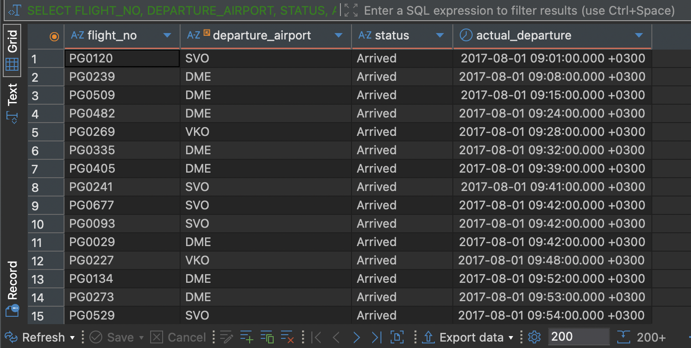

**1.2**
```
EXPLAIN (ANALYZE, BUFFERS)
SELECT flight_no, scheduled_arrival, actual_arrival, EXTRACT(EPOCH FROM actual_arrival - scheduled_arrival) / 60 AS delay_min
FROM bookings.flights
WHERE actual_arrival - scheduled_arrival > INTERVAL '2 hours'
ORDER BY delay_min DESC;
```

```
Sort  (cost=3559.01..3613.73 rows=21888 width=55) (actual time=15.354..15.463 rows=2394 loops=1)
  Sort Key: ((EXTRACT(epoch FROM (actual_arrival - scheduled_arrival)) / '60'::numeric)) DESC
  Sort Method: quicksort  Memory: 227kB
  Buffers: shared hit=832
  ->  Seq Scan on flights  (cost=0.00..1981.12 rows=21888 width=55) (actual time=0.158..14.142 rows=2394 loops=1)
        Filter: ((actual_arrival - scheduled_arrival) > '02:00:00'::interval)
        Rows Removed by Filter: 63270
        Buffers: shared hit=832
Planning Time: 0.608 ms
Execution Time: 15.612 ms
```

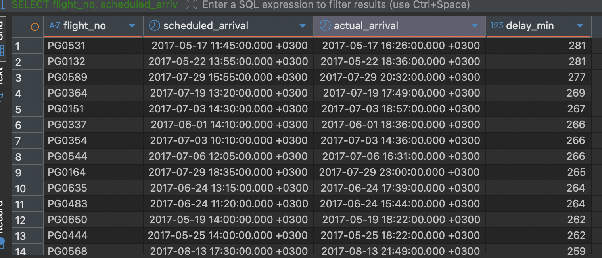


**1.3**
```
EXPLAIN (ANALYZE, BUFFERS)
select flight_no, count(FLIGHT_NO) as sum
from bookings.flights
where FLIGHT_NO like 'PG04%' 
group by FLIGHT_NO 
order by FLIGHT_NO 
```

```
  Buffers: shared hit=832
  ->  HashAggregate  (cost=1702.59..1709.69 rows=710 width=15) (actual time=10.058..10.079 rows=100 loops=1)
        Group Key: flight_no
        Batches: 1  Memory Usage: 49kB
        Buffers: shared hit=832
        ->  Seq Scan on flights  (cost=0.00..1652.80 rows=9958 width=7) (actual time=0.092..8.289 rows=9715 loops=1)
              Filter: (flight_no ~~ 'PG04%'::text)
              Rows Removed by Filter: 55949
              Buffers: shared hit=832
Planning Time: 0.324 ms
Execution Time: 10.363 ms
```

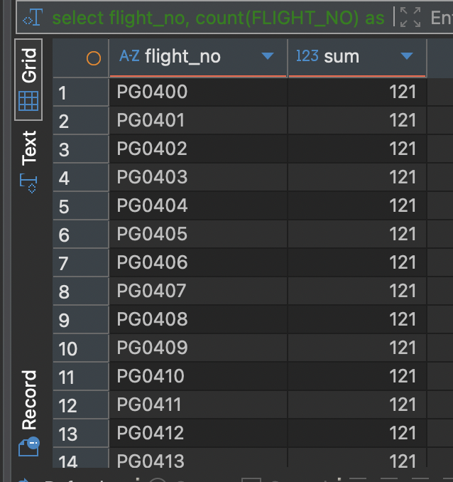

**2.1**
```
EXPLAIN (ANALYZE, BUFFERS)
select DEPARTURE_AIRPORT, count(DEPARTURE_AIRPORT) as sum, avg(EXTRACT(EPOCH FROM actual_arrival - scheduled_arrival) / 60) AS delay_min
from bookings.flights
group by DEPARTURE_AIRPORT
having count(DEPARTURE_AIRPORT) > 500
order by avg(EXTRACT(EPOCH FROM actual_arrival - scheduled_arrival) / 60)
```

```
Sort  (cost=2476.06..2476.15 rows=35 width=44) (actual time=32.048..32.050 rows=38 loops=1)
  Sort Key: (avg((EXTRACT(epoch FROM (actual_arrival - scheduled_arrival)) / '60'::numeric)))
  Sort Method: quicksort  Memory: 27kB
  Buffers: shared hit=832
  ->  HashAggregate  (cost=2473.60..2475.16 rows=35 width=44) (actual time=31.971..32.005 rows=38 loops=1)
        Group Key: departure_airport
        Filter: (count(departure_airport) > 500)
        Batches: 1  Memory Usage: 80kB
        Rows Removed by Filter: 66
        Buffers: shared hit=832
        ->  Seq Scan on flights  (cost=0.00..1488.64 rows=65664 width=20) (actual time=0.037..6.756 rows=65664 loops=1)
              Buffers: shared hit=832
Planning Time: 0.465 ms
Execution Time: 32.158 ms
```

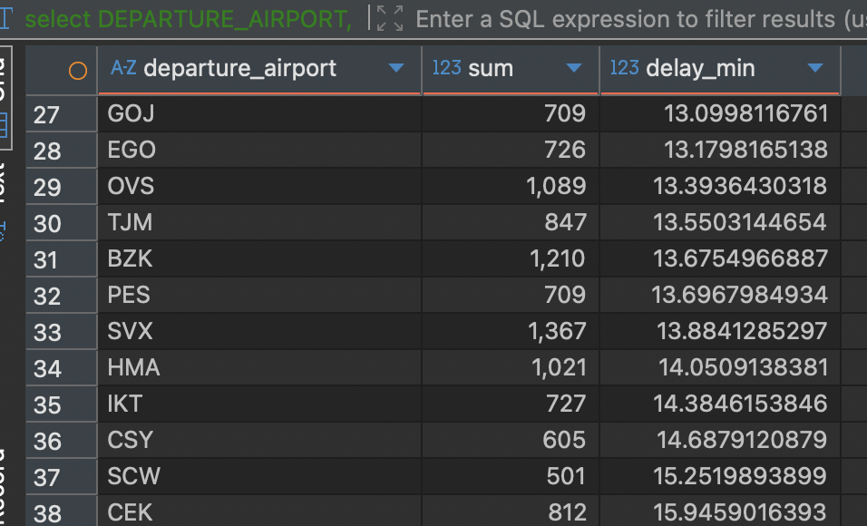


**3.1**
```
EXPLAIN (ANALYZE, BUFFERS)
select PASSENGER_NAME, AMOUNT, FLIGHT_NO, DEPARTURE_CITY, ARRIVAL_CITY
from bookings.ticket_flights
join bookings.tickets on tickets.TICKET_NO = ticket_flights.TICKET_NO
join bookings.flights_v on flights_v.FLIGHT_ID = ticket_flights.FLIGHT_ID
order by AMOUNT desc
limit 10
```

```
Limit  (cost=193470.50..193475.67 rows=10 width=93) (actual time=1639.245..1639.257 rows=10 loops=1)
  Buffers: shared hit=2300 read=32161, temp read=16196 written=16196
  ->  Result  (cost=193470.50..1414943.86 rows=2360335 width=93) (actual time=1631.763..1631.775 rows=10 loops=1)
        Buffers: shared hit=2300 read=32161, temp read=16196 written=16196
        ->  Sort  (cost=193470.50..199371.33 rows=2360335 width=127) (actual time=1631.554..1631.558 rows=10 loops=1)
              Sort Key: ticket_flights.amount DESC
              Sort Method: top-N heapsort  Memory: 28kB
              Buffers: shared hit=2280 read=32161, temp read=16196 written=16196
              ->  Hash Join  (cost=40522.22..142464.50 rows=2360335 width=127) (actual time=118.076..1433.169 rows=2360335 loops=1)
                    Hash Cond: (f.arrival_airport = ml_1.airport_code)
                    Buffers: shared hit=2277 read=32161, temp read=16196 written=16196
                    ->  Hash Join  (cost=40516.88..136010.79 rows=2360335 width=82) (actual time=118.044..1221.449 rows=2360335 loops=1)
                          Hash Cond: (f.departure_airport = ml.airport_code)
                          Buffers: shared hit=2274 read=32161, temp read=16196 written=16196
                          ->  Hash Join  (cost=40511.54..129557.08 rows=2360335 width=37) (actual time=118.024..1012.606 rows=2360335 loops=1)
                                Hash Cond: (ticket_flights.flight_id = f.flight_id)
                                Buffers: shared hit=2271 read=32161, temp read=16196 written=16196
                                ->  Hash Join  (cost=38242.10..121091.36 rows=2360335 width=26) (actual time=106.013..709.522 rows=2360335 loops=1)
                                      Hash Cond: (ticket_flights.ticket_no = tickets.ticket_no)
                                      Buffers: shared hit=1479 read=32161, temp read=16196 written=16196
                                      ->  Seq Scan on ticket_flights  (cost=0.00..43323.35 rows=2360335 width=24) (actual time=0.011..123.744 rows=2360335 loops=1)
                                            Buffers: shared hit=1411 read=18309
                                      ->  Hash  (cost=22210.71..22210.71 rows=829071 width=30) (actual time=105.790..105.790 rows=829071 loops=1)
                                            Buckets: 131072  Batches: 8  Memory Usage: 7319kB
                                            Buffers: shared hit=68 read=13852, temp written=4434
                                            ->  Seq Scan on tickets  (cost=0.00..22210.71 rows=829071 width=30) (actual time=0.004..49.882 rows=829071 loops=1)
                                                  Buffers: shared hit=68 read=13852
                                ->  Hash  (cost=1448.64..1448.64 rows=65664 width=19) (actual time=11.887..11.888 rows=65664 loops=1)
                                      Buckets: 131072  Batches: 1  Memory Usage: 4359kB
                                      Buffers: shared hit=792
                                      ->  Seq Scan on flights f  (cost=0.00..1448.64 rows=65664 width=19) (actual time=0.003..5.465 rows=65664 loops=1)
                                            Buffers: shared hit=792
                          ->  Hash  (cost=4.04..4.04 rows=104 width=53) (actual time=0.016..0.016 rows=104 loops=1)
                                Buckets: 1024  Batches: 1  Memory Usage: 17kB
                                Buffers: shared hit=3
                                ->  Seq Scan on airports_data ml  (cost=0.00..4.04 rows=104 width=53) (actual time=0.002..0.008 rows=104 loops=1)
                                      Buffers: shared hit=3
                    ->  Hash  (cost=4.04..4.04 rows=104 width=53) (actual time=0.026..0.026 rows=104 loops=1)
                          Buckets: 1024  Batches: 1  Memory Usage: 17kB
                          Buffers: shared hit=3
                          ->  Seq Scan on airports_data ml_1  (cost=0.00..4.04 rows=104 width=53) (actual time=0.008..0.016 rows=104 loops=1)
                                Buffers: shared hit=3
Planning:
  Buffers: shared hit=409 dirtied=1
Planning Time: 0.817 ms
JIT:
  Functions: 37
  Options: Inlining false, Optimization false, Expressions true, Deforming true
  Timing: Generation 0.536 ms, Inlining 0.000 ms, Optimization 0.317 ms, Emission 7.210 ms, Total 8.064 ms
Execution Time: 1648.362 ms
```

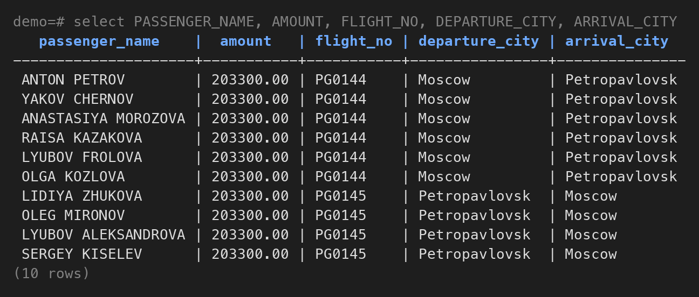

**3.2**
```
EXPLAIN (ANALYZE, BUFFERS)
select AIRPORT_CODE, AIRPORT_NAME, count(FLIGHT_ID) as sum
from bookings.airports
left join bookings.flights on DEPARTURE_AIRPORT = AIRPORT_CODE
group by AIRPORT_CODE, AIRPORT_NAME
order by count(FLIGHT_ID)
```

```
Sort  (cost=18736.79..18737.05 rows=104 width=44) (actual time=39.689..39.692 rows=104 loops=1)
  Sort Key: (count(flights.flight_id))
  Sort Method: quicksort  Memory: 31kB
  Buffers: shared hit=816
  ->  HashAggregate  (cost=18706.01..18733.31 rows=104 width=44) (actual time=39.665..39.671 rows=104 loops=1)
        Group Key: ml.airport_code, (ml.airport_name ->> lang())
        Batches: 1  Memory Usage: 32kB
        Buffers: shared hit=813
        ->  Hash Right Join  (cost=5.34..18213.53 rows=65664 width=40) (actual time=0.091..33.194 rows=65664 loops=1)
              Hash Cond: (flights.departure_airport = ml.airport_code)
              Buffers: shared hit=813
              ->  Seq Scan on flights  (cost=0.00..1448.64 rows=65664 width=8) (actual time=0.001..2.463 rows=65664 loops=1)
                    Buffers: shared hit=792
              ->  Hash  (cost=4.04..4.04 rows=104 width=65) (actual time=0.017..0.018 rows=104 loops=1)
                    Buckets: 1024  Batches: 1  Memory Usage: 18kB
                    Buffers: shared hit=3
                    ->  Seq Scan on airports_data ml  (cost=0.00..4.04 rows=104 width=65) (actual time=0.003..0.008 rows=104 loops=1)
                          Buffers: shared hit=3
Planning:
  Buffers: shared hit=204
Planning Time: 0.241 ms
Execution Time: 39.892 ms
```

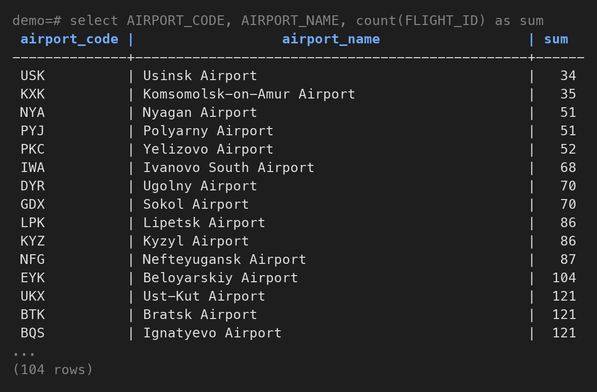

**3.3**
```
EXPLAIN (ANALYZE, BUFFERS)
select PASSENGER_ID, PASSENGER_NAME, count(FLIGHT_ID) as sum, sum(AMOUNT) as amount
from bookings.tickets
join bookings.ticket_flights on ticket_flights.TICKET_NO = tickets.TICKET_NO
group by PASSENGER_ID, PASSENGER_NAME
order by sum(AMOUNT) desc
limit 5
```

```
Limit  (cost=403674.54..403674.55 rows=5 width=68) (actual time=1620.794..1620.804 rows=5 loops=1)
  Buffers: shared hit=1610 read=32033, temp read=34790 written=58309
  ->  Sort  (cost=403674.54..405747.22 rows=829071 width=68) (actual time=1617.729..1617.738 rows=5 loops=1)
        Sort Key: (sum(ticket_flights.amount)) DESC
        Sort Method: top-N heapsort  Memory: 25kB
        Buffers: shared hit=1610 read=32033, temp read=34790 written=58309
        ->  HashAggregate  (cost=342660.35..389903.97 rows=829071 width=68) (actual time=1102.974..1550.112 rows=829071 loops=1)
              Group Key: tickets.passenger_id, tickets.passenger_name
              Planned Partitions: 64  Batches: 65  Memory Usage: 8209kB  Disk Usage: 191568kB
              Buffers: shared hit=1607 read=32033, temp read=34790 written=58309
              ->  Hash Join  (cost=39861.10..124329.36 rows=2360335 width=38) (actual time=114.931..734.622 rows=2360335 loops=1)
                    Hash Cond: (ticket_flights.ticket_no = tickets.ticket_no)
                    Buffers: shared hit=1607 read=32033, temp read=17879 written=17879
                    ->  Seq Scan on ticket_flights  (cost=0.00..43323.35 rows=2360335 width=24) (actual time=0.017..121.371 rows=2360335 loops=1)
                          Buffers: shared hit=1475 read=18245
                    ->  Hash  (cost=22210.71..22210.71 rows=829071 width=42) (actual time=114.694..114.697 rows=829071 loops=1)
                          Buckets: 131072  Batches: 16  Memory Usage: 4780kB
                          Buffers: shared hit=132 read=13788, temp written=5888
                          ->  Seq Scan on tickets  (cost=0.00..22210.71 rows=829071 width=42) (actual time=0.005..51.753 rows=829071 loops=1)
                                Buffers: shared hit=132 read=13788
Planning:
  Buffers: shared hit=272
Planning Time: 0.309 ms
JIT:
  Functions: 18
  Options: Inlining false, Optimization false, Expressions true, Deforming true
  Timing: Generation 0.364 ms, Inlining 0.000 ms, Optimization 0.297 ms, Emission 4.561 ms, Total 5.222 ms
Execution Time: 1634.649 ms
```

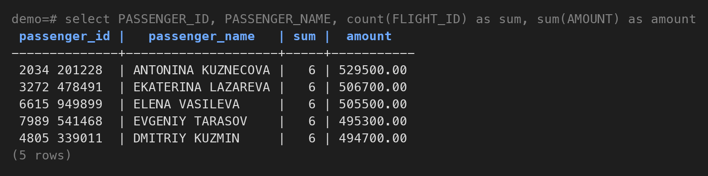

**1**
```
EXPLAIN (ANALYZE, BUFFERS)
select date_trunc('month', BOOK_DATE)::date as month, sum(TOTAL_AMOUNT) as sum
from bookings.bookings
where BOOK_DATE >= '2017-01-01'
and BOOK_DATE < '2018-01-01'
group by rollup (date_trunc('month', BOOK_DATE)::date)
having sum(TOTAL_AMOUNT) > 10000000000
order by date_trunc('month', BOOK_DATE)::date
```

```
GroupAggregate  (cost=82729.24..89288.19 rows=42182 width=36) (actual time=142.700..187.343 rows=4 loops=1)
  Group Key: ((date_trunc('month'::text, book_date))::date)
  Group Key: ()
  Filter: (sum(total_amount) > '10000000000'::numeric)
  Rows Removed by Filter: 2
  Buffers: shared hit=3827, temp read=1521 written=1530
  ->  Sort  (cost=82729.24..84212.52 rows=593314 width=10) (actual time=125.104..148.457 rows=593433 loops=1)
        Sort Key: ((date_trunc('month'::text, book_date))::date)
        Sort Method: external merge  Disk: 12168kB
        Buffers: shared hit=3827, temp read=1521 written=1530
        ->  Seq Scan on bookings  (cost=0.00..15692.06 rows=593314 width=10) (actual time=0.024..86.685 rows=593433 loops=1)
              Filter: ((book_date >= '2017-01-01 00:00:00+03'::timestamp with time zone) AND (book_date < '2018-01-01 00:00:00+03'::timestamp with time zone))
              Buffers: shared hit=3824
Planning:
  Buffers: shared hit=92
Planning Time: 0.187 ms
Execution Time: 187.932 ms
```

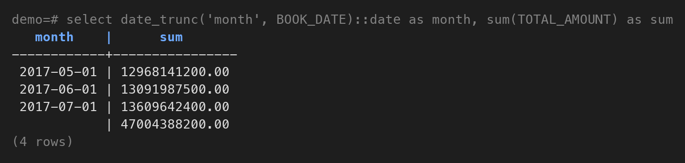

**1.** `ROLLUP` по месяцу делает сразу две группировки: по месяцу и по пустому набору `()`. В плане это видно по двум строкам `Group Key` у `GroupAggregate`. Группа `()` и есть общий итог, месяца у неё нет, поэтому в колонке стоит `NULL`.

**2.** `HAVING` в плане это строка `Filter:` у того же узла. Он проверяет каждую готовую группу, итоговая строка тут не исключение. Апрель и август отброшены (`Rows Removed by Filter: 2`). Итог проходит фильтр, потому что это сумма всех месяцев, а значит он не меньше любого месяца по отдельности. Если хоть один месяц больше 10 млрд, итог тоже больше. При этом итог считается до `HAVING`, поэтому апрель и август в нём учтены, и 47 млрд не равно сумме трёх оставшихся строк. Потерять итоговую строку можно, если в `HAVING` поставить условие на колонку месяца: сравнение с `NULL` даёт `UNKNOWN`, и строка не пройдёт.

**3.** Индекс не используется, `bookings` читается через `Seq Scan` целиком из кеша (`shared hit=3824`). Сортировка 593 тыс. строк не влезла в `work_mem` и ушла на диск: `external merge Disk: 12168kB` и `temp read/written`.

**2 ON**
```
EXPLAIN (ANALYZE, BUFFERS)
select AIRPORT_CODE, AIRPORT_NAME, count(FLIGHT_ID) as sum
from bookings.airports
left join bookings.flights on ARRIVAL_AIRPORT = AIRPORT_CODE and STATUS = 'Arrived'
group by AIRPORT_CODE, AIRPORT_NAME
order by count(FLIGHT_ID)
```

```
Sort  (cost=14554.05..14554.31 rows=104 width=44) (actual time=34.349..34.353 rows=104 loops=1)
  Sort Key: (count(flights.flight_id))
  Sort Method: quicksort  Memory: 31kB
  Buffers: shared hit=813
  ->  HashAggregate  (cost=14523.27..14550.57 rows=104 width=44) (actual time=34.318..34.326 rows=104 loops=1)
        Group Key: ml.airport_code, (ml.airport_name ->> lang())
        Batches: 1  Memory Usage: 32kB
        Buffers: shared hit=810
        ->  Hash Right Join  (cost=5.34..14154.88 rows=49119 width=40) (actual time=0.158..29.251 rows=49235 loops=1)
              Hash Cond: (flights.arrival_airport = ml.airport_code)
              Buffers: shared hit=810
              ->  Seq Scan on flights  (cost=0.00..1612.80 rows=49119 width=8) (actual time=0.007..5.117 rows=49235 loops=1)
                    Filter: ((status)::text = 'Arrived'::text)
                    Rows Removed by Filter: 16429
                    Buffers: shared hit=792
              ->  Hash  (cost=4.04..4.04 rows=104 width=65) (actual time=0.027..0.028 rows=104 loops=1)
                    Buckets: 1024  Batches: 1  Memory Usage: 18kB
                    Buffers: shared hit=3
                    ->  Seq Scan on airports_data ml  (cost=0.00..4.04 rows=104 width=65) (actual time=0.004..0.013 rows=104 loops=1)
                          Buffers: shared hit=3
Planning:
  Buffers: shared hit=207
Planning Time: 0.473 ms
Execution Time: 34.753 ms
```


**2 WHERE**
```
select AIRPORT_CODE, AIRPORT_NAME, count(FLIGHT_ID) as sum
from bookings.airports
left join bookings.flights on ARRIVAL_AIRPORT = AIRPORT_CODE
where STATUS = 'Arrived'
group by AIRPORT_CODE, AIRPORT_NAME
order by count(FLIGHT_ID)
```

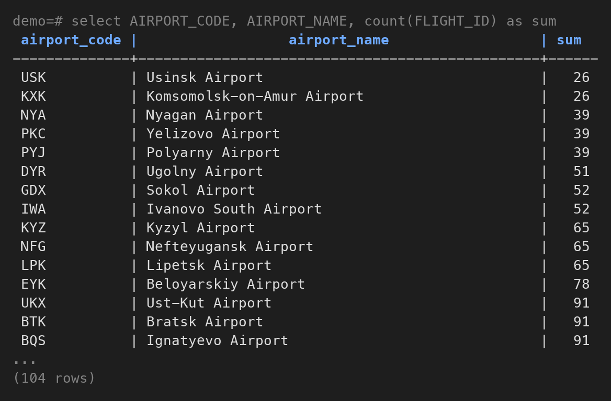

**2 ON 01.08**
```
select AIRPORT_CODE, AIRPORT_NAME, count(FLIGHT_ID) as sum
from bookings.airports
left join bookings.flights on ARRIVAL_AIRPORT = AIRPORT_CODE and STATUS = 'Arrived'
and ACTUAL_ARRIVAL >= '2017-08-01' and ACTUAL_ARRIVAL < '2017-08-02'
group by AIRPORT_CODE, AIRPORT_NAME
order by count(FLIGHT_ID)
```

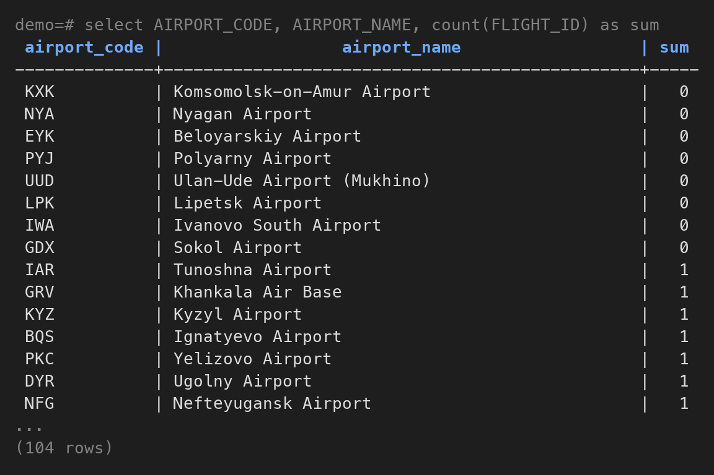

**2 WHERE 01.08**
```
select AIRPORT_CODE, AIRPORT_NAME, count(FLIGHT_ID) as sum
from bookings.airports
left join bookings.flights on ARRIVAL_AIRPORT = AIRPORT_CODE
where STATUS = 'Arrived'
and ACTUAL_ARRIVAL >= '2017-08-01' and ACTUAL_ARRIVAL < '2017-08-02'
group by AIRPORT_CODE, AIRPORT_NAME
order by count(FLIGHT_ID)
```

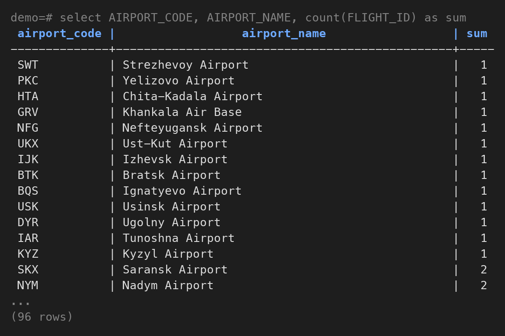

**1.** На всех данных условие в `ON` и в `WHERE` дают одно и то же: 104 строки, потому что в каждый аэропорт что-то прилетало. Поэтому контрольный запуск сделан за один день, 01.08.2017. С условием в `ON` выводятся все 104 аэропорта, у 8 из них 0 рейсов. С условием в `WHERE` остаётся 96: у аэропортов без рейсов в колонках `flights` стоит `NULL`, `STATUS = 'Arrived'` для них не выполняется, и `WHERE` эти строки выкидывает. `LEFT JOIN` по сути превращается в обычный `JOIN`.

**2.** `COUNT(*)` считает строки, а у аэропорта без рейсов после `LEFT JOIN` всё равно остаётся одна строка, просто с `NULL` справа. `COUNT(*)` даст для него 1, а `COUNT(FLIGHT_ID)` пропускает `NULL` и даёт 0.

**3.** `Hash Right Join` значит, что в хеш положили меньшую таблицу, 104 аэропорта, а `flights` прочитали через `Seq Scan` и проверили каждую строку по хешу. Right - потому что сохраняются все строки той стороны, которая лежит в хеше, то есть аэропортов. Это тот же `LEFT JOIN`, просто планировщик поменял стороны местами.

**4.** Индексы не используются, обе таблицы читаются через `Seq Scan` из кеша (`shared hit=813`), на диск ничего не уходило.

**3 индекс**
```
create index idx_flights_actual_departure on bookings.flights(ACTUAL_DEPARTURE)
```

**3 EXTRACT**
```
EXPLAIN (ANALYZE, BUFFERS)
select FLIGHT_NO, DEPARTURE_AIRPORT, ACTUAL_DEPARTURE
from bookings.flights
where STATUS = 'Arrived'
and EXTRACT(DOW FROM ACTUAL_DEPARTURE) in (0, 6)
and to_char(ACTUAL_DEPARTURE, 'YYYY-MM') = '2017-08'
order by ACTUAL_DEPARTURE ASC
```

```
Sort  (cost=2269.45..2269.46 rows=2 width=19) (actual time=10.073..10.126 rows=2251 loops=1)
  Sort Key: actual_departure
  Sort Method: quicksort  Memory: 202kB
  Buffers: shared hit=795
  ->  Seq Scan on flights  (cost=0.00..2269.44 rows=2 width=19) (actual time=0.059..9.816 rows=2251 loops=1)
        Filter: (((status)::text = 'Arrived'::text) AND (EXTRACT(dow FROM actual_departure) = ANY ('{0,6}'::numeric[])) AND (to_char(actual_departure, 'YYYY-MM'::text) = '2017-08'::text))
        Rows Removed by Filter: 63413
        Buffers: shared hit=792
Planning:
  Buffers: shared hit=186 read=1
Planning Time: 0.234 ms
Execution Time: 10.181 ms
```


**3 диапазоны**
```
EXPLAIN (ANALYZE, BUFFERS)
select FLIGHT_NO, DEPARTURE_AIRPORT, ACTUAL_DEPARTURE
from bookings.flights
where STATUS = 'Arrived'
and (ACTUAL_DEPARTURE >= '2017-08-05' and ACTUAL_DEPARTURE < '2017-08-07'
or ACTUAL_DEPARTURE >= '2017-08-12' and ACTUAL_DEPARTURE < '2017-08-14'
or ACTUAL_DEPARTURE >= '2017-08-19' and ACTUAL_DEPARTURE < '2017-08-21'
or ACTUAL_DEPARTURE >= '2017-08-26' and ACTUAL_DEPARTURE < '2017-08-28')
order by ACTUAL_DEPARTURE ASC
```

```
Sort  (cost=999.78..1003.70 rows=1568 width=19) (actual time=1.107..1.166 rows=2251 loops=1)
  Sort Key: actual_departure
  Sort Method: quicksort  Memory: 202kB
  Buffers: shared hit=762 read=8
  ->  Bitmap Heap Scan on flights  (cost=55.89..916.56 rows=1568 width=19) (actual time=0.156..0.856 rows=2251 loops=1)
        Recheck Cond: (((actual_departure >= '2017-08-05 00:00:00+03'::timestamp with time zone) AND (actual_departure < '2017-08-07 00:00:00+03'::timestamp with time zone)) OR ((actual_departure >= '2017-08-12 00:00:00+03'::timestamp with time zone) AND (actual_departure < '2017-08-14 00:00:00+03'::timestamp with time zone)) OR ((actual_departure >= '2017-08-19 00:00:00+03'::timestamp with time zone) AND (actual_departure < '2017-08-21 00:00:00+03'::timestamp with time zone)) OR ((actual_departure >= '2017-08-26 00:00:00+03'::timestamp with time zone) AND (actual_departure < '2017-08-28 00:00:00+03'::timestamp with time zone)))
        Filter: ((status)::text = 'Arrived'::text)
        Rows Removed by Filter: 1
        Heap Blocks: exact=753
        Buffers: shared hit=759 read=8
        ->  BitmapOr  (cost=55.89..55.89 rows=2113 width=0) (actual time=0.110..0.110 rows=0 loops=1)
              Buffers: shared hit=6 read=8
              ->  Bitmap Index Scan on idx_flights_actual_departure  (cost=0.00..22.77 rows=1048 width=0) (actual time=0.066..0.066 rows=1126 loops=1)
                    Index Cond: ((actual_departure >= '2017-08-05 00:00:00+03'::timestamp with time zone) AND (actual_departure < '2017-08-07 00:00:00+03'::timestamp with time zone))
                    Buffers: shared hit=1 read=4
              ->  Bitmap Index Scan on idx_flights_actual_departure  (cost=0.00..22.94 rows=1065 width=0) (actual time=0.042..0.042 rows=1126 loops=1)
                    Index Cond: ((actual_departure >= '2017-08-12 00:00:00+03'::timestamp with time zone) AND (actual_departure < '2017-08-14 00:00:00+03'::timestamp with time zone))
                    Buffers: shared hit=1 read=4
              ->  Bitmap Index Scan on idx_flights_actual_departure  (cost=0.00..4.30 rows=1 width=0) (actual time=0.001..0.001 rows=0 loops=1)
                    Index Cond: ((actual_departure >= '2017-08-19 00:00:00+03'::timestamp with time zone) AND (actual_departure < '2017-08-21 00:00:00+03'::timestamp with time zone))
                    Buffers: shared hit=2
              ->  Bitmap Index Scan on idx_flights_actual_departure  (cost=0.00..4.30 rows=1 width=0) (actual time=0.000..0.000 rows=0 loops=1)
                    Index Cond: ((actual_departure >= '2017-08-26 00:00:00+03'::timestamp with time zone) AND (actual_departure < '2017-08-28 00:00:00+03'::timestamp with time zone))
                    Buffers: shared hit=2
Planning:
  Buffers: shared hit=148 read=2
Planning Time: 0.195 ms
Execution Time: 1.245 ms
```

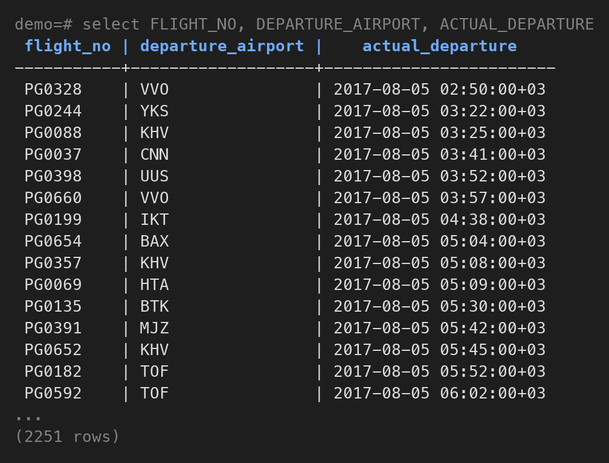

**1.** Индекс по `ACTUAL_DEPARTURE` создан перед обоими запросами, оба возвращают 2251 рейс. В первом запросе к колонке применяются `EXTRACT` и `to_char`. Индекс хранит значения самой колонки, а не результат функции от неё, поэтому использовать его нельзя: `Seq Scan` по всей таблице, `Rows Removed by Filter: 63413`, примерно 10 мс. Посчитать такое выражение заранее планировщик тоже не может, поэтому ждёт 2 строки вместо 2251.

**2.** Во втором запросе выходные заданы диапазонами по самой колонке, и индекс работает. Идут 4 `Bitmap Index Scan`, по одному на каждые выходные, результаты объединяются в `BitmapOr`, потом `Bitmap Heap Scan` читает только нужные страницы таблицы. Время примерно 1,2 мс, то есть быстрее раз в 8.

**3.** Первый запрос без индекса, все страницы из кеша (`shared hit=792`). Второй использует индекс, 8 страниц индекса прочитаны с диска (`read=8`), остальное из кеша.

**7 NOT IN**
```
EXPLAIN (ANALYZE, BUFFERS)
select FLIGHT_ID, FLIGHT_NO, SCHEDULED_DEPARTURE
from bookings.flights
where FLIGHT_ID not in (select FLIGHT_ID from bookings.ticket_flights where FARE_CONDITIONS = 'Business')
```

```
Seq Scan on flights  (cost=49818.40..51431.20 rows=32832 width=19) (actual time=100.760..108.644 rows=41705 loops=1)
  Filter: (NOT (hashed SubPlan 1))
  Rows Removed by Filter: 23959
  Buffers: shared hit=2331 read=18181
  SubPlan 1
    ->  Seq Scan on ticket_flights  (cost=0.00..49224.19 rows=237686 width=4) (actual time=16.374..82.628 rows=242204 loops=1)
          Filter: ((fare_conditions)::text = 'Business'::text)
          Rows Removed by Filter: 2118131
          Buffers: shared hit=1539 read=18181
Planning:
  Buffers: shared hit=131
Planning Time: 0.194 ms
Execution Time: 109.557 ms
```

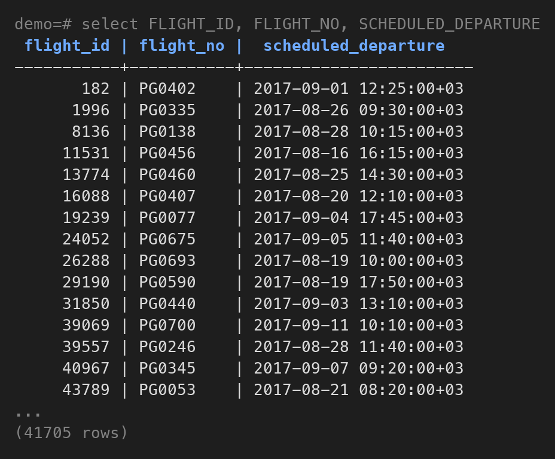

**7 NOT EXISTS**
```
EXPLAIN (ANALYZE, BUFFERS)
select FLIGHT_ID, FLIGHT_NO, SCHEDULED_DEPARTURE
from bookings.flights
where not exists (select 1 from bookings.ticket_flights where ticket_flights.FLIGHT_ID = flights.FLIGHT_ID and FARE_CONDITIONS = 'Business')
```

```
Hash Right Anti Join  (cost=2269.44..53240.47 rows=37779 width=19) (actual time=99.127..102.578 rows=41705 loops=1)
  Hash Cond: (ticket_flights.flight_id = flights.flight_id)
  Buffers: shared hit=2395 read=18117
  ->  Seq Scan on ticket_flights  (cost=0.00..49224.19 rows=237686 width=4) (actual time=13.418..75.870 rows=242204 loops=1)
        Filter: ((fare_conditions)::text = 'Business'::text)
        Rows Removed by Filter: 2118131
        Buffers: shared hit=1603 read=18117
  ->  Hash  (cost=1448.64..1448.64 rows=65664 width=19) (actual time=7.881..7.882 rows=65664 loops=1)
        Buckets: 131072  Batches: 1  Memory Usage: 4615kB
        Buffers: shared hit=792
        ->  Seq Scan on flights  (cost=0.00..1448.64 rows=65664 width=19) (actual time=0.003..3.158 rows=65664 loops=1)
              Buffers: shared hit=792
Planning:
  Buffers: shared hit=259
Planning Time: 0.261 ms
Execution Time: 103.453 ms
```

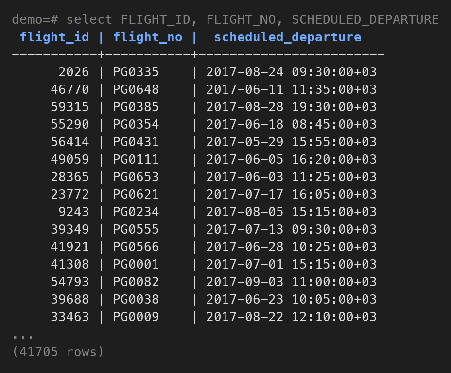

**1.** Оба запроса возвращают 41 705 рейсов. `NOT EXISTS` планировщик превратил в `Hash Right Anti Join`: рейсы лежат в хеше, билеты бизнес-класса проверяются по нему, и рейс отбрасывается при первом же совпадении. `NOT IN` стал `hashed SubPlan`: результат подзапроса кладётся в хеш, и каждая строка проверяется по нему. Здесь хеш влез в `work_mem`, поэтому разница маленькая, 109 и 103 мс. Если хеш не влезет, `NOT IN` выполнит подзапрос для каждой строки, и запрос станет очень медленным, а анти-джойн так не деградирует.

**2.** `x NOT IN (a, b, NULL)` раскрывается в `x <> a AND x <> b AND x <> NULL`. Сравнение с `NULL` даёт `UNKNOWN`, поэтому всё условие тоже `UNKNOWN`, и `WHERE` не пропускает ни одной строки. Достаточно одного `NULL` в подзапросе, чтобы результат стал пустым. `NOT EXISTS` только проверяет, нашлась ли строка, и всегда возвращает `TRUE` или `FALSE`, поэтому такой ловушки нет.

**3.** Индексы не используются, `ticket_flights` в обоих запросах читается через `Seq Scan`. Около 18 тыс. страниц прочитано с диска (`read=18181` и `read=18117`), остальное из кеша.

**8 до индекса**
```
EXPLAIN (ANALYZE, BUFFERS)
select STATUS, count(*) as sum
from bookings.flights
group by STATUS
```

```
HashAggregate  (cost=1776.96..1777.02 rows=6 width=16) (actual time=7.277..7.277 rows=6 loops=1)
  Group Key: status
  Batches: 1  Memory Usage: 24kB
  Buffers: shared hit=792
  ->  Seq Scan on flights  (cost=0.00..1448.64 rows=65664 width=8) (actual time=0.002..2.060 rows=65664 loops=1)
        Buffers: shared hit=792
Planning:
  Buffers: shared hit=132
Planning Time: 0.121 ms
Execution Time: 7.301 ms
```

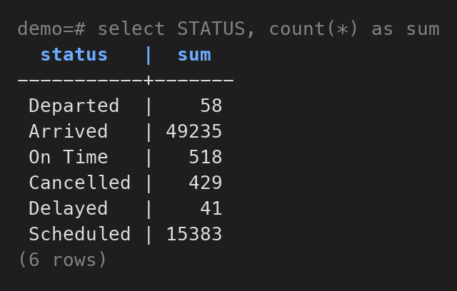

**8 индекс**
```
CREATE INDEX idx_flights_status ON bookings.flights(status);
VACUUM bookings.flights
```

**8 после индекса**
```
EXPLAIN (ANALYZE, BUFFERS)
select STATUS, count(*) as sum
from bookings.flights
group by STATUS
```

```
GroupAggregate  (cost=0.29..1545.63 rows=6 width=16) (actual time=3.510..4.629 rows=6 loops=1)
  Group Key: status
  Buffers: shared hit=1 read=57
  ->  Index Only Scan using idx_flights_status on flights  (cost=0.29..1217.25 rows=65664 width=8) (actual time=0.021..2.249 rows=65664 loops=1)
        Heap Fetches: 0
        Buffers: shared hit=1 read=57
Planning:
  Buffers: shared hit=149
Planning Time: 0.138 ms
Execution Time: 4.648 ms
```

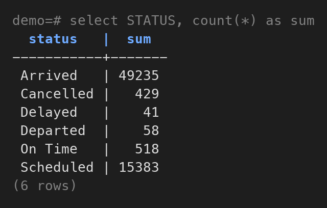

**1.** До индекса: `Seq Scan` по всей таблице, 792 страницы, потом `HashAggregate`, 7,3 мс. После индекса и `VACUUM`: `Index Only Scan` по `idx_flights_status`, всего 58 страниц, потом `GroupAggregate`, 4,6 мс. Хеш уже не нужен, потому что из индекса строки приходят отсортированными по `status`.

**2.** `Index Only Scan` значит, что `status` берётся прямо из индекса, и в саму таблицу PostgreSQL не ходит. Обычно ему всё равно нужно проверить в таблице, видна ли строка текущей транзакции. `VACUUM` отмечает в Visibility Map страницы, где все строки видны всем, и для таких страниц проверка не нужна, поэтому `Heap Fetches: 0`. Индекс сильно меньше таблицы, 58 страниц против 792, отсюда и ускорение.

**3.** До индекса индексы не используются, всё из кеша (`shared hit=792`). После используется индекс, 57 его страниц прочитаны с диска (`read=57`), потому что он только что создан и в кеш ещё не попал.
