# ДЗ к семинару 4

База: `project_db`, схема `bookings` (demo-medium-en-20170815). Данные заканчиваются 15.08.2017.
PostgreSQL 16 в Docker, запросы выполнялись в DBeaver, время — московское.

Все запросы лежат в файле [queries.sql](queries.sql), полный вывод — в [psql_output.txt](psql_output.txt).

**Как я читаю `Buffers` в плане:**
- `shared hit` — страницы, которые нашлись в кеше PostgreSQL (в памяти);
- `shared read` — страниц не было в кеше, их пришлось читать с диска;
- `temp read/written` — запросу не хватило памяти (`work_mem` = 4 МБ), и он писал временные файлы на диск.

Кеш (`shared_buffers`) — 128 МБ. Таблицы `flights` (6,5 МБ) и `bookings` (30 МБ) в него помещаются целиком, а `tickets` (109 МБ) и `ticket_flights` (154 МБ) вместе — нет.

## Как запустить

1. Загрузить дамп `demo-medium-en-20170815.sql` (из `СУБД_2/семинар_3/data`). Он создаёт базу `demo`:
   ```bash
   psql -U postgres -f demo-medium-en-20170815.sql
   ```
2. Скопировать схему `bookings` в базу `project_db`:
   ```bash
   pg_dump -U postgres -d demo -n bookings --no-owner | psql -U student -d project_db
   ```
3. Чтобы таблицы находились без имени схемы и названия были на английском:
   ```sql
   ALTER DATABASE project_db SET search_path = bookings, public;
   ALTER DATABASE project_db SET bookings.lang = en;
   ```
4. Открыть файл с запросами в DBeaver, подключиться к `project_db` и выполнять запросы по одному: курсор в запрос, `Ctrl+Enter`. Часовой пояс сессии — `Europe/Moscow`.

---

## 0. Курс на Stepik

_Скриншот сертификата — добавить после прохождения курса._

---

# Задачи с семинара

## Задача 1.1

```sql
SELECT flight_no, departure_airport, actual_departure
FROM flights
WHERE status = 'Arrived'
  AND departure_airport IN (SELECT airport_code FROM airports WHERE city = 'Moscow')
  AND actual_departure >= '2017-08-01' AND actual_departure < '2017-09-01'
ORDER BY actual_departure;
```

Результат: 1913 строк (рейсы только до 15 августа, дальше в базе нет выполненных рейсов).

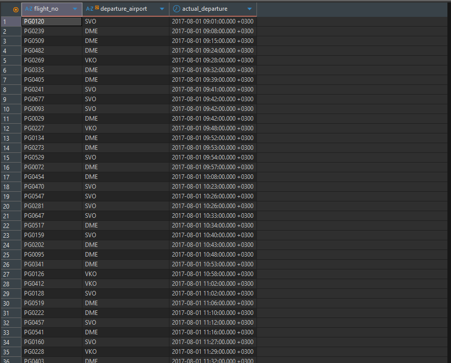

```
 Sort  (cost=1990.18..1990.33 rows=59 width=19) (actual time=4.471..4.541 rows=1913 loops=1)
   Sort Key: flights.actual_departure
   Sort Method: quicksort  Memory: 138kB
   Buffers: shared hit=795
   ->  Hash Join  (cost=30.57..1988.45 rows=59 width=19) (actual time=0.081..4.199 rows=1913 loops=1)
         Hash Cond: (flights.departure_airport = ml.airport_code)
         Buffers: shared hit=795
         ->  Seq Scan on flights  (cost=0.00..1941.12 rows=6133 width=19) (actual time=0.006..3.673 rows=8021 loops=1)
               Filter: ((actual_departure >= '2017-08-01 00:00:00+03'::timestamp with time zone) AND (actual_departure < '2017-09-01 00:00:00+03'::timestamp with time zone) AND ((status)::text = 'Arrived'::text))
               Rows Removed by Filter: 57643
               Buffers: shared hit=792
         ->  Hash  (cost=30.56..30.56 rows=1 width=4) (actual time=0.070..0.070 rows=3 loops=1)
               Buckets: 1024  Batches: 1  Memory Usage: 9kB
               Buffers: shared hit=3
               ->  Seq Scan on airports_data ml  (cost=0.00..30.56 rows=1 width=4) (actual time=0.022..0.068 rows=3 loops=1)
                     Filter: ((city ->> lang()) = 'Moscow'::text)
                     Rows Removed by Filter: 101
                     Buffers: shared hit=3
 Planning:
   Buffers: shared hit=4
 Planning Time: 0.102 ms
 Execution Time: 4.616 ms
```

**Вывод.** С диском запрос не работал: везде `shared hit`, `read` нет, всё взято из кеша. Индекс не использовался: по `status` и `actual_departure` индексов нет, поэтому `flights` читается целиком (Seq Scan). Подзапрос с московскими аэропортами PostgreSQL превратил в Hash Join с тремя аэропортами.

---

## Задача 1.2

```sql
SELECT flight_no, scheduled_arrival, actual_arrival,
       ROUND(EXTRACT(EPOCH FROM (actual_arrival - scheduled_arrival)) / 60) AS delay_minutes
FROM flights
WHERE actual_arrival - scheduled_arrival > INTERVAL '2 hours'
ORDER BY delay_minutes DESC;
```

Результат: 2394 строки, самое большое опоздание — 281 минута.

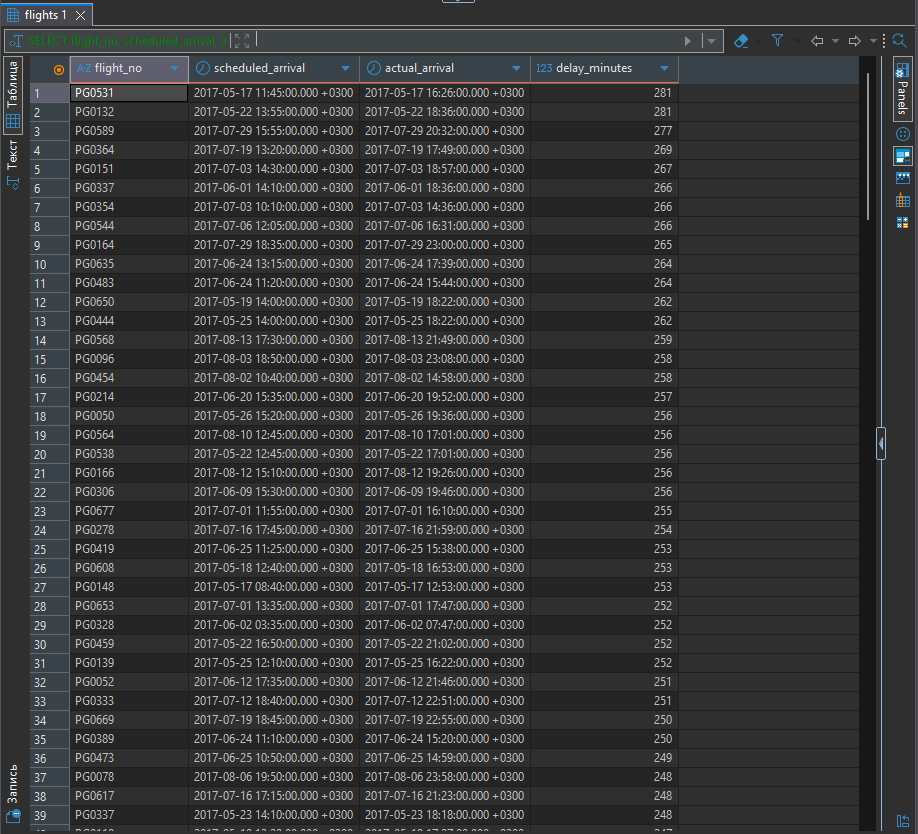

```
 Sort  (cost=3573.73..3628.45 rows=21888 width=55) (actual time=5.250..5.314 rows=2394 loops=1)
   Sort Key: (round((EXTRACT(epoch FROM (actual_arrival - scheduled_arrival)) / '60'::numeric), 0)) DESC
   Sort Method: quicksort  Memory: 227kB
   Buffers: shared hit=792
   ->  Seq Scan on flights  (cost=0.00..1995.84 rows=21888 width=55) (actual time=0.008..4.769 rows=2394 loops=1)
         Filter: ((actual_arrival - scheduled_arrival) > '02:00:00'::interval)
         Rows Removed by Filter: 63270
         Buffers: shared hit=792
 Planning Time: 0.046 ms
 Execution Time: 5.389 ms
```

**Вывод.** Всё из кеша (`shared hit=792`, `read` нет). Индекс не использовался: условие — это разница двух столбцов, по такому выражению индекс не построен, поэтому вся таблица читается целиком. Сортировка прошла в памяти (quicksort).

---

## Задача 1.3

```sql
SELECT flight_no, COUNT(*) AS flights_count
FROM flights
WHERE flight_no LIKE 'PG04%'
  AND status = 'Arrived'
GROUP BY flight_no
ORDER BY flight_no;
```

Результат: 100 строк (PG0400–PG0499). У большинства номеров (74 из 100) 90–91 выполненный рейс: они летают каждый день. У остальных от 12 до 39 рейсов: они летают раз или несколько раз в неделю.

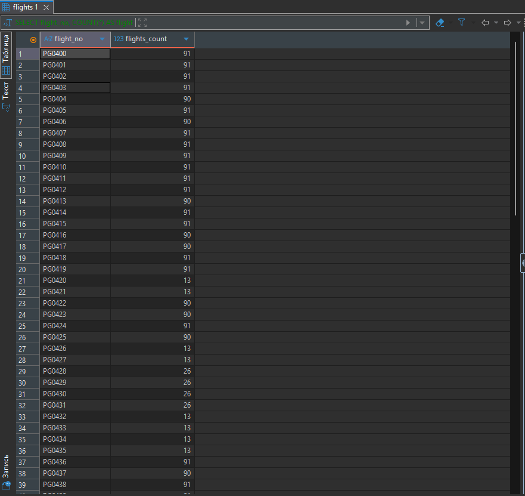

```
 Sort  (cost=1853.98..1855.75 rows=710 width=15) (actual time=4.819..4.822 rows=100 loops=1)
   Sort Key: flight_no
   Sort Method: quicksort  Memory: 28kB
   Buffers: shared hit=792
   ->  HashAggregate  (cost=1813.26..1820.36 rows=710 width=15) (actual time=4.756..4.764 rows=100 loops=1)
         Group Key: flight_no
         Batches: 1  Memory Usage: 49kB
         Buffers: shared hit=792
         ->  Seq Scan on flights  (cost=0.00..1776.96 rows=7259 width=7) (actual time=0.006..4.061 rows=7284 loops=1)
               Filter: ((flight_no ~~ 'PG04%'::text) AND ((status)::text = 'Arrived'::text))
               Rows Removed by Filter: 58380
               Buffers: shared hit=792
 Planning Time: 0.055 ms
 Execution Time: 4.846 ms
```

**Вывод.** Всё из кеша (`shared hit=792`, `read` нет). Индекс по `flight_no` в таблице есть, но для `LIKE` он не использовался. При сортировке строк `en_US.utf8` обычный B-tree индекс не подходит для поиска по началу строки через `LIKE`, поэтому вышел Seq Scan. Если записать условие диапазоном `flight_no BETWEEN 'PG0400' AND 'PG0499'`, индекс используется.

---

## Задача 2.1

```sql
SELECT departure_airport,
       COUNT(*) AS flights_count,
       ROUND(AVG(EXTRACT(EPOCH FROM (actual_arrival - scheduled_arrival)) / 60), 2) AS avg_delay_minutes
FROM flights
WHERE status = 'Arrived'
GROUP BY departure_airport
HAVING COUNT(*) > 500
ORDER BY avg_delay_minutes DESC;
```

Считаю только выполненные рейсы: опоздание есть только у них. Результат: 28 аэропортов, больше всего опаздывают рейсы из CEK (Челябинск), в среднем на 15,99 минуты.

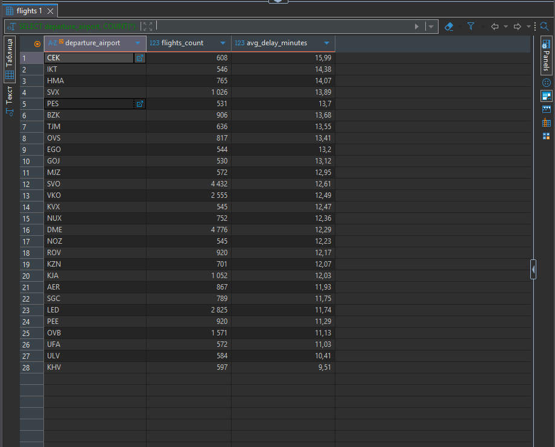

```
 Sort  (cost=2356.56..2356.64 rows=35 width=44) (actual time=16.151..16.153 rows=28 loops=1)
   Sort Key: (round(avg((EXTRACT(epoch FROM (actual_arrival - scheduled_arrival)) / '60'::numeric)), 2)) DESC
   Sort Method: quicksort  Memory: 26kB
   Buffers: shared hit=792
   ->  HashAggregate  (cost=2354.01..2355.66 rows=35 width=44) (actual time=16.121..16.143 rows=28 loops=1)
         Group Key: departure_airport
         Filter: (count(*) > 500)
         Batches: 1  Memory Usage: 80kB
         Rows Removed by Filter: 76
         Buffers: shared hit=792
         ->  Seq Scan on flights  (cost=0.00..1612.80 rows=49414 width=20) (actual time=0.004..5.092 rows=49235 loops=1)
               Filter: ((status)::text = 'Arrived'::text)
               Rows Removed by Filter: 16429
               Buffers: shared hit=792
 Planning Time: 0.047 ms
 Execution Time: 16.170 ms
```

**Вывод.** Всё из кеша (`shared hit=792`, `read` нет). Индекс не использовался: выполненных рейсов около 75 % таблицы, проще прочитать её всю. `HAVING` в плане виден как `Filter: (count(*) > 500)` у HashAggregate: отсеяно 76 аэропортов.

---

## Задача 3.1

```sql
SELECT tickets.passenger_name, ticket_flights.amount, flights.flight_no,
       (SELECT city FROM airports WHERE airport_code = flights.departure_airport) AS city_from,
       (SELECT city FROM airports WHERE airport_code = flights.arrival_airport) AS city_to
FROM ticket_flights
JOIN tickets ON ticket_flights.ticket_no = tickets.ticket_no
JOIN flights ON ticket_flights.flight_id = flights.flight_id
ORDER BY ticket_flights.amount DESC
LIMIT 10;
```

Сумма берётся из `ticket_flights`, имя — из `tickets`, номер рейса — из `flights`. Города достаю из `airports` подзапросами: первый находит город по аэропорту вылета, второй — по аэропорту прилёта.

Результат: 10 билетов по 203 300 руб. (бизнес-класс Москва — Петропавловск-Камчатский и обратно). Билетов с такой ценой больше десяти, поэтому имена пассажиров в разных запусках могут отличаться.

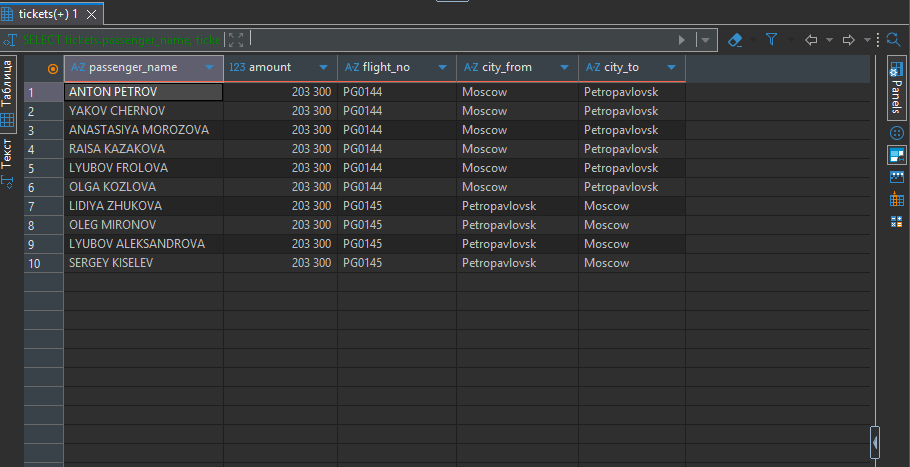

```
 Limit  (cost=180563.07..180654.25 rows=10 width=93) (actual time=1527.382..1527.499 rows=10 loops=1)
   Buffers: shared hit=1397 read=33095, temp read=16196 written=16196
   ->  Result  (cost=180563.07..21700917.43 rows=2360335 width=93) (actual time=1520.681..1520.796 rows=10 loops=1)
         Buffers: shared hit=1397 read=33095, temp read=16196 written=16196
         ->  Sort  (cost=180563.07..186463.91 rows=2360335 width=37) (actual time=1520.579..1520.582 rows=10 loops=1)
               Sort Key: ticket_flights.amount DESC
               Sort Method: top-N heapsort  Memory: 26kB
               Buffers: shared hit=1337 read=33095, temp read=16196 written=16196
               ->  Hash Join  (cost=40511.54..129557.08 rows=2360335 width=37) (actual time=176.256..1257.447 rows=2360335 loops=1)
                     Hash Cond: (ticket_flights.flight_id = flights.flight_id)
                     Buffers: shared hit=1337 read=33095, temp read=16196 written=16196
                     ->  Hash Join  (cost=38242.10..121091.36 rows=2360335 width=26) (actual time=166.357..959.348 rows=2360335 loops=1)
                           Hash Cond: (ticket_flights.ticket_no = tickets.ticket_no)
                           Buffers: shared hit=545 read=33095, temp read=16196 written=16196
                           ->  Seq Scan on ticket_flights  (cost=0.00..43323.35 rows=2360335 width=24) (actual time=0.065..131.775 rows=2360335 loops=1)
                                 Buffers: shared hit=353 read=19367
                           ->  Hash  (cost=22210.71..22210.71 rows=829071 width=30) (actual time=165.864..165.864 rows=829071 loops=1)
                                 Buckets: 131072  Batches: 8  Memory Usage: 7319kB
                                 Buffers: shared hit=192 read=13728, temp written=4434
                                 ->  Seq Scan on tickets  (cost=0.00..22210.71 rows=829071 width=30) (actual time=0.011..56.128 rows=829071 loops=1)
                                       Buffers: shared hit=192 read=13728
                     ->  Hash  (cost=1448.64..1448.64 rows=65664 width=19) (actual time=9.643..9.643 rows=65664 loops=1)
                           Buckets: 131072  Batches: 1  Memory Usage: 4359kB
                           Buffers: shared hit=792
                           ->  Seq Scan on flights  (cost=0.00..1448.64 rows=65664 width=19) (actual time=0.015..3.548 rows=65664 loops=1)
                                 Buffers: shared hit=792
         SubPlan 1
           ->  Seq Scan on airports_data ml  (cost=0.00..4.55 rows=1 width=32) (actual time=0.006..0.010 rows=1 loops=10)
                 Filter: (airport_code = flights.departure_airport)
                 Rows Removed by Filter: 103
                 Buffers: shared hit=30
         SubPlan 2
           ->  Seq Scan on airports_data ml_1  (cost=0.00..4.55 rows=1 width=32) (actual time=0.004..0.008 rows=1 loops=10)
                 Filter: (airport_code = flights.arrival_airport)
                 Rows Removed by Filter: 103
                 Buffers: shared hit=30
 Planning:
   Buffers: shared hit=22
 Planning Time: 0.210 ms
 JIT:
   Functions: 33
   Options: Inlining false, Optimization false, Expressions true, Deforming true
   Timing: Generation 0.522 ms, Inlining 0.000 ms, Optimization 0.323 ms, Emission 6.453 ms, Total 7.298 ms
 Execution Time: 1528.480 ms
```

**Вывод.**
- **Диск и кеш.** Запрос много работал с диском: `read=33095` против `hit=1397`. Таблицы `tickets` и `ticket_flights` большие и в кеш не помещаются. Хеш по `tickets` тоже не влез в память (`Batches: 8`), поэтому появились временные файлы (`temp read/written=16196`).
- **Индексы.** Не использовались: индекса по `amount` нет, поэтому сначала соединяются все 2,36 млн строк, а потом из них выбираются 10 самых дорогих (top-N heapsort).
- **Подзапросы за городами** (`SubPlan 1` и `SubPlan 2`) выполнились всего по 10 раз (`loops=10`): PostgreSQL считает их уже после сортировки, только для 10 итоговых строк.
- **Время** около 1,5 с.

---

## Задача 3.2

```sql
SELECT airports.airport_code, airports.airport_name, COUNT(flights.flight_id) AS flights_count
FROM airports
LEFT JOIN flights ON airports.airport_code = flights.departure_airport
GROUP BY airports.airport_code, airports.airport_name
ORDER BY flights_count DESC;
```

`LEFT JOIN` нужен, чтобы в результат попали и аэропорты без вылетов: у них будет 0. В этих данных таких нет, вылеты есть у всех 104 аэропортов. Больше всего рейсов из Домодедово (6376).

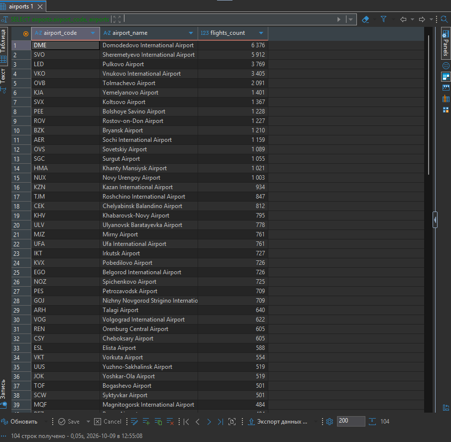

```
 Sort  (cost=18736.79..18737.05 rows=104 width=44) (actual time=54.063..54.068 rows=104 loops=1)
   Sort Key: (count(flights.flight_id)) DESC
   Sort Method: quicksort  Memory: 31kB
   Buffers: shared hit=795
   ->  HashAggregate  (cost=18706.01..18733.31 rows=104 width=44) (actual time=54.042..54.049 rows=104 loops=1)
         Group Key: ml.airport_code, (ml.airport_name ->> lang())
         Batches: 1  Memory Usage: 32kB
         Buffers: shared hit=795
         ->  Hash Right Join  (cost=5.34..18213.53 rows=65664 width=40) (actual time=0.028..45.872 rows=65664 loops=1)
               Hash Cond: (flights.departure_airport = ml.airport_code)
               Buffers: shared hit=795
               ->  Seq Scan on flights  (cost=0.00..1448.64 rows=65664 width=8) (actual time=0.001..2.637 rows=65664 loops=1)
                     Buffers: shared hit=792
               ->  Hash  (cost=4.04..4.04 rows=104 width=65) (actual time=0.017..0.018 rows=104 loops=1)
                     Buckets: 1024  Batches: 1  Memory Usage: 18kB
                     Buffers: shared hit=3
                     ->  Seq Scan on airports_data ml  (cost=0.00..4.04 rows=104 width=65) (actual time=0.003..0.009 rows=104 loops=1)
                           Buffers: shared hit=3
 Planning:
   Buffers: shared hit=4
 Planning Time: 0.108 ms
 Execution Time: 54.093 ms
```

**Вывод.** Всё из кеша (`shared hit=795`, `read` нет). Индекс не использовался, потому что считаются все рейсы. Соединение — Hash Right Join: по маленькой таблице аэропортов строится хеш, по нему проходят все рейсы, а аэропорты без пары добавляются в конце (подробнее — в задании 2).

---

## Задача 3.3

```sql
SELECT tickets.passenger_id, tickets.passenger_name, COUNT(*) AS flights_count, SUM(ticket_flights.amount) AS total
FROM tickets
JOIN ticket_flights ON tickets.ticket_no = ticket_flights.ticket_no
GROUP BY tickets.passenger_id, tickets.passenger_name
ORDER BY total DESC
LIMIT 5;
```

Результат: первое место у ANTONINA KUZNECOVA — 6 перелётов на 529 500 руб.

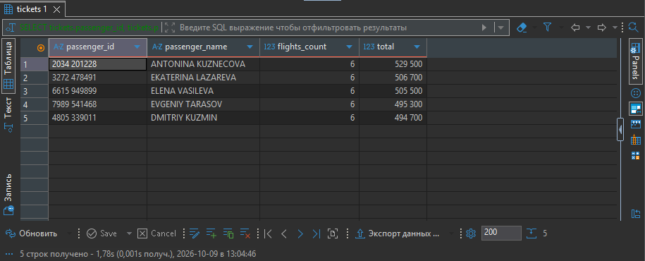

```
 Limit  (cost=403674.54..403674.55 rows=5 width=68) (actual time=2078.816..2078.818 rows=5 loops=1)
   Buffers: shared hit=673 read=32967, temp read=32216 written=47725
   ->  Sort  (cost=403674.54..405747.22 rows=829071 width=68) (actual time=2074.901..2074.903 rows=5 loops=1)
         Sort Key: (sum(ticket_flights.amount)) DESC
         Sort Method: top-N heapsort  Memory: 25kB
         Buffers: shared hit=673 read=32967, temp read=32216 written=47725
         ->  HashAggregate  (cost=342660.35..389903.97 rows=829071 width=68) (actual time=1463.983..1979.183 rows=829071 loops=1)
               Group Key: tickets.passenger_id, tickets.passenger_name
               Planned Partitions: 64  Batches: 65  Memory Usage: 8209kB  Disk Usage: 126880kB
               Buffers: shared hit=673 read=32967, temp read=32216 written=47725
               ->  Hash Join  (cost=39861.10..124329.36 rows=2360335 width=34) (actual time=225.227..998.419 rows=2360335 loops=1)
                     Hash Cond: (ticket_flights.ticket_no = tickets.ticket_no)
                     Buffers: shared hit=673 read=32967, temp read=16797 written=16797
                     ->  Seq Scan on ticket_flights  (cost=0.00..43323.35 rows=2360335 width=20) (actual time=0.056..131.715 rows=2360335 loops=1)
                           Buffers: shared hit=417 read=19303
                     ->  Hash  (cost=22210.71..22210.71 rows=829071 width=42) (actual time=224.716..224.717 rows=829071 loops=1)
                           Buckets: 131072  Batches: 16  Memory Usage: 4780kB
                           Buffers: shared hit=256 read=13664, temp written=5888
                           ->  Seq Scan on tickets  (cost=0.00..22210.71 rows=829071 width=42) (actual time=0.011..58.583 rows=829071 loops=1)
                                 Buffers: shared hit=256 read=13664
 Planning:
   Buffers: shared hit=18
 Planning Time: 0.145 ms
 JIT:
   Functions: 18
   Options: Inlining false, Optimization false, Expressions true, Deforming true
   Timing: Generation 0.490 ms, Inlining 0.000 ms, Optimization 0.355 ms, Emission 6.088 ms, Total 6.932 ms
 Execution Time: 2086.741 ms
```

**Вывод.** Почти всё читалось с диска (`read=32967`, `hit=673`), потому что две большие таблицы не помещаются в кеш. Группировка по 829 тысячам пассажиров не влезла в память: `Batches: 65`, `Disk Usage` ≈ 124 МБ, большие `temp read/written`. Индексы не использовались, так как нужны все строки обеих таблиц. Время около 2 с.

---

# Домашние задания

## Задание 1. ROLLUP

```sql
SELECT EXTRACT(MONTH FROM book_date) AS month, SUM(total_amount) AS revenue
FROM bookings
WHERE EXTRACT(YEAR FROM book_date) = 2017
GROUP BY ROLLUP (EXTRACT(MONTH FROM book_date))
HAVING SUM(total_amount) > 10000000000
    OR EXTRACT(MONTH FROM book_date) IS NULL
ORDER BY month;
```

Результат:

```
 month |    revenue
-------+----------------
     5 | 12968141200.00
     6 | 13091987500.00
     7 | 13609642400.00
       | 47004388200.00
```

Для сравнения — тот же запрос без `HAVING`:

```
 month |    revenue
-------+----------------
     4 |   359249000.00
     5 | 12968141200.00
     6 | 13091987500.00
     7 | 13609642400.00
     8 |  6975368100.00
       | 47004388200.00
```

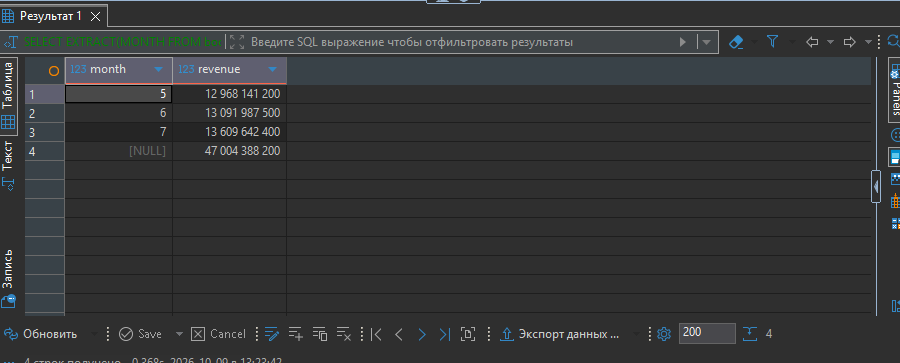

```
 GroupAggregate  (cost=8599.55..9013.88 rows=990 width=64) (actual time=128.067..226.828 rows=4 loops=1)
   Group Key: (EXTRACT(month FROM book_date))
   Group Key: ()
   Filter: ((sum(total_amount) > '10000000000'::numeric) OR ((EXTRACT(month FROM book_date)) IS NULL))
   Rows Removed by Filter: 2
   Buffers: shared hit=3936, temp read=2474 written=2483
   ->  Gather Merge  (cost=8599.55..8945.10 rows=2967 width=46) (actual time=88.035..168.231 rows=593433 loops=1)
         Workers Planned: 2
         Workers Launched: 2
         Buffers: shared hit=3936, temp read=2474 written=2483
         ->  Sort  (cost=7599.52..7602.61 rows=1236 width=46) (actual time=79.357..95.324 rows=197811 loops=3)
               Sort Key: (EXTRACT(month FROM book_date))
               Sort Method: external merge  Disk: 7408kB
               Buffers: shared hit=3936, temp read=2474 written=2483
               Worker 0:  Sort Method: external merge  Disk: 6248kB
               Worker 1:  Sort Method: external merge  Disk: 6136kB
               ->  Parallel Seq Scan on bookings  (cost=0.00..7536.05 rows=1236 width=46) (actual time=0.007..50.078 rows=197811 loops=3)
                     Filter: (EXTRACT(year FROM book_date) = '2017'::numeric)
                     Buffers: shared hit=3824
 Planning Time: 0.056 ms
 Execution Time: 227.209 ms
```

**Вывод.**
- **Кеш и диск.** Таблица `bookings` прочитана из кеша (`shared hit`, `read` нет). А вот сортировка по месяцу не влезла в память и шла через диск (`external merge`, `temp read/written` ≈ 2480).
- **Индексы.** Не использовались: индекса по `book_date` нет. PostgreSQL читал таблицу в 3 потока (Parallel Seq Scan, 2 дополнительных процесса).
- **ROLLUP в плане** — это два `Group Key`: по месяцу и пустой `()`. Пустой ключ — это и есть общий итог.

**Как HAVING работает с ROLLUP.** Сначала считаются все группы: каждый месяц и строка общего итога. Потом `HAVING` проверяет каждую из этих строк, в том числе итоговую. В плане это `Filter` у GroupAggregate: `Rows Removed by Filter: 2` — убраны апрель и август, у них меньше 10 млрд.

**Почему итоговая строка проходит фильтр.** В строке итога месяц равен NULL, но условие `SUM(total_amount) > 10 млрд` смотрит не на месяц, а на сумму. Сумма в итоге — это выручка за весь год, 47 млрд, она больше 10 млрд, поэтому строка остаётся. Итог при этом не пересчитывается после фильтра: 47 млрд — это сумма всех месяцев, включая убранные апрель и август, а не только трёх оставшихся (те дают 39,67 млрд).

Условие `OR EXTRACT(MONTH FROM book_date) IS NULL` я добавил на всякий случай. Если бы порог был больше общей суммы, без него итоговая строка пропала бы.

---

## Задание 2. LEFT JOIN

**Условие по статусу в ON:**

```sql
SELECT airports.airport_code, airports.airport_name, COUNT(flights.flight_id) AS arrived_count
FROM airports
LEFT JOIN flights ON airports.airport_code = flights.arrival_airport AND flights.status = 'Arrived'
GROUP BY airports.airport_code, airports.airport_name
ORDER BY arrived_count;
```

Результат: 104 строки, все аэропорты.

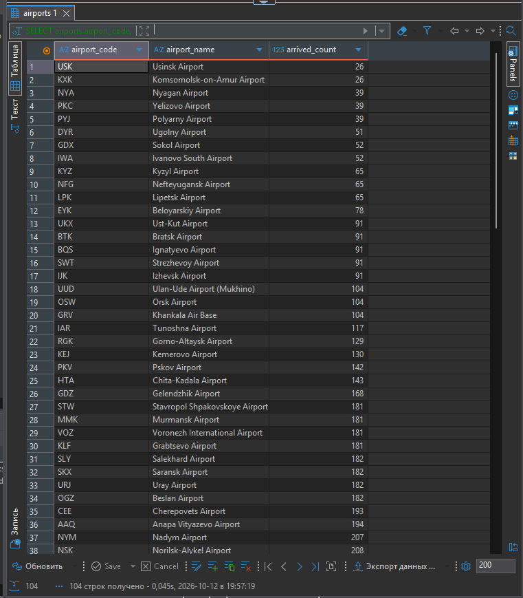

```
 Sort  (cost=14631.56..14631.82 rows=104 width=44) (actual time=44.399..44.403 rows=104 loops=1)
   Sort Key: (count(flights.flight_id))
   Sort Method: quicksort  Memory: 31kB
   Buffers: shared hit=795
   ->  HashAggregate  (cost=14600.78..14628.08 rows=104 width=44) (actual time=44.377..44.384 rows=104 loops=1)
         Group Key: ml.airport_code, (ml.airport_name ->> lang())
         Batches: 1  Memory Usage: 32kB
         Buffers: shared hit=795
         ->  Hash Right Join  (cost=5.34..14230.17 rows=49414 width=40) (actual time=0.028..37.899 rows=49235 loops=1)
               Hash Cond: (flights.arrival_airport = ml.airport_code)
               Buffers: shared hit=795
               ->  Seq Scan on flights  (cost=0.00..1612.80 rows=49414 width=8) (actual time=0.003..5.193 rows=49235 loops=1)
                     Filter: ((status)::text = 'Arrived'::text)
                     Rows Removed by Filter: 16429
                     Buffers: shared hit=792
               ->  Hash  (cost=4.04..4.04 rows=104 width=65) (actual time=0.017..0.017 rows=104 loops=1)
                     Buckets: 1024  Batches: 1  Memory Usage: 18kB
                     Buffers: shared hit=3
                     ->  Seq Scan on airports_data ml  (cost=0.00..4.04 rows=104 width=65) (actual time=0.002..0.008 rows=104 loops=1)
                           Buffers: shared hit=3
 Planning:
   Buffers: shared hit=4
 Planning Time: 0.120 ms
 Execution Time: 44.429 ms
```

**Контрольный запуск — условие в WHERE:**

```sql
SELECT airports.airport_code, airports.airport_name, COUNT(flights.flight_id) AS arrived_count
FROM airports
LEFT JOIN flights ON airports.airport_code = flights.arrival_airport
WHERE flights.status = 'Arrived'
GROUP BY airports.airport_code, airports.airport_name
ORDER BY arrived_count;
```

Результат тоже 104 строки, потому что в этих данных рейсы прилетали во все аэропорты. Но план уже другой: вместо `Hash Right Join` стоит обычный `Hash Join`.

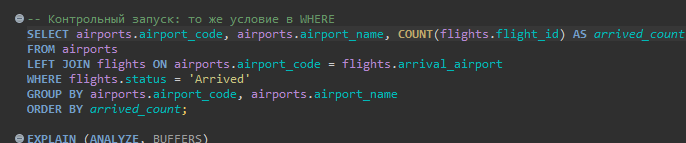
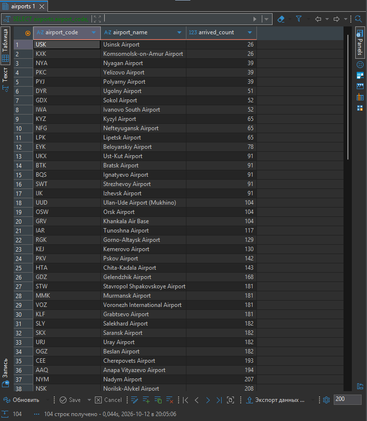

```
 Sort  (cost=14631.56..14631.82 rows=104 width=44) (actual time=42.472..42.476 rows=104 loops=1)
   Sort Key: (count(flights.flight_id))
   Sort Method: quicksort  Memory: 31kB
   Buffers: shared hit=795
   ->  HashAggregate  (cost=14600.78..14628.08 rows=104 width=44) (actual time=42.450..42.458 rows=104 loops=1)
         Group Key: ml.airport_code, (ml.airport_name ->> lang())
         Batches: 1  Memory Usage: 32kB
         Buffers: shared hit=795
         ->  Hash Join  (cost=5.34..14230.17 rows=49414 width=40) (actual time=0.047..36.262 rows=49235 loops=1)
               Hash Cond: (flights.arrival_airport = ml.airport_code)
               Buffers: shared hit=795
               ->  Seq Scan on flights  (cost=0.00..1612.80 rows=49414 width=8) (actual time=0.004..4.981 rows=49235 loops=1)
                     Filter: ((status)::text = 'Arrived'::text)
                     Rows Removed by Filter: 16429
                     Buffers: shared hit=792
               ->  Hash  (cost=4.04..4.04 rows=104 width=65) (actual time=0.033..0.033 rows=104 loops=1)
                     Buckets: 1024  Batches: 1  Memory Usage: 18kB
                     Buffers: shared hit=3
                     ->  Seq Scan on airports_data ml  (cost=0.00..4.04 rows=104 width=65) (actual time=0.001..0.007 rows=104 loops=1)
                           Buffers: shared hit=3
 Planning:
   Buffers: shared hit=4
 Planning Time: 0.120 ms
 Execution Time: 42.501 ms
```

**Проверка на отменённых рейсах.** Чтобы увидеть разницу в данных, взял статус `Cancelled`: есть аэропорты, куда не было ни одного отменённого рейса.

```sql
-- условие в ON
SELECT airports.airport_code, COUNT(flights.flight_id) AS cancelled_count, COUNT(*) AS count_all
FROM airports
LEFT JOIN flights ON airports.airport_code = flights.arrival_airport AND flights.status = 'Cancelled'
GROUP BY airports.airport_code
ORDER BY cancelled_count;

-- условие в WHERE
SELECT airports.airport_code, COUNT(flights.flight_id) AS cancelled_count
FROM airports
LEFT JOIN flights ON airports.airport_code = flights.arrival_airport
WHERE flights.status = 'Cancelled'
GROUP BY airports.airport_code
ORDER BY cancelled_count;
```

- Условие в `ON` — 104 строки. У DYR и URJ `cancelled_count = 0`, а `count_all = 1`.
- Условие в `WHERE` — 102 строки, DYR и URJ пропали.

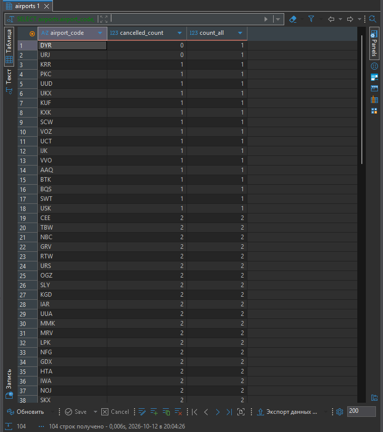
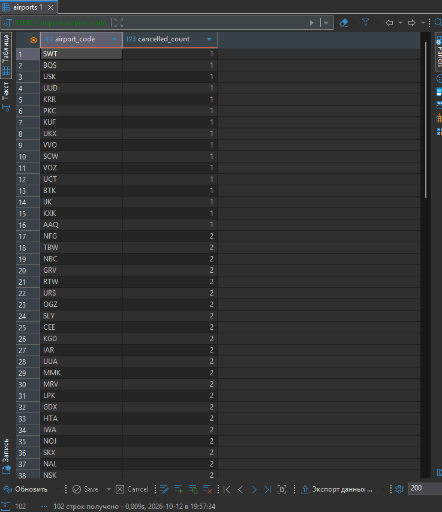

**Вывод.** Оба запроса работали только с кешем (`shared hit=795`, `read` нет), индексы не использовались: прибывших рейсов около 75 % таблицы. Если условие по статусу перенести в `WHERE`, аэропорты без подходящих рейсов отсекаются. У них все поля из `flights` равны NULL, а `NULL = 'Arrived'` не даёт TRUE. Получается обычный INNER JOIN, что видно и в плане (`Hash Join`).

**Почему нельзя `COUNT(*)`.** Для аэропорта без рейсов `LEFT JOIN` всё равно выдаёт одну строку, где поля рейса пустые (NULL). `COUNT(*)` считает строки и насчитает 1, а `COUNT(flights.flight_id)` считает только непустые значения и даёт правильный 0. Это видно в проверке на отменённых рейсах: у DYR и URJ `count_all = 1`.

**Что такое Hash Right Join.** PostgreSQL строит хеш-таблицу по меньшей таблице — аэропортам (104 строки), а потом проходит по рейсам и ищет для каждого его аэропорт в хеше. Сохранять нам нужно аэропорты, и они оказались справа (в хеше), поэтому соединение называется Right Join. После прохода по всем рейсам аэропорты, для которых не нашлось ни одного рейса, выводятся с NULL.

---

## Задание 3. Выходные дни в августе 2017

**Неоптимизированный вариант:**

```sql
SELECT flight_id, flight_no, actual_departure
FROM flights
WHERE status = 'Arrived'
  AND EXTRACT(YEAR FROM actual_departure) = 2017
  AND EXTRACT(MONTH FROM actual_departure) = 8
  AND EXTRACT(DOW FROM actual_departure) IN (0, 6)
ORDER BY actual_departure;
```

**Оптимизированный вариант (диапазоны дат):**

```sql
SELECT flight_id, flight_no, actual_departure
FROM flights
WHERE status = 'Arrived'
  AND ((actual_departure >= '2017-08-05' AND actual_departure < '2017-08-07')
    OR (actual_departure >= '2017-08-12' AND actual_departure < '2017-08-14')
    OR (actual_departure >= '2017-08-19' AND actual_departure < '2017-08-21')
    OR (actual_departure >= '2017-08-26' AND actual_departure < '2017-08-28'))
ORDER BY actual_departure;
```

Оба запроса дают одинаковый результат — 2251 строка. Все рейсы приходятся на 5–6 и 12–13 августа, потому что после 15 августа в базе выполненных рейсов нет.

Вывод из psql (у обоих запросов одинаковый, показаны первые строки):

```
 flight_id | flight_no |    actual_departure
-----------+-----------+------------------------
     52954 | PG0328    | 2017-08-05 02:50:00+03
     31201 | PG0244    | 2017-08-05 03:22:00+03
     52510 | PG0088    | 2017-08-05 03:25:00+03
     39604 | PG0037    | 2017-08-05 03:41:00+03
     35961 | PG0398    | 2017-08-05 03:52:00+03
     52879 | PG0660    | 2017-08-05 03:57:00+03
     50068 | PG0199    | 2017-08-05 04:38:00+03
     49887 | PG0654    | 2017-08-05 05:04:00+03
     52031 | PG0357    | 2017-08-05 05:08:00+03
     64481 | PG0069    | 2017-08-05 05:09:00+03
   ... (ещё 2241 строк)
(2251 rows)
```

**План, EXTRACT:**

```
 Sort  (cost=2597.77..2597.78 rows=1 width=19) (actual time=12.699..12.774 rows=2251 loops=1)
   Sort Key: actual_departure
   Sort Method: quicksort  Memory: 202kB
   Buffers: shared hit=792
   ->  Seq Scan on flights  (cost=0.00..2597.76 rows=1 width=19) (actual time=0.014..12.417 rows=2251 loops=1)
         Filter: (((status)::text = 'Arrived'::text) AND (EXTRACT(dow FROM actual_departure) = ANY ('{0,6}'::numeric[])) AND (EXTRACT(year FROM actual_departure) = '2017'::numeric) AND (EXTRACT(month FROM actual_departure) = '8'::numeric))
         Rows Removed by Filter: 63413
         Buffers: shared hit=792
 Planning Time: 0.066 ms
 Execution Time: 12.831 ms
```

**План, диапазоны:**

```
 Sort  (cost=3013.89..3018.00 rows=1644 width=19) (actual time=5.239..5.308 rows=2251 loops=1)
   Sort Key: actual_departure
   Sort Method: quicksort  Memory: 202kB
   Buffers: shared hit=792
   ->  Seq Scan on flights  (cost=0.00..2926.08 rows=1644 width=19) (actual time=0.009..4.914 rows=2251 loops=1)
         Filter: (((status)::text = 'Arrived'::text) AND (((actual_departure >= '2017-08-05 00:00:00+03'::timestamp with time zone) AND (actual_departure < '2017-08-07 00:00:00+03'::timestamp with time zone)) OR ((actual_departure >= '2017-08-12 00:00:00+03'::timestamp with time zone) AND (actual_departure < '2017-08-14 00:00:00+03'::timestamp with time zone)) OR ((actual_departure >= '2017-08-19 00:00:00+03'::timestamp with time zone) AND (actual_departure < '2017-08-21 00:00:00+03'::timestamp with time zone)) OR ((actual_departure >= '2017-08-26 00:00:00+03'::timestamp with time zone) AND (actual_departure < '2017-08-28 00:00:00+03'::timestamp with time zone))))
         Rows Removed by Filter: 63413
         Buffers: shared hit=792
 Planning Time: 0.047 ms
 Execution Time: 5.368 ms
```

**То же после создания индекса по `actual_departure`.** Индекса по этому столбцу в базе нет, поэтому я его создал, посмотрел планы и удалил.

```sql
CREATE INDEX idx_flights_actual_departure ON flights(actual_departure);
-- ... EXPLAIN обоих запросов ...
DROP INDEX idx_flights_actual_departure;
```

EXTRACT — план не изменился, индекс не используется:

```
 Sort  (cost=2597.77..2597.78 rows=1 width=19) (actual time=12.511..12.579 rows=2251 loops=1)
   Sort Key: actual_departure
   Sort Method: quicksort  Memory: 202kB
   Buffers: shared hit=792
   ->  Seq Scan on flights  (cost=0.00..2597.76 rows=1 width=19) (actual time=0.018..12.216 rows=2251 loops=1)
         Filter: (((status)::text = 'Arrived'::text) AND (EXTRACT(dow FROM actual_departure) = ANY ('{0,6}'::numeric[])) AND (EXTRACT(year FROM actual_departure) = '2017'::numeric) AND (EXTRACT(month FROM actual_departure) = '8'::numeric))
         Rows Removed by Filter: 63413
         Buffers: shared hit=792
 Planning:
   Buffers: shared hit=16 read=1
 Planning Time: 0.108 ms
 Execution Time: 12.648 ms
```

Диапазоны — индекс используется:

```
 Sort  (cost=1008.23..1012.34 rows=1644 width=19) (actual time=0.937..1.002 rows=2251 loops=1)
   Sort Key: actual_departure
   Sort Method: quicksort  Memory: 202kB
   Buffers: shared hit=759 read=8
   ->  Bitmap Heap Scan on flights  (cost=56.85..920.42 rows=1644 width=19) (actual time=0.174..0.685 rows=2251 loops=1)
         Recheck Cond: (((actual_departure >= '2017-08-05 00:00:00+03'::timestamp with time zone) AND (actual_departure < '2017-08-07 00:00:00+03'::timestamp with time zone)) OR ((actual_departure >= '2017-08-12 00:00:00+03'::timestamp with time zone) AND (actual_departure < '2017-08-14 00:00:00+03'::timestamp with time zone)) OR ((actual_departure >= '2017-08-19 00:00:00+03'::timestamp with time zone) AND (actual_departure < '2017-08-21 00:00:00+03'::timestamp with time zone)) OR ((actual_departure >= '2017-08-26 00:00:00+03'::timestamp with time zone) AND (actual_departure < '2017-08-28 00:00:00+03'::timestamp with time zone)))
         Filter: ((status)::text = 'Arrived'::text)
         Rows Removed by Filter: 1
         Heap Blocks: exact=753
         Buffers: shared hit=759 read=8
         ->  BitmapOr  (cost=56.85..56.85 rows=2202 width=0) (actual time=0.117..0.118 rows=0 loops=1)
               Buffers: shared hit=6 read=8
               ->  Bitmap Index Scan on idx_flights_actual_departure  (cost=0.00..23.09 rows=1080 width=0) (actual time=0.066..0.066 rows=1126 loops=1)
                     Index Cond: ((actual_departure >= '2017-08-05 00:00:00+03'::timestamp with time zone) AND (actual_departure < '2017-08-07 00:00:00+03'::timestamp with time zone))
                     Buffers: shared hit=1 read=4
               ->  Bitmap Index Scan on idx_flights_actual_departure  (cost=0.00..23.51 rows=1122 width=0) (actual time=0.046..0.046 rows=1126 loops=1)
                     Index Cond: ((actual_departure >= '2017-08-12 00:00:00+03'::timestamp with time zone) AND (actual_departure < '2017-08-14 00:00:00+03'::timestamp with time zone))
                     Buffers: shared hit=1 read=4
               ->  Bitmap Index Scan on idx_flights_actual_departure  (cost=0.00..4.30 rows=1 width=0) (actual time=0.001..0.001 rows=0 loops=1)
                     Index Cond: ((actual_departure >= '2017-08-19 00:00:00+03'::timestamp with time zone) AND (actual_departure < '2017-08-21 00:00:00+03'::timestamp with time zone))
                     Buffers: shared hit=2
               ->  Bitmap Index Scan on idx_flights_actual_departure  (cost=0.00..4.30 rows=1 width=0) (actual time=0.004..0.004 rows=0 loops=1)
                     Index Cond: ((actual_departure >= '2017-08-26 00:00:00+03'::timestamp with time zone) AND (actual_departure < '2017-08-28 00:00:00+03'::timestamp with time zone))
                     Buffers: shared hit=2
 Planning:
   Buffers: shared hit=10 read=2
 Planning Time: 0.112 ms
 Execution Time: 1.065 ms
```

| | Без индекса | С индексом |
|---|---|---|
| EXTRACT | Seq Scan, 12,8 мс | Seq Scan, 12,6 мс |
| Диапазоны | Seq Scan, 5,4 мс | Bitmap Index Scan, 1,1 мс |

**Вывод и разница в планах.**
- **Кеш и диск.** Все запросы брали данные из кеша. Только после создания индекса запрос с диапазонами прочитал с диска 8 страниц нового индекса (`read=8`).
- **Без индекса** оба запроса читают всю таблицу (Seq Scan), но вариант с диапазонами быстрее (5,4 мс против 12,8 мс): сравнить дату с константой проще, чем три раза вызвать `EXTRACT` для каждой из 65 тысяч строк.
- **С индексом** запрос с диапазонами его использует: по каждому из 4 диапазонов делается Bitmap Index Scan, результаты объединяются (`BitmapOr`), и читаются только нужные строки — 1,1 мс. Запрос с `EXTRACT` индекс использовать не может и остаётся на Seq Scan.
- **Почему так.** Индекс хранит сами даты `actual_departure`, а не «номер дня недели». Когда столбец обёрнут в функцию (`EXTRACT(DOW FROM ...)`), PostgreSQL не может по индексу найти нужные значения. Когда столбец стоит в условии «как есть» и сравнивается с константой (такое условие называют sargable), индекс работает.
- **Оценка строк.** Для варианта с `EXTRACT` PostgreSQL ожидал 1 строку (`rows=1`), а получил 2251: по выражению с функцией у него нет статистики. Для диапазонов оценка близкая — 1644.

